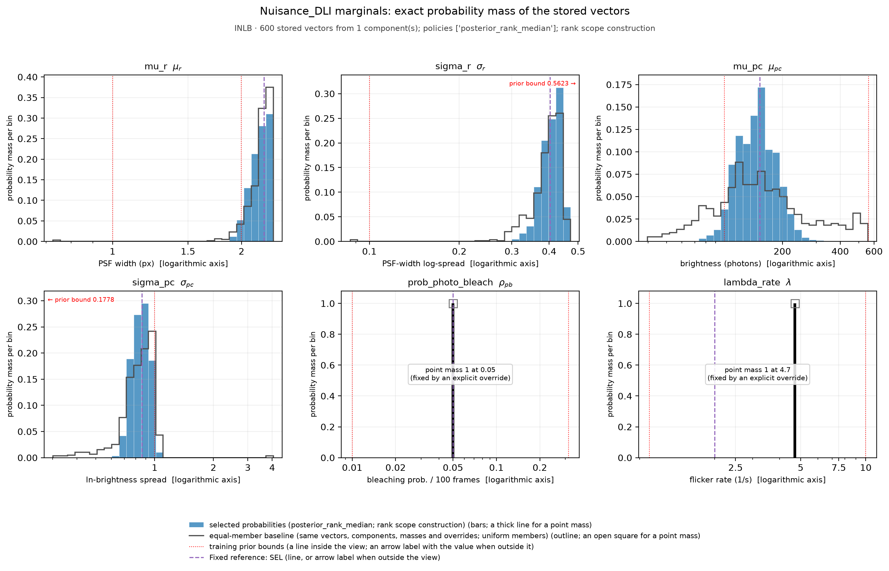
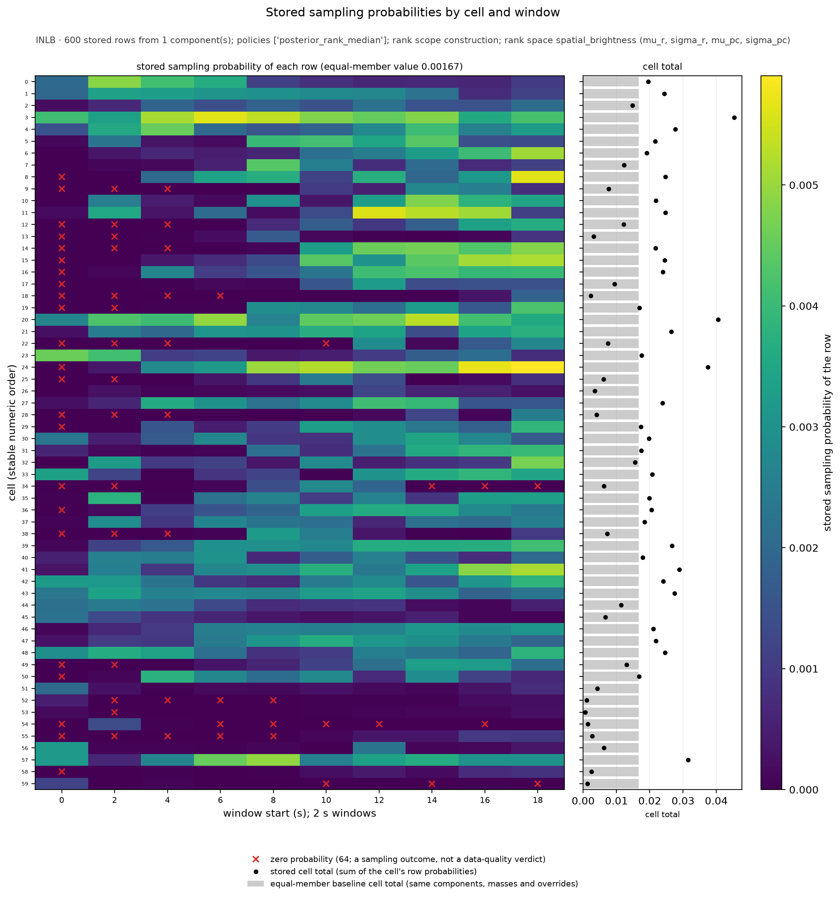
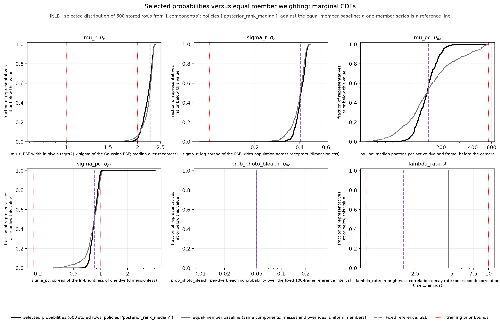
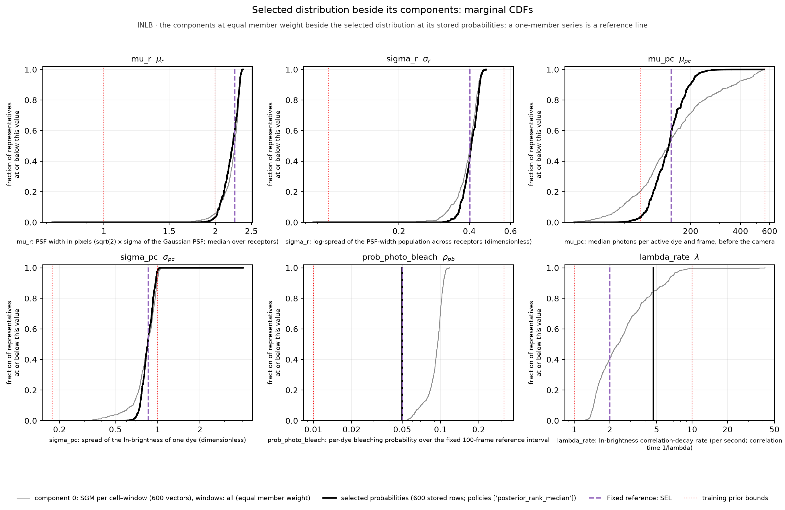
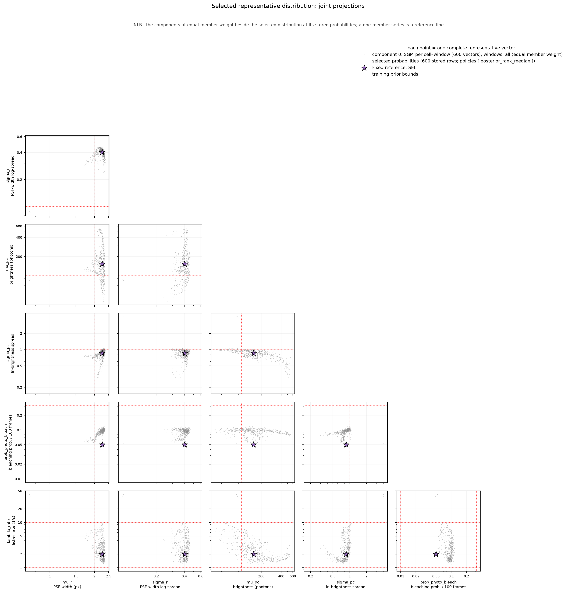

# Nuisance_DLI diagnostics - SRM_AND_SBI_MONOMER_DIMER_ALP_DETECTOR_INLB_2S_50FPS
Run: 2026-11-10 11:35:27 UTC

## Checks - 7 passed, 0 failed

| check | result | detail |
|---|---|---|
| file(artifact) | PASS | exists, 65295 bytes |
| parameter_keys_in_table_order | PASS | 6 keys: mu_r, sigma_r, mu_pc, sigma_pc, prob_photo_bleach, lambda_rate |
| shape(draws) | PASS | (10000, 6) (expected (10000, 6)) |
| no_nan_inf(draws) | PASS | clean |
| sampler_draws_are_stored_positive_probability_rows | PASS | 10000 of 10000 draws are stored rows of positive probability |
| representative_probabilities_normalized | PASS | 600 vectors; total probability 1.000000000; 64 row(s) at zero |
| representative_row_provenance | PASS | 600 memberships over 600 stored rows |

## Quantitative

| metric | value | expected | meaning |
|---|---|---|---|
| frac_draws_outside_prior | 0.9693 | - | share of the stored probability mass with at least one parameter outside the imaging prior box; permitted only under pool_mode='unrestricted', where it is a property of the calibration pool, not a defect. |

## Nuisance_DLI provenance

| field | value |
|---|---|
| artifact | /home/mars-fias/Documents/Projects/RCL_Agent_Projects/srm-and-sbi/Special_Analyses/NUISANCE_DLI_PRODUCTION_PROPOSAL_2026-11-09/WEIGHTING_REVISION_2026-11-10/INLB/SRM_AND_SBI_MONOMER_DIMER_ALP_DETECTOR_INLB_2S_50FPS_PROPOSALCW4_Nuisance_DLI.npz |
| posterior_sample_pool_choice | empirical_representatives |
| pool_mode | unrestricted |
| parameters | 6 |
| marginal summary and figure | exact: 600 stored vectors with their stored probabilities (no resampling) |
| sampler-validation draws | 10000 |

*How the calibrated imaging is represented for production marginalization.*

## Per-parameter marginal summary (log10; exact)

| parameter | median | [p05, p95] | prior box | probability mass outside prior |
|---|---|---|---|---|
| mu_r | +0.347 | [+0.305, +0.368] | [+0.00, +0.30] | 0.9693 |
| sigma_r | -0.390 | [-0.450, -0.349] | [-1.00, -0.25] | 0.0000 |
| mu_pc | +2.170 | [+2.013, +2.327] | [+2.00, +2.75] | 0.0350 |
| sigma_pc | -0.070 | [-0.140, -0.007] | [-0.75, +0.00] | 0.0218 |
| prob_photo_bleach | -1.301 | [-1.301, -1.301] | [-2.00, -0.50] | 0.0000 |
| lambda_rate | +0.672 | [+0.672, +0.672] | [+0.00, +1.00] | 0.0000 |

*Exact: the inverse weighted empirical CDF of the stored vectors under their stored probabilities (the smallest stored value whose cumulative probability reaches the level), and the stored probability mass outside the prior box per parameter. No draw enters this table, so it does not vary with a seed or a draw count; it is the distribution production samples whole vectors from.*

## empirical_representatives: selection

| component | source Experiment | condition | window set | grouping | statistic | component mass | member policy | members / positive / zero | member probability (range) | effective members 1/sum(p^2) |
|---|---|---|---|---|---|---|---|---|---|---|
| 0 | SRM_AND_SBI_MONOMER_DIMER_ALP_DETECTOR_INLB_2S_50FPS_C128V42AP3LR32 | INLB | all | SGM per cell–window (`per_cell_window`) | sgm | 1.000000 | posterior_rank_median, rank scope `construction` (every other cell–window group of the same condition and window set, the other windows of the candidate's own cell included; each reference is one window's own cloud), in rank space `spatial_brightness` (mu_r, sigma_r, mu_pc, sigma_pc); normalization: weight * score / sum of the component's scores | 600 / 536 / 64 | 0.000000 – 0.005903 | 317.97 |

*rationale: Review proposal PROPOSALCW4 (2026-11-10; NOT adopted, built for review only): one SGM representative per cell and 2 s window over all ten windows of the sixty INLB recordings (600 vectors), so that the between-cell and the within-recording variation of the effective imaging conditions across the full acquisition both enter the simulated population; member weighting posterior_rank_median under rank_scope construction: each representative's probability is proportional to the median cross-posterior distance rank of its SGM among the other 599 cell-window groups of the condition (the other windows of its own cell are nine of those references, with no separate treatment), normalized over all 600 representatives. This is consensus over the complete representative population of the aggregation; no cell keeps a reserved mass, so a cell whose windows lie away from the population receives less total probability, possibly zero (a majority-zero window receives exactly zero; both are sampling outcomes of the policy, documented, not data-quality verdicts). It revises the scope of the adopted RANK4 selection (within-cell ranks with equal cell mass), which stays unchanged under its own tag. The four spatial and brightness coordinates of each SGM are retained together; the bleaching probability is overridden by the recorded value 0.05 (empirically anchored for Fab, declared for InlB) and the flicker rate by the direct single-dye-equivalent reference of the committed derivation, because the estimator does not recover the former and only partially recovers the latter. One complete vector is sampled per synthetic 2 s video and held fixed during it. Member weights from the ranks over the four retained coordinates only (rank space spatial_brightness), so the weights rest on exactly the coordinates the final vectors carry. | archive /media/mars-fias/MARS_Data_Reserve_0/MARS_Data_Bank/Projects/RCL_Agent_Projects/srm-and-sbi-monomer-dimer-alp/Data_Bank/Posit/SRM_AND_SBI_MONOMER_DIMER_ALP_DETECTOR_INLB_2S_50FPS_C128V42AP3LR32_MAP_Experiment_COHORT60RANKSR4/aggregation_candidates.npz (sha256 179617f26655…) | NOTE Complete cohort: MET-INLB 60 of 60 cells, 600 of 600 windows. The original MAP and summary references above come from the adopted product; the aggregation summaries come from the retained collections named below, fresh draws of the same estimator that do not reconstruct the original sampling attempt. | 600 member rows -> 600 unique vectors (64 at zero probability); effective rows 1/sum(p^2) over the stored rows = 317.97 (equal-member baseline 600.00); the effective number is a concentration measure of the sampling probabilities, within the stated normalization scope, not a count of independent experiments | the rows are NOT all original joint draws (a median statistic or an override is involved); the compatibility scores describe the original SGM candidates | the ranked coordinates exclude every overridden coordinate (prob_photo_bleach, lambda_rate), so the member weights rest only on coordinates the final vectors carry*

## empirical_representatives: explicit parameter overrides (applied to every vector; shown, never silent)

| parameter | value (physical) | stored (log10) | replaced range (log10) | reason |
|---|---|---|---|---|
| prob_photo_bleach | 0.05 | -1.3010 | [-1.3056, -0.9277] | declared shared-rate assumption: the same dye, illumination, camera settings and 100-frame reference interval as MET-FAB, so the Fab empirically anchored value 0.05 is adopted as the practical baseline in the absence of an InlB decline analysis (the lead, 2026-10-27; DETECTOR_WORKFLOW.md sec. 7.6). The estimator's own coordinate (median 0.100, MAP 0.120) is not retained: it does not recover the parameter (r 0.02). No measurement on the InlB recordings supports the value. |
| lambda_rate | 4.7 | +0.6721 | [+0.0761, +1.6190] | direct single-dye-equivalent reference: lambda_rate shape-matched to the normalized ln-brightness autocorrelation of the MET-INLB single-molecule localization tables (61,884 tracks, public accession S-BSST712; tau_corr(1/e) about 0.145 s), the matched-length model arm absorbing the finite-track detrending bias (DETECTOR_WORKFLOW.md sec. 6.5; the committed derivation Script_Bank/Analysis/SRM_AND_SBI_MONOMER_DIMER_ALP_DETECTOR_Flicker_Rate_Derivation.md). Assumptions that travel with the value: one dye per trace with the logarithm taken per trace (a multi-dye spot's ln-intensity is not a single-dye OU process and its autocorrelation also depends on sigma_pc), so this is a reference under the single-emitter assumption, not a calibration of dye multiplicity or of the image-analysis chain; mu_pc and sigma_pc cancel in the single-dye normalized autocorrelation. The adopted neural estimator's per-window coordinate (median 2.283, partially recovered, MAE 0.206 dex, r 0.53, conditioned on the extrapolated PSF-width estimate) is not retained. The condition-specific localization-table references, 5.1 per second for FAB and 4.7 for INLB, are similar within the reported cell-to-cell scatter; we use them as empirically anchored working overrides under the single-emitter model. Their agreement does not establish unbiased per-dye recovery; observation-chain effects and the single-dye approximation remain limitations. The neural SEL value 2 remains a documented alternative; the factor-of-four difference between the neural values is recorded, not explained, and does not by itself show them wrong. This is a selection from existing evidence, not a new measurement or a validation of the derivation. |

*a transformed vector is no longer the original joint draw; the compatibility scores describe the original SGMs and were not recomputed for the transformed rows.*

## empirical_representatives: weighted marginal summary (physical units; inverse weighted CDF)

| parameter | median | IQR | central 90 % range | outside-prior mass |
|---|---|---|---|---|
| mu_r | 2.2229 | 2.127 – 2.2943 | 2.019 – 2.334 | 96.9 % |
| sigma_r | 0.40721 | 0.38581 – 0.43147 | 0.35441 – 0.44745 | 0.0 % |
| mu_pc | 147.77 | 123.4 – 173.97 | 103.13 – 212.43 | 3.5 % |
| sigma_pc | 0.85066 | 0.7914 – 0.92096 | 0.72435 – 0.98324 | 2.2 % |
| prob_photo_bleach | 0.05 | 0.05 – 0.05 | 0.05 – 0.05 | 0.0 % |
| lambda_rate | 4.7 | 4.7 – 4.7 | 4.7 – 4.7 | 0.0 % |

*empirical dispersion of the selected representatives under their probabilities, not a credible interval; total outside-prior mass 96.9 %.*

## empirical_representatives: exports

Per-member record (identities, the primary-space compatibility score, status and references, the rank space, the rank scope and the score used by the policy, contribution, stored row): `representatives_members.csv`; per stored row (probability, equal-member baseline probability, memberships by recorded identity, the stored estimator coordinates `<key>_stored_log10` and the physical values `<key>_physical`): `representatives_rows.csv`; both beside this report. Member policies in this artifact: ['posterior_rank_median']. The equal-member baseline uses the same components, component masses, duplicate consolidation and overrides with uniform members; it isolates the member weighting.

## empirical_representatives: cell totals of the stored probabilities

| cells | smallest cell total | largest cell total | equal-member cell total | cells at exactly zero | mass of the first window (start 0) | equal-member mass of the first window |
|---|---|---|---|---|---|---|
| 60 | 0.000666 | 0.045406 | 0.016667 | 0 | 0.048765 | 0.100000 |

*a cell total is the sum of the stored probabilities of the cell's rows. Under rank scope `construction` the scores are normalized over the whole component, so no cell has a reserved mass: cell totals differ, and a cell whose rows all score zero has total zero (a sampling outcome of the policy, not a data-quality verdict). Every cell's total is in representatives_cell_totals.csv.*

## What these mean

A check **PASS** means the invariant held; a **FAIL** aborts the run immediately with a located error message.

- **file** -- the output file exists on disk and is non-empty (the write succeeded).
- **shape** -- the array has the expected dimensions.
- **no_nan_inf** -- the array contains no NaN and no infinite values.
- **parameter_keys_in_table_order** -- the artifact's parameter order equals the detector table's, so the DLI stage maps every draw onto the right imaging row.
- **sampler_draws_are_stored_positive_probability_rows** -- sampler validation only: production draws whole stored vectors with replacement under the stored probabilities. The tables and figures of this report do not use these draws; they are computed exactly from the stored vectors and probabilities.
- **representative_probabilities_normalized** -- the stored per-vector probabilities sum to one; a component's members carry weight_k / n_k under uniform weighting, or the normalized median compatibility ranks under posterior_rank_median (a zero score is exactly zero probability, kept).
- **representative_row_provenance** -- every stored row names the members that contributed to it, by recorded identity, and their contributions add up to its probability.

## Figures

*INLB · 600 stored vectors from 1 component(s); policies ['posterior_rank_median']; rank scope construction. Exact marginal histograms of the stored distribution, in physical units (a logarithmic axis for a log-scaled parameter): each bar is the SUM of the stored probabilities of the stored vectors whose coordinate falls in the bin (probability mass per bin, the bars of a panel adding up to one); nothing is resampled, so the figure does not depend on a random seed or a draw count. Every parameter inherits the same whole-vector probabilities: the panels are projections of one joint distribution, not six separately weighted ones. Bins: 30 equal-width bins in the stored coordinate (uniform in log10 for a log-scaled parameter) from the smallest to the largest stored value of that coordinate over all stored vectors, zero-probability vectors included; the range is never cropped to the training box. Blue bars: the selected probabilities; dark outline: the equal-member baseline, the same vectors, components, component masses and overrides with uniform members, in the same bins (the comparison isolates the member weighting). 2 parameter(s) hold one stored value and are drawn as a point mass of the total probability at that value (prob_photo_bleach, lambda_rate: fixed by explicit overrides). Each binned panel shows the full support of the stored vectors with a small margin; no tail is cropped. Dotted red: the training-prior bounds; dashed purple: the reference scenario. Both are annotations, not data weights: one that lies inside the view is a line, one that lies outside it is named with its value by an arrow label at that edge of the panel, so an annotation never stretches the axis. The bin masses are in nuisance_marginal_histograms.csv; the exact weighted CDFs are in representatives_marginals.*

*INLB · 600 stored rows from 1 component(s); policies ['posterior_rank_median']; rank scope construction; rank space spatial_brightness (mu_r, sigma_r, mu_pc, sigma_pc). Left: the stored sampling probability of every row itself (rows: source cells in numeric order; columns: window start times in seconds); the values of the grid sum to one, and under the equal-member baseline every row would carry 0.001667. Red crosses mark rows at exactly zero: a sampling outcome of the selected policy, not a data-quality verdict. Right: the cell totals (black: the sum of the cell's stored row probabilities) against the equal-member baseline (gray bars). The scores are normalized over the complete component, so the cell totals differ and no cell has a reserved mass. These are probabilities, not Experiment's raw ranks; the per-row values are in representatives_rows.csv and the cell totals in representatives_cell_totals.csv.*

*Weighted empirical CDFs (physical units; the fraction of a series' mass at or below the x value) of the selected distribution at its stored probabilities, the equal-member baseline built from the same components, component masses, duplicate consolidation and overrides with uniform members (the comparison isolates the member weighting) and the fixed reference. Summary numbers use the inverse weighted empirical CDF. Dotted red lines are the training-prior bounds.*

*Each component's representatives at equal member weight (normalized to unit mass) beside the selected distribution and the reference. A component selected with the marginal-median statistic is labeled as a marginal-median vector, never as an SGM. Dotted red lines are the training-prior bounds.*

*Pairwise projections of the selected vectors (marker size follows the stored probability; a zero-probability row is drawn at the smallest size) beside the components and the reference; each point is one complete vector. Dotted red lines are the training-prior bounds.*
