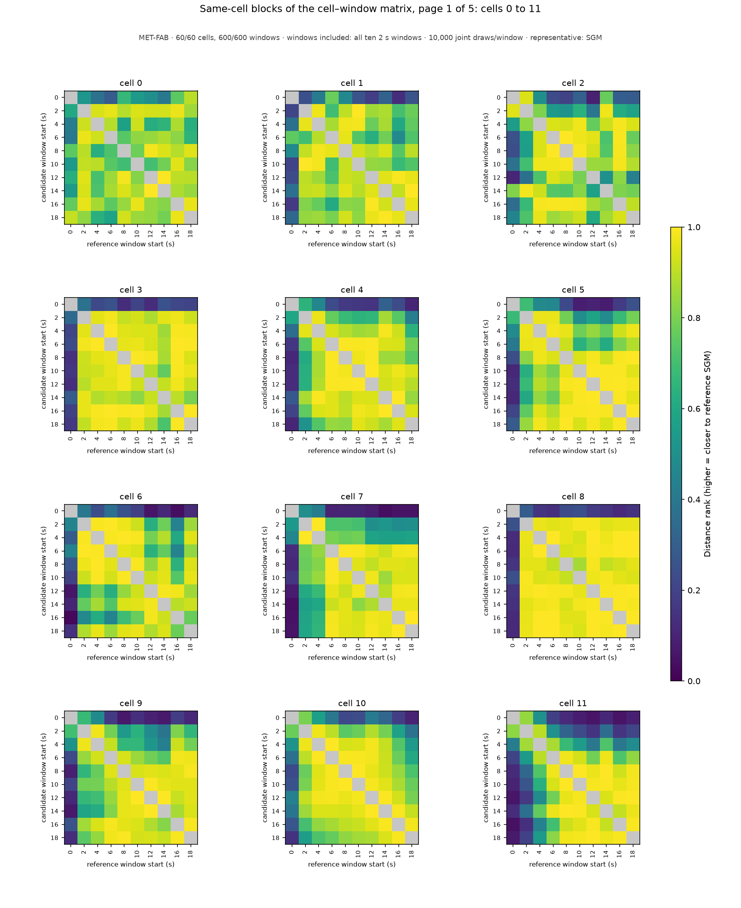
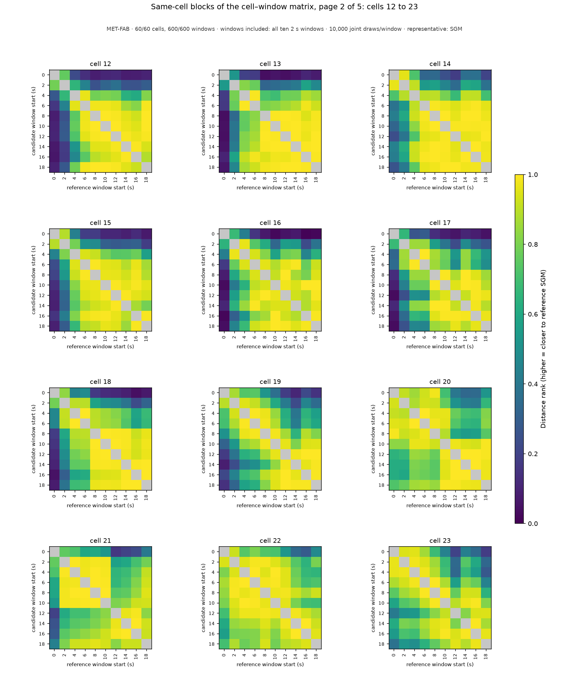
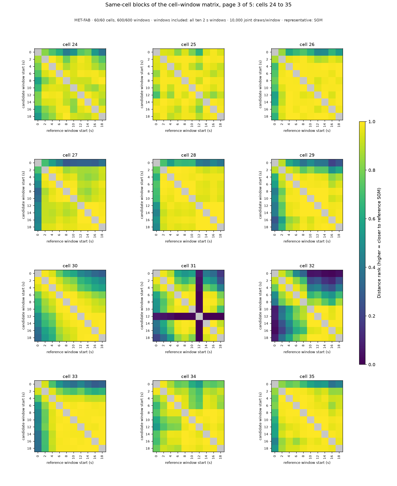
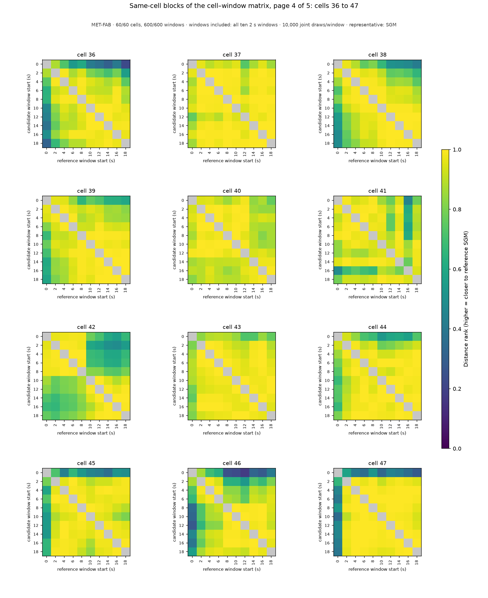
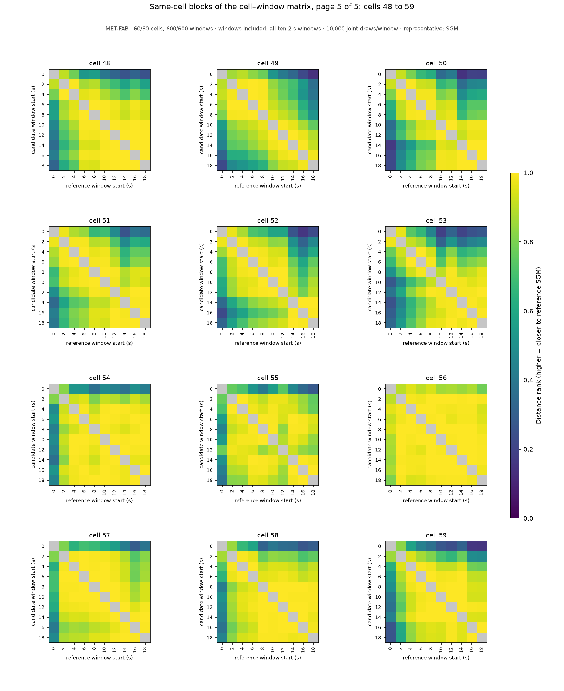

# Same-cell blocks of the cell–window population matrix: MET-FAB, windows included: all ten 2 s windows

MET-FAB · 60/60 cells, 600/600 windows · windows included: all ten 2 s windows · 10,000 joint draws/window · representative: SGM

Each panel enlarges one 10 x 10 diagonal block of the complete 600 x 600 cell–window matrix: the distance ranks between the windows of ONE cell (rows candidate windows, columns reference windows, both labeled by window start time in seconds); color is the share of the reference window's draws strictly farther from its own SGM than the candidate window's SGM (0–1, one scale for every panel); the self comparison is gray (excluded). These same-cell comparisons are 9 of each candidate's 599 references under the construction-wide scope; they are shown for legibility and are NOT the candidate's score, which is the median of its whole row of the population matrix (the `compatibility_score` column of [aggregation_groups.csv](../../../../aggregation_groups.csv), listed per cell below). Every pairwise value is in [aggregation_compatibility.csv](../../../../aggregation_compatibility.csv); the full matrix is the `compatibility_block_*` arrays of [aggregation_candidates.npz](../../../../aggregation_candidates.npz). A zero is a centrality outcome, not a data-quality classification; raw-data notes and training-prior flags stay separate. Back to the [report](../../../../report.md).

| cell | page | scores over the complete population (599 references) by window start (s) |
|---|---|---|
| 0 | [page_01.png](page_01.png) | 0: 0.429, 2: 0.750, 4: 0.628, 6: 0.711, 8: 0.665, 10: 0.688, 12: 0.765, 14: 0.769, 16: 0.747, 18: 0.672 |
| 1 | [page_01.png](page_01.png) | 0: 0.212, 2: 0.717, 4: 0.691, 6: 0.569, 8: 0.711, 10: 0.687, 12: 0.734, 14: 0.801, 16: 0.745, 18: 0.794 |
| 2 | [page_01.png](page_01.png) | 0: 0.157, 2: 0.335, 4: 0.652, 6: 0.557, 8: 0.590, 10: 0.585, 12: 0.282, 14: 0.475, 16: 0.683, 18: 0.787 |
| 3 | [page_01.png](page_01.png) | 0: 0.341, 2: 0.794, 4: 0.834, 6: 0.840, 8: 0.733, 10: 0.697, 12: 0.720, 14: 0.724, 16: 0.815, 18: 0.763 |
| 4 | [page_01.png](page_01.png) | 0: 0.201, 2: 0.630, 4: 0.762, 6: 0.770, 8: 0.732, 10: 0.803, 12: 0.759, 14: 0.788, 16: 0.807, 18: 0.730 |
| 5 | [page_01.png](page_01.png) | 0: 0.381, 2: 0.487, 4: 0.625, 6: 0.401, 8: 0.489, 10: 0.486, 12: 0.459, 14: 0.489, 16: 0.576, 18: 0.571 |
| 6 | [page_01.png](page_01.png) | 0: 0.354, 2: 0.790, 4: 0.794, 6: 0.782, 8: 0.792, 10: 0.775, 12: 0.606, 14: 0.700, 16: 0.470, 18: 0.716 |
| 7 | [page_01.png](page_01.png) | 0: 0.214, 2: 0.720, 4: 0.732, 6: 0.782, 8: 0.781, 10: 0.803, 12: 0.729, 14: 0.665, 16: 0.679, 18: 0.685 |
| 8 | [page_01.png](page_01.png) | 0: 0.356, 2: 0.834, 4: 0.767, 6: 0.748, 8: 0.755, 10: 0.834, 12: 0.817, 14: 0.788, 16: 0.754, 18: 0.773 |
| 9 | [page_01.png](page_01.png) | 0: 0.196, 2: 0.632, 4: 0.620, 6: 0.718, 8: 0.757, 10: 0.839, 12: 0.786, 14: 0.734, 16: 0.797, 18: 0.760 |
| 10 | [page_01.png](page_01.png) | 0: 0.159, 2: 0.389, 4: 0.450, 6: 0.471, 8: 0.538, 10: 0.590, 12: 0.658, 14: 0.763, 16: 0.818, 18: 0.822 |
| 11 | [page_01.png](page_01.png) | 0: 0.163, 2: 0.436, 4: 0.680, 6: 0.723, 8: 0.747, 10: 0.711, 12: 0.615, 14: 0.797, 16: 0.649, 18: 0.669 |
| 12 | [page_02.png](page_02.png) | 0: 0.080, 2: 0.222, 4: 0.504, 6: 0.639, 8: 0.723, 10: 0.723, 12: 0.758, 14: 0.828, 16: 0.817, 18: 0.720 |
| 13 | [page_02.png](page_02.png) | 0: 0.189, 2: 0.669, 4: 0.805, 6: 0.833, 8: 0.675, 10: 0.691, 12: 0.715, 14: 0.745, 16: 0.813, 18: 0.774 |
| 14 | [page_02.png](page_02.png) | 0: 0.089, 2: 0.149, 4: 0.334, 6: 0.570, 8: 0.525, 10: 0.518, 12: 0.622, 14: 0.507, 16: 0.582, 18: 0.604 |
| 15 | [page_02.png](page_02.png) | 0: 0.117, 2: 0.336, 4: 0.621, 6: 0.699, 8: 0.791, 10: 0.689, 12: 0.711, 14: 0.699, 16: 0.749, 18: 0.708 |
| 16 | [page_02.png](page_02.png) | 0: 0.081, 2: 0.481, 4: 0.621, 6: 0.767, 8: 0.579, 10: 0.704, 12: 0.653, 14: 0.830, 16: 0.658, 18: 0.699 |
| 17 | [page_02.png](page_02.png) | 0: 0.092, 2: 0.411, 4: 0.591, 6: 0.563, 8: 0.782, 10: 0.748, 12: 0.795, 14: 0.755, 16: 0.771, 18: 0.780 |
| 18 | [page_02.png](page_02.png) | 0: 0.103, 2: 0.383, 4: 0.661, 6: 0.611, 8: 0.758, 10: 0.769, 12: 0.732, 14: 0.817, 16: 0.758, 18: 0.773 |
| 19 | [page_02.png](page_02.png) | 0: 0.063, 2: 0.149, 4: 0.278, 6: 0.324, 8: 0.485, 10: 0.623, 12: 0.719, 14: 0.797, 16: 0.683, 18: 0.755 |
| 20 | [page_02.png](page_02.png) | 0: 0.705, 2: 0.840, 4: 0.732, 6: 0.764, 8: 0.734, 10: 0.697, 12: 0.567, 14: 0.534, 16: 0.525, 18: 0.638 |
| 21 | [page_02.png](page_02.png) | 0: 0.582, 2: 0.632, 4: 0.616, 6: 0.637, 8: 0.638, 10: 0.579, 12: 0.375, 14: 0.331, 16: 0.373, 18: 0.481 |
| 22 | [page_02.png](page_02.png) | 0: 0.462, 2: 0.711, 4: 0.603, 6: 0.656, 8: 0.802, 10: 0.623, 12: 0.752, 14: 0.747, 16: 0.763, 18: 0.852 |
| 23 | [page_02.png](page_02.png) | 0: 0.624, 2: 0.740, 4: 0.753, 6: 0.851, 8: 0.841, 10: 0.754, 12: 0.595, 14: 0.721, 16: 0.697, 18: 0.525 |
| 24 | [page_03.png](page_03.png) | 0: 0.713, 2: 0.784, 4: 0.781, 6: 0.729, 8: 0.636, 10: 0.631, 12: 0.751, 14: 0.784, 16: 0.688, 18: 0.577 |
| 25 | [page_03.png](page_03.png) | 0: 0.817, 2: 0.715, 4: 0.707, 6: 0.628, 8: 0.722, 10: 0.625, 12: 0.530, 14: 0.704, 16: 0.768, 18: 0.762 |
| 26 | [page_03.png](page_03.png) | 0: 0.673, 2: 0.779, 4: 0.777, 6: 0.783, 8: 0.805, 10: 0.818, 12: 0.709, 14: 0.746, 16: 0.798, 18: 0.778 |
| 27 | [page_03.png](page_03.png) | 0: 0.444, 2: 0.797, 4: 0.782, 6: 0.796, 8: 0.766, 10: 0.802, 12: 0.836, 14: 0.833, 16: 0.832, 18: 0.852 |
| 28 | [page_03.png](page_03.png) | 0: 0.554, 2: 0.829, 4: 0.830, 6: 0.817, 8: 0.817, 10: 0.792, 12: 0.800, 14: 0.765, 16: 0.778, 18: 0.803 |
| 29 | [page_03.png](page_03.png) | 0: 0.195, 2: 0.450, 4: 0.627, 6: 0.622, 8: 0.726, 10: 0.715, 12: 0.734, 14: 0.714, 16: 0.752, 18: 0.688 |
| 30 | [page_03.png](page_03.png) | 0: 0.130, 2: 0.235, 4: 0.305, 6: 0.500, 8: 0.578, 10: 0.629, 12: 0.714, 14: 0.721, 16: 0.763, 18: 0.785 |
| 31 | [page_03.png](page_03.png) | 0: 0.132, 2: 0.213, 4: 0.369, 6: 0.620, 8: 0.680, 10: 0.553, 12: 0.001, 14: 0.718, 16: 0.755, 18: 0.828 |
| 32 | [page_03.png](page_03.png) | 0: 0.074, 2: 0.218, 4: 0.268, 6: 0.410, 8: 0.614, 10: 0.695, 12: 0.680, 14: 0.601, 16: 0.453, 18: 0.622 |
| 33 | [page_03.png](page_03.png) | 0: 0.298, 2: 0.513, 4: 0.714, 6: 0.691, 8: 0.767, 10: 0.807, 12: 0.674, 14: 0.695, 16: 0.760, 18: 0.718 |
| 34 | [page_03.png](page_03.png) | 0: 0.570, 2: 0.672, 4: 0.767, 6: 0.809, 8: 0.829, 10: 0.791, 12: 0.775, 14: 0.835, 16: 0.832, 18: 0.749 |
| 35 | [page_03.png](page_03.png) | 0: 0.474, 2: 0.649, 4: 0.668, 6: 0.611, 8: 0.650, 10: 0.682, 12: 0.674, 14: 0.725, 16: 0.707, 18: 0.583 |
| 36 | [page_04.png](page_04.png) | 0: 0.665, 2: 0.805, 4: 0.839, 6: 0.783, 8: 0.795, 10: 0.717, 12: 0.699, 14: 0.657, 16: 0.713, 18: 0.585 |
| 37 | [page_04.png](page_04.png) | 0: 0.842, 2: 0.799, 4: 0.715, 6: 0.772, 8: 0.752, 10: 0.766, 12: 0.616, 14: 0.732, 16: 0.782, 18: 0.711 |
| 38 | [page_04.png](page_04.png) | 0: 0.242, 2: 0.457, 4: 0.533, 6: 0.643, 8: 0.612, 10: 0.679, 12: 0.747, 14: 0.782, 16: 0.764, 18: 0.724 |
| 39 | [page_04.png](page_04.png) | 0: 0.248, 2: 0.361, 4: 0.403, 6: 0.496, 8: 0.479, 10: 0.485, 12: 0.539, 14: 0.594, 16: 0.586, 18: 0.607 |
| 40 | [page_04.png](page_04.png) | 0: 0.765, 2: 0.859, 4: 0.814, 6: 0.838, 8: 0.807, 10: 0.850, 12: 0.819, 14: 0.707, 16: 0.673, 18: 0.663 |
| 41 | [page_04.png](page_04.png) | 0: 0.264, 2: 0.326, 4: 0.260, 6: 0.257, 8: 0.361, 10: 0.447, 12: 0.668, 14: 0.460, 16: 0.706, 18: 0.595 |
| 42 | [page_04.png](page_04.png) | 0: 0.438, 2: 0.355, 4: 0.445, 6: 0.467, 8: 0.562, 10: 0.697, 12: 0.777, 14: 0.799, 16: 0.794, 18: 0.815 |
| 43 | [page_04.png](page_04.png) | 0: 0.452, 2: 0.436, 4: 0.511, 6: 0.541, 8: 0.533, 10: 0.713, 12: 0.734, 14: 0.592, 16: 0.522, 18: 0.706 |
| 44 | [page_04.png](page_04.png) | 0: 0.314, 2: 0.340, 4: 0.419, 6: 0.618, 8: 0.384, 10: 0.635, 12: 0.687, 14: 0.576, 16: 0.433, 18: 0.515 |
| 45 | [page_04.png](page_04.png) | 0: 0.655, 2: 0.842, 4: 0.805, 6: 0.856, 8: 0.808, 10: 0.766, 12: 0.772, 14: 0.761, 16: 0.790, 18: 0.792 |
| 46 | [page_04.png](page_04.png) | 0: 0.419, 2: 0.678, 4: 0.760, 6: 0.759, 8: 0.772, 10: 0.778, 12: 0.760, 14: 0.830, 16: 0.801, 18: 0.846 |
| 47 | [page_04.png](page_04.png) | 0: 0.442, 2: 0.831, 4: 0.825, 6: 0.771, 8: 0.786, 10: 0.681, 12: 0.758, 14: 0.807, 16: 0.810, 18: 0.821 |
| 48 | [page_05.png](page_05.png) | 0: 0.232, 2: 0.473, 4: 0.541, 6: 0.656, 8: 0.655, 10: 0.674, 12: 0.662, 14: 0.604, 16: 0.640, 18: 0.689 |
| 49 | [page_05.png](page_05.png) | 0: 0.039, 2: 0.082, 4: 0.099, 6: 0.108, 8: 0.130, 10: 0.221, 12: 0.249, 14: 0.244, 16: 0.286, 18: 0.355 |
| 50 | [page_05.png](page_05.png) | 0: 0.070, 2: 0.171, 4: 0.250, 6: 0.373, 8: 0.398, 10: 0.621, 12: 0.605, 14: 0.735, 16: 0.715, 18: 0.690 |
| 51 | [page_05.png](page_05.png) | 0: 0.147, 2: 0.297, 4: 0.425, 6: 0.469, 8: 0.571, 10: 0.564, 12: 0.675, 14: 0.720, 16: 0.705, 18: 0.709 |
| 52 | [page_05.png](page_05.png) | 0: 0.061, 2: 0.140, 4: 0.209, 6: 0.321, 8: 0.324, 10: 0.372, 12: 0.428, 14: 0.602, 16: 0.646, 18: 0.642 |
| 53 | [page_05.png](page_05.png) | 0: 0.133, 2: 0.236, 4: 0.407, 6: 0.497, 8: 0.565, 10: 0.609, 12: 0.655, 14: 0.698, 16: 0.749, 18: 0.689 |
| 54 | [page_05.png](page_05.png) | 0: 0.551, 2: 0.804, 4: 0.827, 6: 0.854, 8: 0.792, 10: 0.842, 12: 0.835, 14: 0.804, 16: 0.843, 18: 0.825 |
| 55 | [page_05.png](page_05.png) | 0: 0.635, 2: 0.813, 4: 0.813, 6: 0.821, 8: 0.764, 10: 0.786, 12: 0.840, 14: 0.802, 16: 0.762, 18: 0.717 |
| 56 | [page_05.png](page_05.png) | 0: 0.782, 2: 0.762, 4: 0.754, 6: 0.760, 8: 0.766, 10: 0.742, 12: 0.686, 14: 0.668, 16: 0.715, 18: 0.659 |
| 57 | [page_05.png](page_05.png) | 0: 0.459, 2: 0.731, 4: 0.714, 6: 0.735, 8: 0.755, 10: 0.754, 12: 0.803, 14: 0.798, 16: 0.793, 18: 0.773 |
| 58 | [page_05.png](page_05.png) | 0: 0.659, 2: 0.788, 4: 0.782, 6: 0.764, 8: 0.625, 10: 0.700, 12: 0.664, 14: 0.606, 16: 0.584, 18: 0.632 |
| 59 | [page_05.png](page_05.png) | 0: 0.624, 2: 0.774, 4: 0.802, 6: 0.791, 8: 0.770, 10: 0.665, 12: 0.669, 14: 0.714, 16: 0.580, 18: 0.566 |

## Pages

### Page 1: cells 0, 1, 2, 3, 4, 5, 6, 7, 8, 9, 10, 11

### Page 2: cells 12, 13, 14, 15, 16, 17, 18, 19, 20, 21, 22, 23

### Page 3: cells 24, 25, 26, 27, 28, 29, 30, 31, 32, 33, 34, 35

### Page 4: cells 36, 37, 38, 39, 40, 41, 42, 43, 44, 45, 46, 47

### Page 5: cells 48, 49, 50, 51, 52, 53, 54, 55, 56, 57, 58, 59

