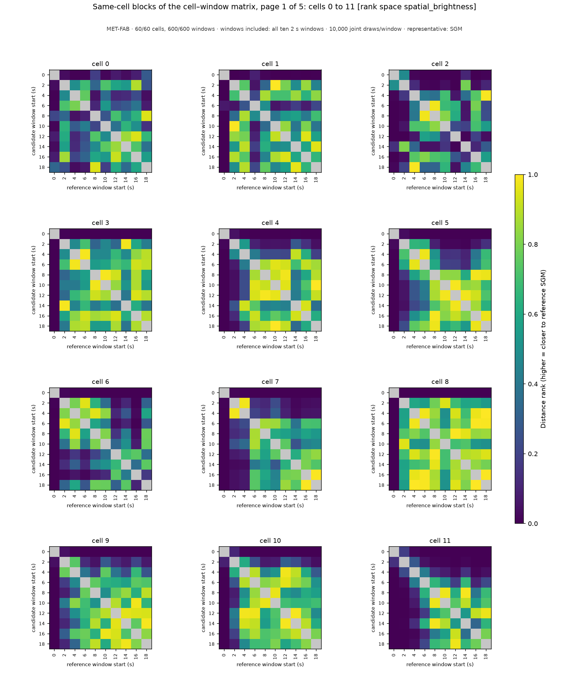
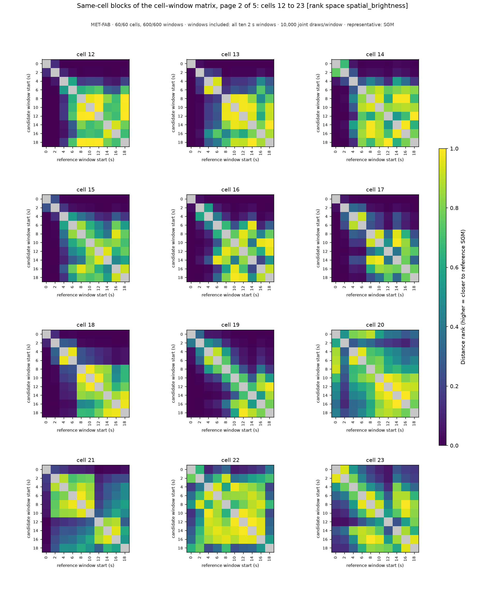
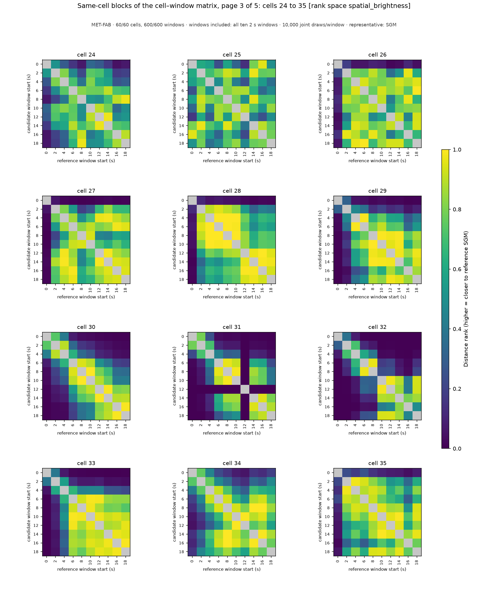
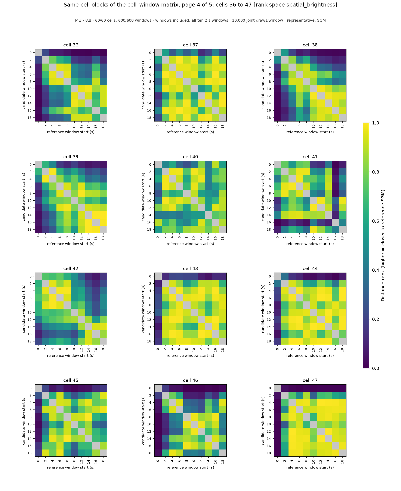
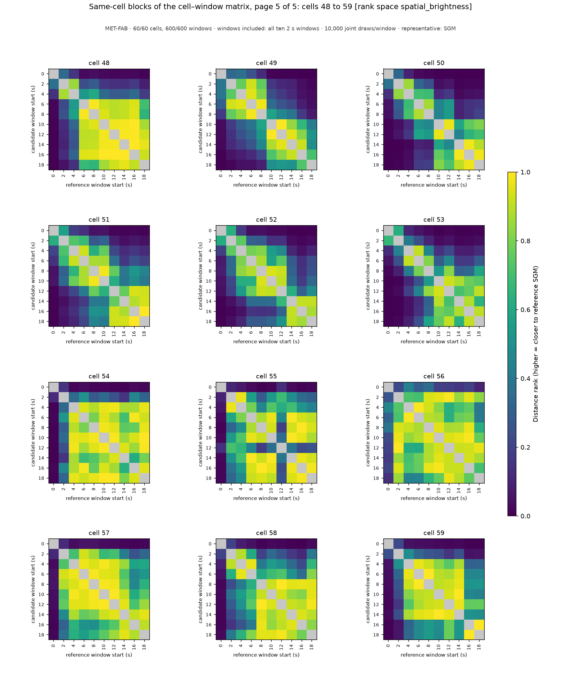

# Same-cell blocks of the cell–window population matrix: MET-FAB, windows included: all ten 2 s windows, rank space `spatial_brightness`

MET-FAB · 60/60 cells, 600/600 windows · windows included: all ten 2 s windows · 10,000 joint draws/window · representative: SGM

Each panel enlarges one 10 x 10 diagonal block of the complete 600 x 600 cell–window matrix: the distance ranks between the windows of ONE cell (rows candidate windows, columns reference windows, both labeled by window start time in seconds); color is the share of the reference window's draws strictly farther from its own SGM than the candidate window's SGM (0–1, one scale for every panel); the self comparison is gray (excluded). These same-cell comparisons are 9 of each candidate's 599 references under the construction-wide scope; they are shown for legibility and are NOT the candidate's score, which is the median of its whole row of the population matrix (the `compatibility_score_spatial_brightness` column of [aggregation_groups.csv](../../../../aggregation_groups.csv), listed per cell below). Every pairwise value is in [aggregation_compatibility_spatial_brightness.csv](../../../../aggregation_compatibility_spatial_brightness.csv); the full matrix is the `compatibility_spatial_brightness_block_*` arrays of [aggregation_candidates.npz](../../../../aggregation_candidates.npz). A zero is a centrality outcome, not a data-quality classification; raw-data notes and training-prior flags stay separate. Rank space `spatial_brightness`: distances over mu_r, sigma_r, mu_pc, sigma_pc only. Back to the [report](../../../../report.md).

| cell | page | scores over the complete population (599 references) by window start (s) |
|---|---|---|
| 0 | [page_01.png](page_01.png) | 0: 0.022, 2: 0.160, 4: 0.080, 6: 0.130, 8: 0.089, 10: 0.152, 12: 0.213, 14: 0.189, 16: 0.195, 18: 0.099 |
| 1 | [page_01.png](page_01.png) | 0: 0.003, 2: 0.198, 4: 0.178, 6: 0.053, 8: 0.115, 10: 0.161, 12: 0.152, 14: 0.225, 16: 0.222, 18: 0.238 |
| 2 | [page_01.png](page_01.png) | 0: 0.006, 2: 0.033, 4: 0.212, 6: 0.159, 8: 0.137, 10: 0.133, 12: 0.035, 14: 0.054, 16: 0.331, 18: 0.195 |
| 3 | [page_01.png](page_01.png) | 0: 0.010, 2: 0.208, 4: 0.351, 6: 0.333, 8: 0.150, 10: 0.145, 12: 0.186, 14: 0.201, 16: 0.264, 18: 0.230 |
| 4 | [page_01.png](page_01.png) | 0: 0.003, 2: 0.063, 4: 0.189, 6: 0.199, 8: 0.168, 10: 0.216, 12: 0.161, 14: 0.213, 16: 0.262, 18: 0.228 |
| 5 | [page_01.png](page_01.png) | 0: 0.029, 2: 0.113, 4: 0.184, 6: 0.104, 8: 0.069, 10: 0.031, 12: 0.037, 14: 0.037, 16: 0.067, 18: 0.106 |
| 6 | [page_01.png](page_01.png) | 0: 0.011, 2: 0.213, 4: 0.248, 6: 0.192, 8: 0.229, 10: 0.199, 12: 0.060, 14: 0.126, 16: 0.025, 18: 0.205 |
| 7 | [page_01.png](page_01.png) | 0: 0.004, 2: 0.144, 4: 0.132, 6: 0.229, 8: 0.215, 10: 0.321, 12: 0.225, 14: 0.108, 16: 0.120, 18: 0.126 |
| 8 | [page_01.png](page_01.png) | 0: 0.010, 2: 0.290, 4: 0.183, 6: 0.160, 8: 0.308, 10: 0.333, 12: 0.281, 14: 0.227, 16: 0.176, 18: 0.181 |
| 9 | [page_01.png](page_01.png) | 0: 0.007, 2: 0.175, 4: 0.241, 6: 0.249, 8: 0.176, 10: 0.360, 12: 0.298, 14: 0.232, 16: 0.311, 18: 0.213 |
| 10 | [page_01.png](page_01.png) | 0: 0.003, 2: 0.098, 4: 0.241, 6: 0.252, 8: 0.243, 10: 0.303, 12: 0.282, 14: 0.326, 16: 0.323, 18: 0.313 |
| 11 | [page_01.png](page_01.png) | 0: 0.002, 2: 0.019, 4: 0.094, 6: 0.188, 8: 0.217, 10: 0.188, 12: 0.121, 14: 0.261, 16: 0.113, 18: 0.162 |
| 12 | [page_02.png](page_02.png) | 0: 0.001, 2: 0.004, 4: 0.042, 6: 0.104, 8: 0.169, 10: 0.158, 12: 0.167, 14: 0.283, 16: 0.264, 18: 0.179 |
| 13 | [page_02.png](page_02.png) | 0: 0.003, 2: 0.086, 4: 0.222, 6: 0.310, 8: 0.104, 10: 0.162, 12: 0.133, 14: 0.194, 16: 0.342, 18: 0.218 |
| 14 | [page_02.png](page_02.png) | 0: 0.001, 2: 0.002, 4: 0.008, 6: 0.040, 8: 0.032, 10: 0.036, 12: 0.077, 14: 0.032, 16: 0.045, 18: 0.069 |
| 15 | [page_02.png](page_02.png) | 0: 0.001, 2: 0.010, 4: 0.063, 6: 0.117, 8: 0.199, 10: 0.125, 12: 0.127, 14: 0.102, 16: 0.191, 18: 0.228 |
| 16 | [page_02.png](page_02.png) | 0: 0.001, 2: 0.049, 4: 0.113, 6: 0.261, 8: 0.241, 10: 0.147, 12: 0.241, 14: 0.306, 16: 0.091, 18: 0.177 |
| 17 | [page_02.png](page_02.png) | 0: 0.001, 2: 0.015, 4: 0.069, 6: 0.052, 8: 0.227, 10: 0.220, 12: 0.367, 14: 0.193, 16: 0.263, 18: 0.193 |
| 18 | [page_02.png](page_02.png) | 0: 0.001, 2: 0.018, 4: 0.100, 6: 0.077, 8: 0.226, 10: 0.198, 12: 0.189, 14: 0.289, 16: 0.167, 18: 0.187 |
| 19 | [page_02.png](page_02.png) | 0: 0.000, 2: 0.002, 4: 0.006, 6: 0.009, 8: 0.027, 10: 0.061, 12: 0.127, 14: 0.249, 16: 0.104, 18: 0.172 |
| 20 | [page_02.png](page_02.png) | 0: 0.209, 2: 0.331, 4: 0.136, 6: 0.178, 8: 0.173, 10: 0.135, 12: 0.102, 14: 0.093, 16: 0.071, 18: 0.113 |
| 21 | [page_02.png](page_02.png) | 0: 0.113, 2: 0.206, 4: 0.158, 6: 0.205, 8: 0.183, 10: 0.143, 12: 0.032, 14: 0.041, 16: 0.058, 18: 0.077 |
| 22 | [page_02.png](page_02.png) | 0: 0.141, 2: 0.272, 4: 0.137, 6: 0.188, 8: 0.297, 10: 0.152, 12: 0.197, 14: 0.204, 16: 0.287, 18: 0.357 |
| 23 | [page_02.png](page_02.png) | 0: 0.112, 2: 0.151, 4: 0.224, 6: 0.357, 8: 0.309, 10: 0.226, 12: 0.143, 14: 0.268, 16: 0.281, 18: 0.223 |
| 24 | [page_03.png](page_03.png) | 0: 0.120, 2: 0.263, 4: 0.263, 6: 0.188, 8: 0.117, 10: 0.189, 12: 0.201, 14: 0.199, 16: 0.128, 18: 0.089 |
| 25 | [page_03.png](page_03.png) | 0: 0.289, 2: 0.225, 4: 0.216, 6: 0.111, 8: 0.244, 10: 0.170, 12: 0.085, 14: 0.271, 16: 0.334, 18: 0.258 |
| 26 | [page_03.png](page_03.png) | 0: 0.164, 2: 0.329, 4: 0.207, 6: 0.244, 8: 0.262, 10: 0.286, 12: 0.118, 14: 0.160, 16: 0.278, 18: 0.194 |
| 27 | [page_03.png](page_03.png) | 0: 0.027, 2: 0.276, 4: 0.335, 6: 0.333, 8: 0.224, 10: 0.291, 12: 0.353, 14: 0.353, 16: 0.333, 18: 0.356 |
| 28 | [page_03.png](page_03.png) | 0: 0.060, 2: 0.294, 4: 0.309, 6: 0.305, 8: 0.333, 10: 0.312, 12: 0.245, 14: 0.189, 16: 0.201, 18: 0.262 |
| 29 | [page_03.png](page_03.png) | 0: 0.003, 2: 0.019, 4: 0.063, 6: 0.080, 8: 0.162, 10: 0.135, 12: 0.163, 14: 0.164, 16: 0.234, 18: 0.165 |
| 30 | [page_03.png](page_03.png) | 0: 0.002, 2: 0.006, 4: 0.011, 6: 0.045, 8: 0.067, 10: 0.080, 12: 0.142, 14: 0.149, 16: 0.209, 18: 0.221 |
| 31 | [page_03.png](page_03.png) | 0: 0.002, 2: 0.005, 4: 0.018, 6: 0.076, 8: 0.109, 10: 0.100, 12: 0.000, 14: 0.189, 16: 0.198, 18: 0.277 |
| 32 | [page_03.png](page_03.png) | 0: 0.001, 2: 0.020, 4: 0.078, 6: 0.245, 8: 0.205, 10: 0.171, 12: 0.175, 14: 0.080, 16: 0.030, 18: 0.112 |
| 33 | [page_03.png](page_03.png) | 0: 0.013, 2: 0.073, 4: 0.214, 6: 0.306, 8: 0.387, 10: 0.355, 12: 0.267, 14: 0.248, 16: 0.265, 18: 0.217 |
| 34 | [page_03.png](page_03.png) | 0: 0.061, 2: 0.114, 4: 0.180, 6: 0.251, 8: 0.314, 10: 0.356, 12: 0.359, 14: 0.307, 16: 0.330, 18: 0.244 |
| 35 | [page_03.png](page_03.png) | 0: 0.026, 2: 0.112, 4: 0.126, 6: 0.126, 8: 0.142, 10: 0.206, 12: 0.213, 14: 0.225, 16: 0.243, 18: 0.159 |
| 36 | [page_04.png](page_04.png) | 0: 0.096, 2: 0.246, 4: 0.336, 6: 0.265, 8: 0.228, 10: 0.141, 12: 0.124, 14: 0.093, 16: 0.174, 18: 0.084 |
| 37 | [page_04.png](page_04.png) | 0: 0.318, 2: 0.237, 4: 0.137, 6: 0.213, 8: 0.185, 10: 0.187, 12: 0.088, 14: 0.137, 16: 0.212, 18: 0.128 |
| 38 | [page_04.png](page_04.png) | 0: 0.005, 2: 0.031, 4: 0.068, 6: 0.139, 8: 0.083, 10: 0.131, 12: 0.161, 14: 0.208, 16: 0.196, 18: 0.130 |
| 39 | [page_04.png](page_04.png) | 0: 0.004, 2: 0.011, 4: 0.014, 6: 0.025, 8: 0.030, 10: 0.031, 12: 0.037, 14: 0.058, 16: 0.059, 18: 0.065 |
| 40 | [page_04.png](page_04.png) | 0: 0.198, 2: 0.379, 4: 0.338, 6: 0.383, 8: 0.254, 10: 0.366, 12: 0.321, 14: 0.213, 16: 0.251, 18: 0.268 |
| 41 | [page_04.png](page_04.png) | 0: 0.013, 2: 0.040, 4: 0.061, 6: 0.045, 8: 0.032, 10: 0.156, 12: 0.145, 14: 0.075, 16: 0.290, 18: 0.176 |
| 42 | [page_04.png](page_04.png) | 0: 0.055, 2: 0.091, 4: 0.143, 6: 0.144, 8: 0.149, 10: 0.111, 12: 0.195, 14: 0.245, 16: 0.243, 18: 0.252 |
| 43 | [page_04.png](page_04.png) | 0: 0.108, 2: 0.236, 4: 0.349, 6: 0.288, 8: 0.212, 10: 0.271, 12: 0.292, 14: 0.255, 16: 0.302, 18: 0.202 |
| 44 | [page_04.png](page_04.png) | 0: 0.101, 2: 0.239, 4: 0.221, 6: 0.230, 8: 0.098, 10: 0.171, 12: 0.234, 14: 0.200, 16: 0.083, 18: 0.229 |
| 45 | [page_04.png](page_04.png) | 0: 0.108, 2: 0.320, 4: 0.322, 6: 0.369, 8: 0.271, 10: 0.186, 12: 0.239, 14: 0.300, 16: 0.274, 18: 0.345 |
| 46 | [page_04.png](page_04.png) | 0: 0.032, 2: 0.233, 4: 0.312, 6: 0.280, 8: 0.200, 10: 0.219, 12: 0.208, 14: 0.299, 16: 0.245, 18: 0.375 |
| 47 | [page_04.png](page_04.png) | 0: 0.036, 2: 0.328, 4: 0.347, 6: 0.260, 8: 0.334, 10: 0.205, 12: 0.349, 14: 0.337, 16: 0.307, 18: 0.298 |
| 48 | [page_05.png](page_05.png) | 0: 0.004, 2: 0.023, 4: 0.034, 6: 0.090, 8: 0.085, 10: 0.114, 12: 0.129, 14: 0.112, 16: 0.118, 18: 0.139 |
| 49 | [page_05.png](page_05.png) | 0: 0.000, 2: 0.001, 4: 0.001, 6: 0.001, 8: 0.001, 10: 0.004, 12: 0.004, 14: 0.004, 16: 0.006, 18: 0.013 |
| 50 | [page_05.png](page_05.png) | 0: 0.001, 2: 0.002, 4: 0.005, 6: 0.016, 8: 0.018, 10: 0.062, 12: 0.055, 14: 0.156, 16: 0.123, 18: 0.101 |
| 51 | [page_05.png](page_05.png) | 0: 0.002, 2: 0.009, 4: 0.024, 6: 0.030, 8: 0.049, 10: 0.049, 12: 0.101, 14: 0.141, 16: 0.121, 18: 0.125 |
| 52 | [page_05.png](page_05.png) | 0: 0.000, 2: 0.002, 4: 0.005, 6: 0.011, 8: 0.010, 10: 0.013, 12: 0.020, 14: 0.051, 16: 0.073, 18: 0.065 |
| 53 | [page_05.png](page_05.png) | 0: 0.001, 2: 0.004, 4: 0.015, 6: 0.028, 8: 0.044, 10: 0.113, 12: 0.092, 14: 0.145, 16: 0.193, 18: 0.130 |
| 54 | [page_05.png](page_05.png) | 0: 0.040, 2: 0.246, 4: 0.367, 6: 0.349, 8: 0.276, 10: 0.334, 12: 0.327, 14: 0.256, 16: 0.328, 18: 0.341 |
| 55 | [page_05.png](page_05.png) | 0: 0.072, 2: 0.249, 4: 0.291, 6: 0.324, 8: 0.185, 10: 0.266, 12: 0.303, 14: 0.294, 16: 0.219, 18: 0.222 |
| 56 | [page_05.png](page_05.png) | 0: 0.226, 2: 0.197, 4: 0.204, 6: 0.170, 8: 0.226, 10: 0.175, 12: 0.145, 14: 0.106, 16: 0.185, 18: 0.091 |
| 57 | [page_05.png](page_05.png) | 0: 0.030, 2: 0.195, 4: 0.231, 6: 0.222, 8: 0.187, 10: 0.205, 12: 0.240, 14: 0.223, 16: 0.264, 18: 0.184 |
| 58 | [page_05.png](page_05.png) | 0: 0.103, 2: 0.232, 4: 0.208, 6: 0.177, 8: 0.087, 10: 0.156, 12: 0.104, 14: 0.064, 16: 0.062, 18: 0.121 |
| 59 | [page_05.png](page_05.png) | 0: 0.096, 2: 0.185, 4: 0.270, 6: 0.277, 8: 0.260, 10: 0.171, 12: 0.150, 14: 0.190, 16: 0.079, 18: 0.084 |

## Pages

### Page 1: cells 0, 1, 2, 3, 4, 5, 6, 7, 8, 9, 10, 11

### Page 2: cells 12, 13, 14, 15, 16, 17, 18, 19, 20, 21, 22, 23

### Page 3: cells 24, 25, 26, 27, 28, 29, 30, 31, 32, 33, 34, 35

### Page 4: cells 36, 37, 38, 39, 40, 41, 42, 43, 44, 45, 46, 47

### Page 5: cells 48, 49, 50, 51, 52, 53, 54, 55, 56, 57, 58, 59

