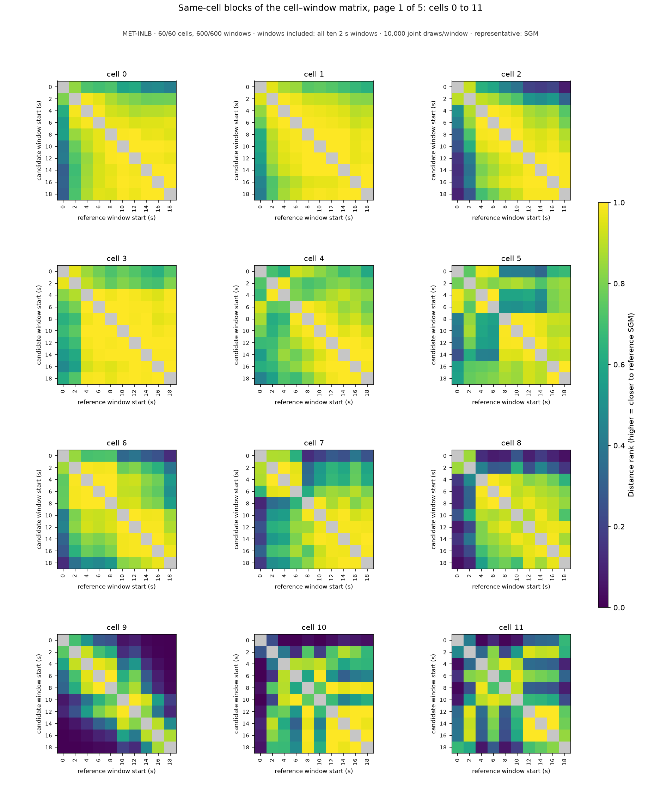
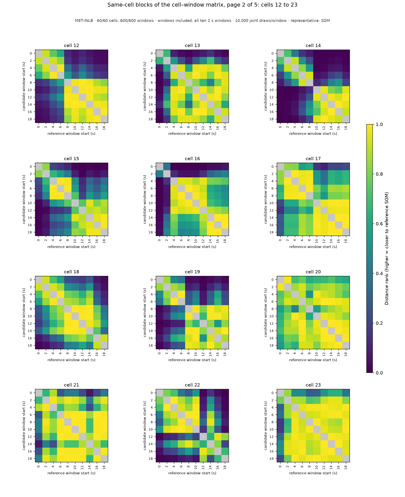
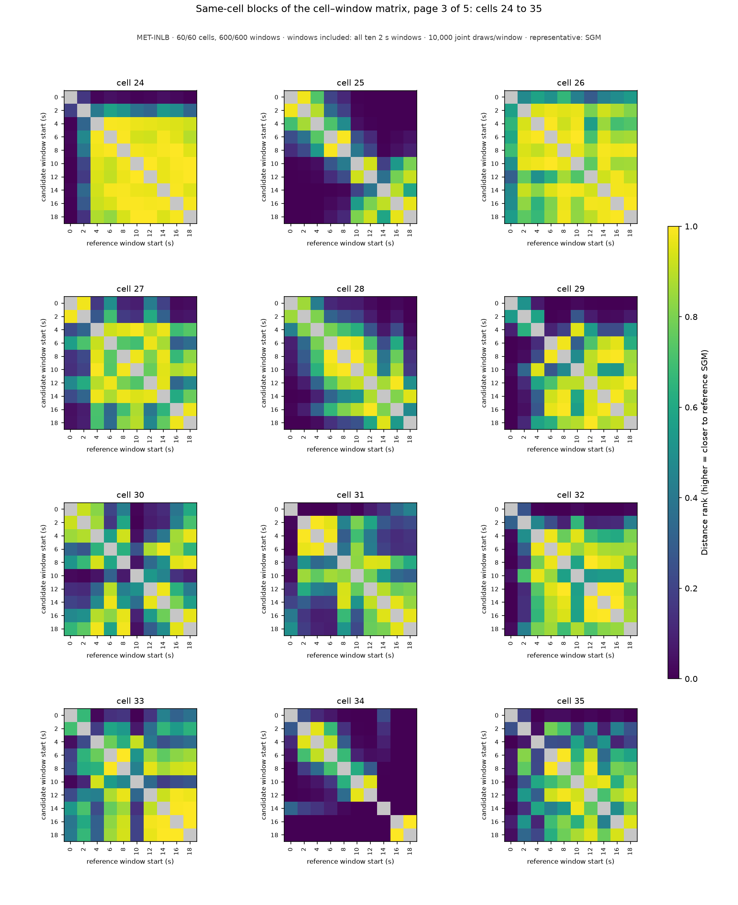
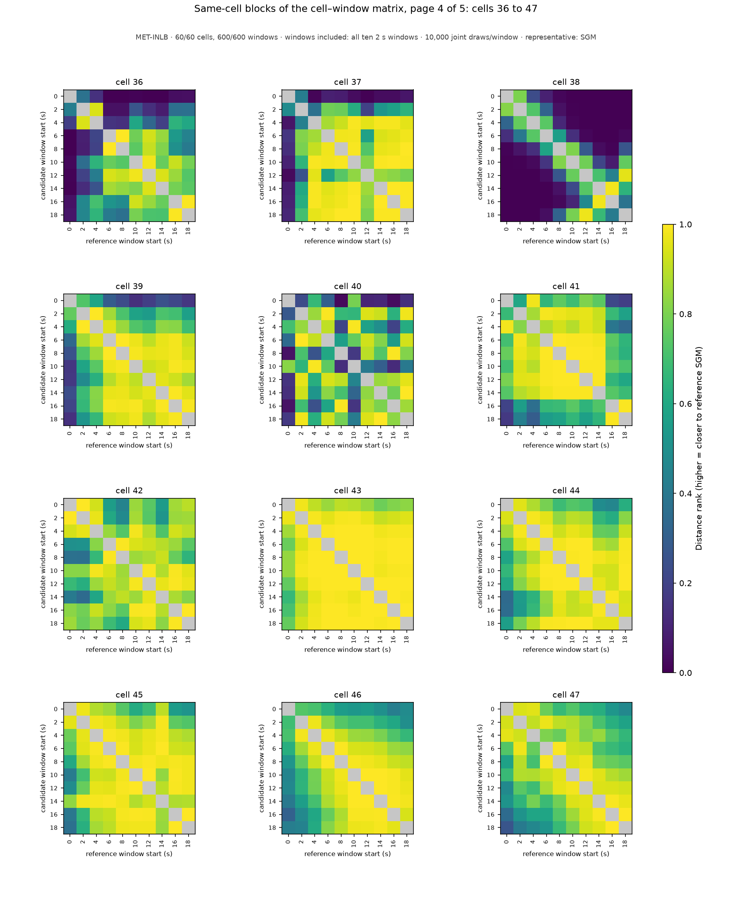
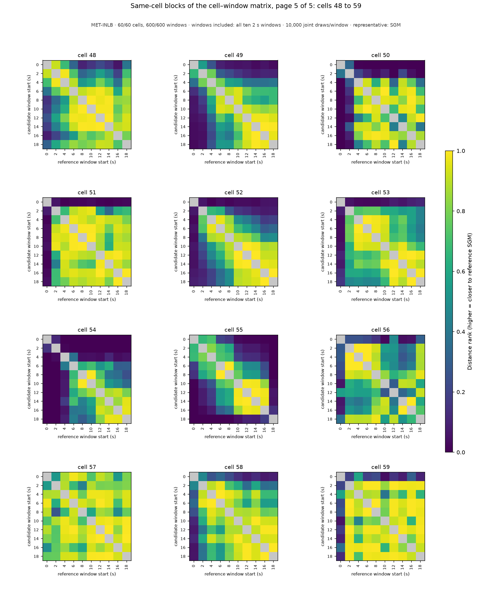

# Same-cell blocks of the cell–window population matrix: MET-INLB, windows included: all ten 2 s windows

MET-INLB · 60/60 cells, 600/600 windows · windows included: all ten 2 s windows · 10,000 joint draws/window · representative: SGM

Each panel enlarges one 10 x 10 diagonal block of the complete 600 x 600 cell–window matrix: the distance ranks between the windows of ONE cell (rows candidate windows, columns reference windows, both labeled by window start time in seconds); color is the share of the reference window's draws strictly farther from its own SGM than the candidate window's SGM (0–1, one scale for every panel); the self comparison is gray (excluded). These same-cell comparisons are 9 of each candidate's 599 references under the construction-wide scope; they are shown for legibility and are NOT the candidate's score, which is the median of its whole row of the population matrix (the `compatibility_score` column of [aggregation_groups.csv](../../../../aggregation_groups.csv), listed per cell below). Every pairwise value is in [aggregation_compatibility.csv](../../../../aggregation_compatibility.csv); the full matrix is the `compatibility_block_*` arrays of [aggregation_candidates.npz](../../../../aggregation_candidates.npz). A zero is a centrality outcome, not a data-quality classification; raw-data notes and training-prior flags stay separate. Back to the [report](../../../../report.md).

| cell | page | scores over the complete population (599 references) by window start (s) |
|---|---|---|
| 0 | [page_01.png](page_01.png) | 0: 0.336, 2: 0.421, 4: 0.366, 6: 0.324, 8: 0.231, 10: 0.189, 12: 0.173, 14: 0.169, 16: 0.175, 18: 0.183 |
| 1 | [page_01.png](page_01.png) | 0: 0.364, 2: 0.404, 4: 0.386, 6: 0.361, 8: 0.304, 10: 0.303, 12: 0.274, 14: 0.257, 16: 0.186, 18: 0.207 |
| 2 | [page_01.png](page_01.png) | 0: 0.146, 2: 0.212, 4: 0.295, 6: 0.260, 8: 0.262, 10: 0.227, 12: 0.243, 14: 0.230, 16: 0.212, 18: 0.210 |
| 3 | [page_01.png](page_01.png) | 0: 0.396, 2: 0.426, 4: 0.441, 6: 0.417, 8: 0.403, 10: 0.400, 12: 0.366, 14: 0.350, 16: 0.299, 18: 0.355 |
| 4 | [page_01.png](page_01.png) | 0: 0.286, 2: 0.389, 4: 0.464, 6: 0.332, 8: 0.314, 10: 0.330, 12: 0.360, 14: 0.378, 16: 0.346, 18: 0.321 |
| 5 | [page_01.png](page_01.png) | 0: 0.145, 2: 0.297, 4: 0.194, 6: 0.167, 8: 0.427, 10: 0.393, 12: 0.385, 14: 0.392, 16: 0.287, 18: 0.286 |
| 6 | [page_01.png](page_01.png) | 0: 0.063, 2: 0.185, 4: 0.226, 6: 0.201, 8: 0.238, 10: 0.382, 12: 0.387, 14: 0.375, 16: 0.452, 18: 0.447 |
| 7 | [page_01.png](page_01.png) | 0: 0.031, 2: 0.124, 4: 0.134, 6: 0.194, 8: 0.286, 10: 0.249, 12: 0.200, 14: 0.271, 16: 0.208, 18: 0.237 |
| 8 | [page_01.png](page_01.png) | 0: 0.011, 2: 0.056, 4: 0.243, 6: 0.297, 8: 0.297, 10: 0.251, 12: 0.328, 14: 0.283, 16: 0.360, 18: 0.411 |
| 9 | [page_01.png](page_01.png) | 0: 0.002, 2: 0.005, 4: 0.025, 6: 0.055, 8: 0.088, 10: 0.166, 12: 0.151, 14: 0.223, 16: 0.174, 18: 0.149 |
| 10 | [page_01.png](page_01.png) | 0: 0.043, 2: 0.196, 4: 0.126, 6: 0.101, 8: 0.199, 10: 0.115, 12: 0.203, 14: 0.235, 16: 0.217, 18: 0.202 |
| 11 | [page_01.png](page_01.png) | 0: 0.153, 2: 0.277, 4: 0.158, 6: 0.277, 8: 0.131, 10: 0.199, 12: 0.282, 14: 0.292, 16: 0.289, 18: 0.200 |
| 12 | [page_02.png](page_02.png) | 0: 0.005, 2: 0.004, 4: 0.017, 6: 0.032, 8: 0.198, 10: 0.274, 12: 0.223, 14: 0.279, 16: 0.264, 18: 0.309 |
| 13 | [page_02.png](page_02.png) | 0: 0.000, 2: 0.004, 4: 0.073, 6: 0.152, 8: 0.249, 10: 0.128, 12: 0.092, 14: 0.042, 16: 0.132, 18: 0.240 |
| 14 | [page_02.png](page_02.png) | 0: 0.001, 2: 0.002, 4: 0.006, 6: 0.039, 8: 0.110, 10: 0.229, 12: 0.328, 14: 0.338, 16: 0.321, 18: 0.353 |
| 15 | [page_02.png](page_02.png) | 0: 0.005, 2: 0.036, 4: 0.185, 6: 0.214, 8: 0.240, 10: 0.317, 12: 0.277, 14: 0.364, 16: 0.405, 18: 0.360 |
| 16 | [page_02.png](page_02.png) | 0: 0.004, 2: 0.114, 4: 0.293, 6: 0.180, 8: 0.206, 10: 0.200, 12: 0.271, 14: 0.272, 16: 0.309, 18: 0.301 |
| 17 | [page_02.png](page_02.png) | 0: 0.014, 2: 0.080, 4: 0.080, 6: 0.155, 8: 0.126, 10: 0.309, 12: 0.410, 14: 0.303, 16: 0.304, 18: 0.300 |
| 18 | [page_02.png](page_02.png) | 0: 0.001, 2: 0.002, 4: 0.007, 6: 0.009, 8: 0.041, 10: 0.049, 12: 0.071, 14: 0.037, 16: 0.170, 18: 0.288 |
| 19 | [page_02.png](page_02.png) | 0: 0.003, 2: 0.015, 4: 0.065, 6: 0.076, 8: 0.326, 10: 0.269, 12: 0.238, 14: 0.277, 16: 0.248, 18: 0.276 |
| 20 | [page_02.png](page_02.png) | 0: 0.220, 2: 0.308, 4: 0.338, 6: 0.379, 8: 0.313, 10: 0.386, 12: 0.407, 14: 0.421, 16: 0.409, 18: 0.413 |
| 21 | [page_02.png](page_02.png) | 0: 0.145, 2: 0.309, 4: 0.269, 6: 0.292, 8: 0.354, 10: 0.323, 12: 0.304, 14: 0.222, 16: 0.341, 18: 0.352 |
| 22 | [page_02.png](page_02.png) | 0: 0.001, 2: 0.009, 4: 0.013, 6: 0.040, 8: 0.072, 10: 0.027, 12: 0.302, 14: 0.124, 16: 0.215, 18: 0.239 |
| 23 | [page_02.png](page_02.png) | 0: 0.236, 2: 0.241, 4: 0.188, 6: 0.112, 8: 0.129, 10: 0.124, 12: 0.168, 14: 0.154, 16: 0.146, 18: 0.148 |
| 24 | [page_03.png](page_03.png) | 0: 0.003, 2: 0.150, 4: 0.379, 6: 0.338, 8: 0.363, 10: 0.432, 12: 0.428, 14: 0.375, 16: 0.374, 18: 0.434 |
| 25 | [page_03.png](page_03.png) | 0: 0.004, 2: 0.009, 4: 0.036, 6: 0.176, 8: 0.208, 10: 0.245, 12: 0.309, 14: 0.051, 16: 0.123, 18: 0.182 |
| 26 | [page_03.png](page_03.png) | 0: 0.050, 2: 0.139, 4: 0.072, 6: 0.095, 8: 0.156, 10: 0.109, 12: 0.254, 14: 0.167, 16: 0.200, 18: 0.171 |
| 27 | [page_03.png](page_03.png) | 0: 0.188, 2: 0.204, 4: 0.440, 6: 0.435, 8: 0.379, 10: 0.407, 12: 0.411, 14: 0.435, 16: 0.285, 18: 0.286 |
| 28 | [page_03.png](page_03.png) | 0: 0.000, 2: 0.001, 4: 0.005, 6: 0.031, 8: 0.060, 10: 0.059, 12: 0.164, 14: 0.333, 16: 0.139, 18: 0.415 |
| 29 | [page_03.png](page_03.png) | 0: 0.004, 2: 0.070, 4: 0.226, 6: 0.209, 8: 0.275, 10: 0.305, 12: 0.336, 14: 0.392, 16: 0.291, 18: 0.318 |
| 30 | [page_03.png](page_03.png) | 0: 0.359, 2: 0.229, 4: 0.334, 6: 0.244, 8: 0.189, 10: 0.087, 12: 0.153, 14: 0.203, 16: 0.219, 18: 0.255 |
| 31 | [page_03.png](page_03.png) | 0: 0.202, 2: 0.145, 4: 0.111, 6: 0.120, 8: 0.292, 10: 0.223, 12: 0.370, 14: 0.355, 16: 0.420, 18: 0.456 |
| 32 | [page_03.png](page_03.png) | 0: 0.042, 2: 0.334, 4: 0.286, 6: 0.269, 8: 0.188, 10: 0.400, 12: 0.196, 14: 0.242, 16: 0.249, 18: 0.381 |
| 33 | [page_03.png](page_03.png) | 0: 0.334, 2: 0.287, 4: 0.111, 6: 0.245, 8: 0.276, 10: 0.085, 12: 0.311, 14: 0.410, 16: 0.358, 18: 0.367 |
| 34 | [page_03.png](page_03.png) | 0: 0.001, 2: 0.018, 4: 0.045, 6: 0.134, 8: 0.326, 10: 0.432, 12: 0.343, 14: 0.002, 16: 0.000, 18: 0.000 |
| 35 | [page_03.png](page_03.png) | 0: 0.080, 2: 0.393, 4: 0.094, 6: 0.401, 8: 0.400, 10: 0.268, 12: 0.351, 14: 0.210, 16: 0.315, 18: 0.300 |
| 36 | [page_04.png](page_04.png) | 0: 0.008, 2: 0.171, 4: 0.272, 6: 0.342, 8: 0.342, 10: 0.465, 12: 0.428, 14: 0.315, 16: 0.374, 18: 0.314 |
| 37 | [page_04.png](page_04.png) | 0: 0.111, 2: 0.437, 4: 0.300, 6: 0.383, 8: 0.417, 10: 0.363, 12: 0.221, 14: 0.366, 16: 0.363, 18: 0.375 |
| 38 | [page_04.png](page_04.png) | 0: 0.002, 2: 0.006, 4: 0.015, 6: 0.101, 8: 0.326, 10: 0.316, 12: 0.185, 14: 0.078, 16: 0.055, 18: 0.261 |
| 39 | [page_04.png](page_04.png) | 0: 0.144, 2: 0.254, 4: 0.283, 6: 0.286, 8: 0.287, 10: 0.252, 12: 0.409, 14: 0.327, 16: 0.290, 18: 0.245 |
| 40 | [page_04.png](page_04.png) | 0: 0.180, 2: 0.380, 4: 0.365, 6: 0.399, 8: 0.248, 10: 0.337, 12: 0.399, 14: 0.274, 16: 0.248, 18: 0.335 |
| 41 | [page_04.png](page_04.png) | 0: 0.215, 2: 0.244, 4: 0.283, 6: 0.307, 8: 0.349, 10: 0.343, 12: 0.317, 14: 0.371, 16: 0.348, 18: 0.364 |
| 42 | [page_04.png](page_04.png) | 0: 0.234, 2: 0.190, 4: 0.184, 6: 0.172, 8: 0.200, 10: 0.230, 12: 0.299, 14: 0.325, 16: 0.290, 18: 0.325 |
| 43 | [page_04.png](page_04.png) | 0: 0.044, 2: 0.066, 4: 0.085, 6: 0.086, 8: 0.076, 10: 0.081, 12: 0.099, 14: 0.109, 16: 0.081, 18: 0.073 |
| 44 | [page_04.png](page_04.png) | 0: 0.066, 2: 0.055, 4: 0.056, 6: 0.054, 8: 0.066, 10: 0.050, 12: 0.064, 14: 0.048, 16: 0.034, 18: 0.041 |
| 45 | [page_04.png](page_04.png) | 0: 0.066, 2: 0.069, 4: 0.089, 6: 0.068, 8: 0.064, 10: 0.077, 12: 0.082, 14: 0.056, 16: 0.050, 18: 0.038 |
| 46 | [page_04.png](page_04.png) | 0: 0.031, 2: 0.118, 4: 0.102, 6: 0.097, 8: 0.090, 10: 0.095, 12: 0.098, 14: 0.094, 16: 0.104, 18: 0.062 |
| 47 | [page_04.png](page_04.png) | 0: 0.148, 2: 0.237, 4: 0.150, 6: 0.282, 8: 0.275, 10: 0.218, 12: 0.215, 14: 0.143, 16: 0.134, 18: 0.123 |
| 48 | [page_05.png](page_05.png) | 0: 0.290, 2: 0.417, 4: 0.453, 6: 0.360, 8: 0.248, 10: 0.270, 12: 0.347, 14: 0.316, 16: 0.266, 18: 0.334 |
| 49 | [page_05.png](page_05.png) | 0: 0.004, 2: 0.004, 4: 0.031, 6: 0.071, 8: 0.038, 10: 0.093, 12: 0.150, 14: 0.155, 16: 0.198, 18: 0.108 |
| 50 | [page_05.png](page_05.png) | 0: 0.004, 2: 0.134, 4: 0.362, 6: 0.382, 8: 0.369, 10: 0.407, 12: 0.233, 14: 0.443, 16: 0.352, 18: 0.224 |
| 51 | [page_05.png](page_05.png) | 0: 0.332, 2: 0.174, 4: 0.087, 6: 0.151, 8: 0.158, 10: 0.184, 12: 0.107, 14: 0.069, 16: 0.144, 18: 0.176 |
| 52 | [page_05.png](page_05.png) | 0: 0.195, 2: 0.003, 4: 0.002, 6: 0.007, 8: 0.006, 10: 0.028, 12: 0.027, 14: 0.027, 16: 0.056, 18: 0.065 |
| 53 | [page_05.png](page_05.png) | 0: 0.135, 2: 0.004, 4: 0.002, 6: 0.002, 8: 0.002, 10: 0.007, 12: 0.025, 14: 0.018, 16: 0.037, 18: 0.052 |
| 54 | [page_05.png](page_05.png) | 0: 0.005, 2: 0.271, 4: 0.097, 6: 0.009, 8: 0.000, 10: 0.000, 12: 0.002, 14: 0.011, 16: 0.002, 18: 0.007 |
| 55 | [page_05.png](page_05.png) | 0: 0.000, 2: 0.001, 4: 0.006, 6: 0.024, 8: 0.029, 10: 0.141, 12: 0.221, 14: 0.201, 16: 0.269, 18: 0.277 |
| 56 | [page_05.png](page_05.png) | 0: 0.340, 2: 0.111, 4: 0.102, 6: 0.102, 8: 0.126, 10: 0.060, 12: 0.308, 14: 0.088, 16: 0.110, 18: 0.188 |
| 57 | [page_05.png](page_05.png) | 0: 0.364, 2: 0.170, 4: 0.268, 6: 0.340, 8: 0.391, 10: 0.225, 12: 0.297, 14: 0.273, 16: 0.152, 18: 0.257 |
| 58 | [page_05.png](page_05.png) | 0: 0.000, 2: 0.002, 4: 0.012, 6: 0.006, 8: 0.031, 10: 0.030, 12: 0.069, 14: 0.028, 16: 0.059, 18: 0.057 |
| 59 | [page_05.png](page_05.png) | 0: 0.336, 2: 0.043, 4: 0.107, 6: 0.064, 8: 0.074, 10: 0.009, 12: 0.037, 14: 0.015, 16: 0.092, 18: 0.032 |

## Pages

### Page 1: cells 0, 1, 2, 3, 4, 5, 6, 7, 8, 9, 10, 11

### Page 2: cells 12, 13, 14, 15, 16, 17, 18, 19, 20, 21, 22, 23

### Page 3: cells 24, 25, 26, 27, 28, 29, 30, 31, 32, 33, 34, 35

### Page 4: cells 36, 37, 38, 39, 40, 41, 42, 43, 44, 45, 46, 47

### Page 5: cells 48, 49, 50, 51, 52, 53, 54, 55, 56, 57, 58, 59

