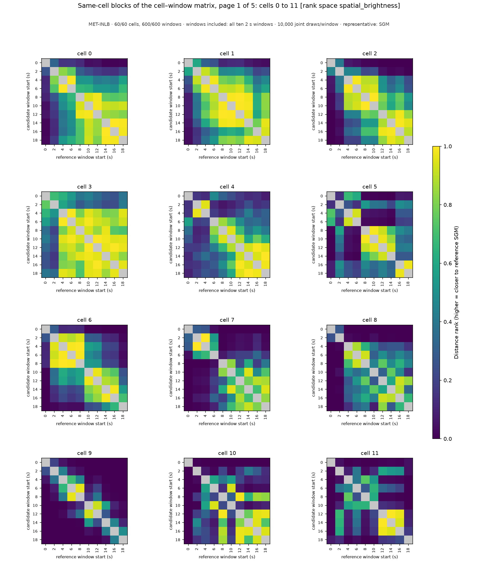
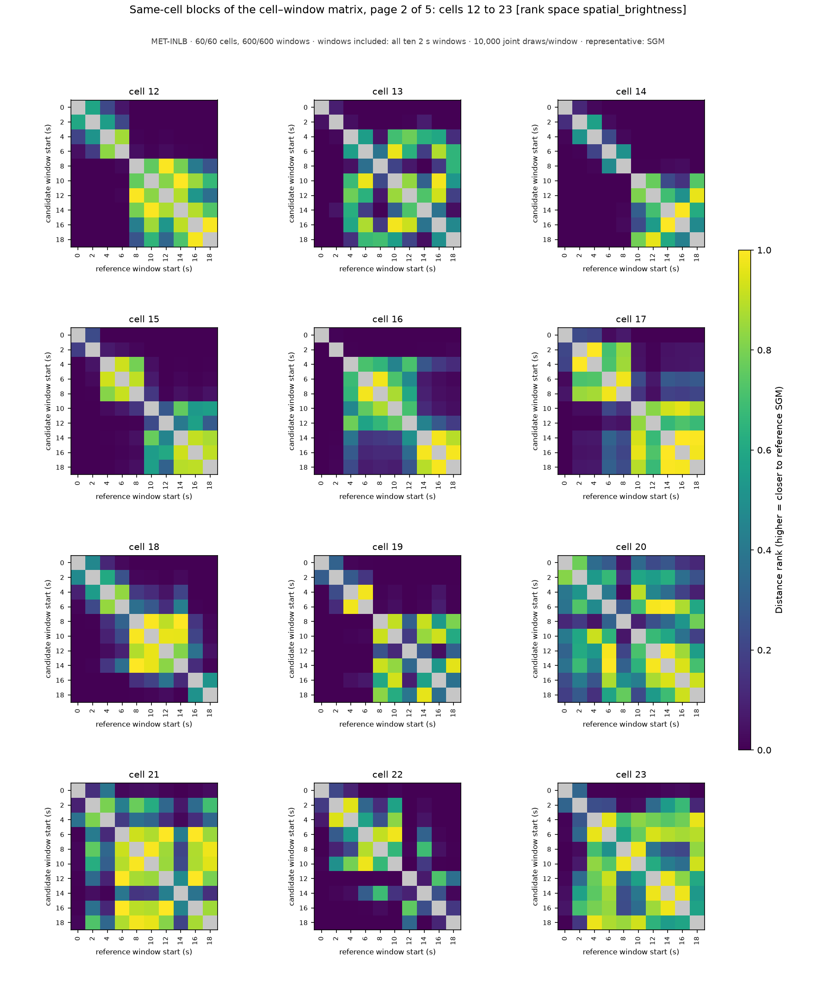
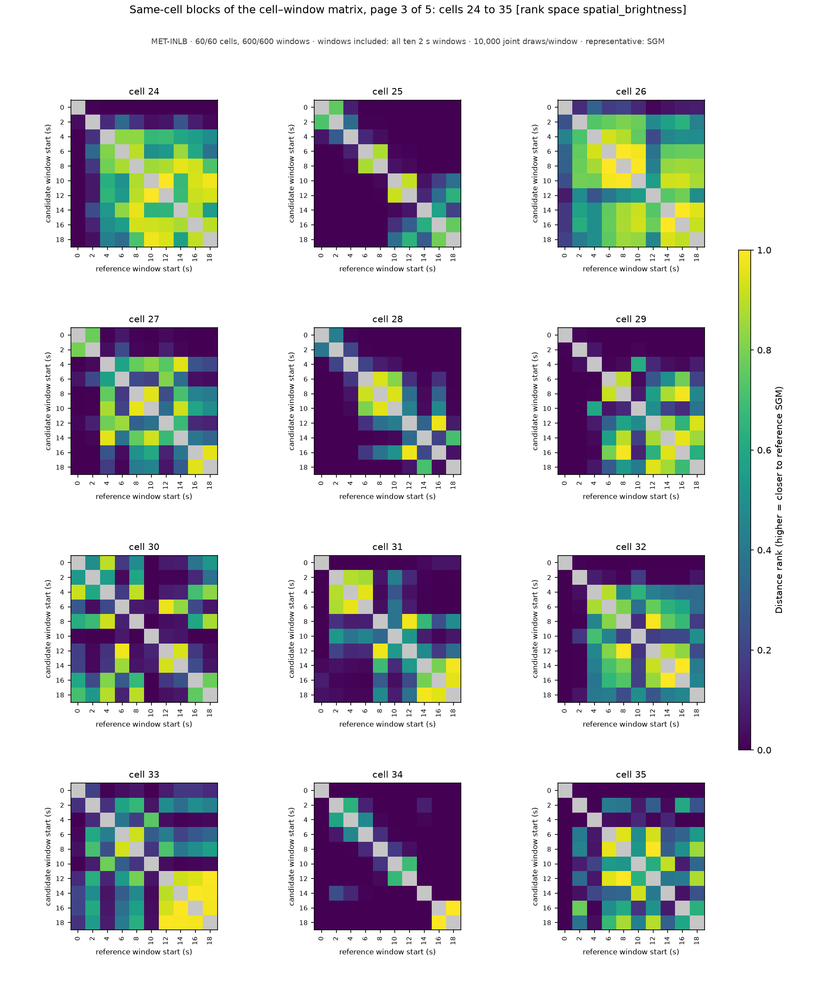
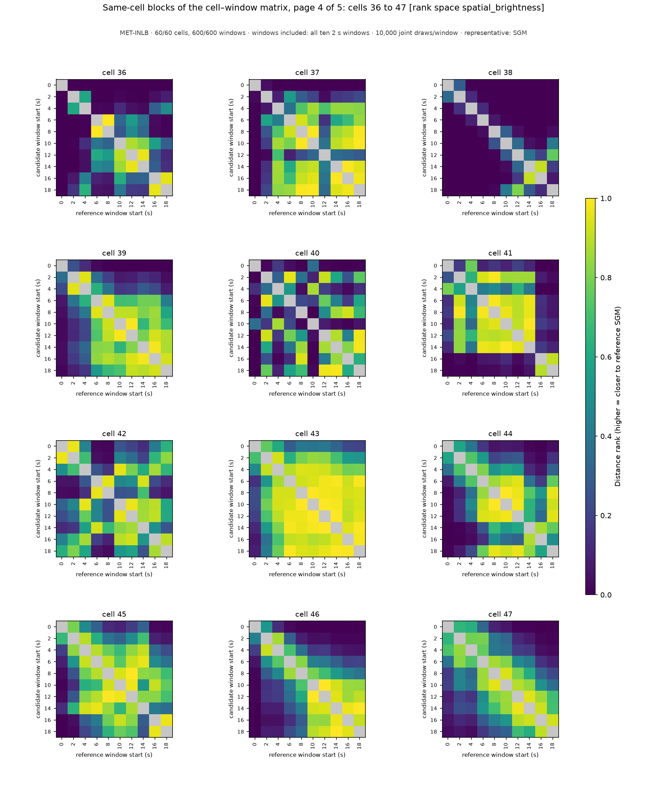
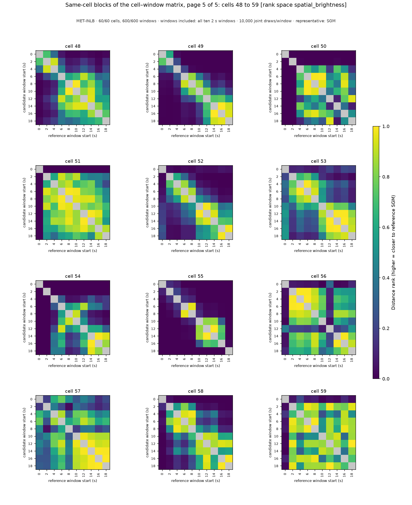

# Same-cell blocks of the cell–window population matrix: MET-INLB, windows included: all ten 2 s windows, rank space `spatial_brightness`

MET-INLB · 60/60 cells, 600/600 windows · windows included: all ten 2 s windows · 10,000 joint draws/window · representative: SGM

Each panel enlarges one 10 x 10 diagonal block of the complete 600 x 600 cell–window matrix: the distance ranks between the windows of ONE cell (rows candidate windows, columns reference windows, both labeled by window start time in seconds); color is the share of the reference window's draws strictly farther from its own SGM than the candidate window's SGM (0–1, one scale for every panel); the self comparison is gray (excluded). These same-cell comparisons are 9 of each candidate's 599 references under the construction-wide scope; they are shown for legibility and are NOT the candidate's score, which is the median of its whole row of the population matrix (the `compatibility_score_spatial_brightness` column of [aggregation_groups.csv](../../../../aggregation_groups.csv), listed per cell below). Every pairwise value is in [aggregation_compatibility_spatial_brightness.csv](../../../../aggregation_compatibility_spatial_brightness.csv); the full matrix is the `compatibility_spatial_brightness_block_*` arrays of [aggregation_candidates.npz](../../../../aggregation_candidates.npz). A zero is a centrality outcome, not a data-quality classification; raw-data notes and training-prior flags stay separate. Rank space `spatial_brightness`: distances over mu_r, sigma_r, mu_pc, sigma_pc only. Back to the [report](../../../../report.md).

| cell | page | scores over the complete population (599 references) by window start (s) |
|---|---|---|
| 0 | [page_01.png](page_01.png) | 0: 0.033, 2: 0.078, 4: 0.066, 6: 0.059, 8: 0.018, 10: 0.013, 12: 0.010, 14: 0.011, 16: 0.010, 18: 0.017 |
| 1 | [page_01.png](page_01.png) | 0: 0.032, 2: 0.054, 4: 0.053, 6: 0.049, 8: 0.048, 10: 0.045, 12: 0.044, 14: 0.036, 16: 0.012, 18: 0.018 |
| 2 | [page_01.png](page_01.png) | 0: 0.003, 2: 0.011, 4: 0.030, 6: 0.023, 8: 0.030, 10: 0.024, 12: 0.035, 14: 0.024, 16: 0.024, 18: 0.033 |
| 3 | [page_01.png](page_01.png) | 0: 0.066, 2: 0.054, 4: 0.083, 6: 0.090, 8: 0.086, 10: 0.077, 12: 0.072, 14: 0.077, 16: 0.058, 18: 0.067 |
| 4 | [page_01.png](page_01.png) | 0: 0.024, 2: 0.057, 4: 0.073, 6: 0.032, 8: 0.025, 10: 0.030, 12: 0.044, 14: 0.065, 16: 0.042, 18: 0.052 |
| 5 | [page_01.png](page_01.png) | 0: 0.002, 2: 0.036, 4: 0.005, 6: 0.003, 8: 0.064, 10: 0.067, 12: 0.056, 14: 0.070, 16: 0.023, 18: 0.021 |
| 6 | [page_01.png](page_01.png) | 0: 0.000, 2: 0.006, 4: 0.010, 6: 0.007, 8: 0.010, 10: 0.035, 12: 0.040, 14: 0.052, 16: 0.065, 18: 0.082 |
| 7 | [page_01.png](page_01.png) | 0: 0.000, 2: 0.002, 4: 0.002, 6: 0.009, 8: 0.070, 10: 0.041, 12: 0.012, 14: 0.033, 16: 0.011, 18: 0.018 |
| 8 | [page_01.png](page_01.png) | 0: 0.000, 2: 0.000, 4: 0.032, 6: 0.055, 8: 0.059, 10: 0.019, 12: 0.059, 14: 0.032, 16: 0.051, 18: 0.091 |
| 9 | [page_01.png](page_01.png) | 0: 0.000, 2: 0.000, 4: 0.000, 6: 0.000, 8: 0.001, 10: 0.017, 12: 0.008, 14: 0.044, 16: 0.041, 18: 0.013 |
| 10 | [page_01.png](page_01.png) | 0: 0.000, 2: 0.041, 4: 0.007, 6: 0.002, 8: 0.048, 10: 0.006, 12: 0.053, 14: 0.076, 16: 0.061, 18: 0.056 |
| 11 | [page_01.png](page_01.png) | 0: 0.003, 2: 0.057, 4: 0.005, 6: 0.033, 8: 0.003, 10: 0.022, 12: 0.090, 14: 0.085, 16: 0.082, 18: 0.018 |
| 12 | [page_02.png](page_02.png) | 0: 0.000, 2: 0.000, 4: 0.000, 6: 0.000, 8: 0.012, 10: 0.028, 12: 0.015, 14: 0.029, 16: 0.054, 18: 0.059 |
| 13 | [page_02.png](page_02.png) | 0: 0.000, 2: 0.000, 4: 0.000, 6: 0.003, 8: 0.028, 10: 0.002, 12: 0.001, 14: 0.000, 16: 0.002, 18: 0.015 |
| 14 | [page_02.png](page_02.png) | 0: 0.000, 2: 0.000, 4: 0.000, 6: 0.000, 8: 0.001, 10: 0.053, 12: 0.074, 14: 0.075, 16: 0.069, 18: 0.077 |
| 15 | [page_02.png](page_02.png) | 0: 0.000, 2: 0.000, 4: 0.006, 6: 0.012, 8: 0.021, 10: 0.070, 12: 0.048, 14: 0.071, 16: 0.082, 18: 0.083 |
| 16 | [page_02.png](page_02.png) | 0: 0.000, 2: 0.001, 4: 0.043, 6: 0.017, 8: 0.025, 10: 0.037, 12: 0.065, 14: 0.068, 16: 0.063, 18: 0.064 |
| 17 | [page_02.png](page_02.png) | 0: 0.000, 2: 0.000, 4: 0.000, 6: 0.002, 8: 0.001, 10: 0.025, 12: 0.052, 14: 0.023, 16: 0.024, 18: 0.024 |
| 18 | [page_02.png](page_02.png) | 0: 0.000, 2: 0.000, 4: 0.000, 6: 0.000, 8: 0.000, 10: 0.000, 12: 0.000, 14: 0.000, 16: 0.005, 18: 0.030 |
| 19 | [page_02.png](page_02.png) | 0: 0.000, 2: 0.000, 4: 0.000, 6: 0.001, 8: 0.046, 10: 0.044, 12: 0.035, 14: 0.052, 16: 0.026, 18: 0.068 |
| 20 | [page_02.png](page_02.png) | 0: 0.043, 2: 0.068, 4: 0.065, 6: 0.080, 8: 0.042, 10: 0.071, 12: 0.074, 14: 0.085, 16: 0.066, 18: 0.058 |
| 21 | [page_02.png](page_02.png) | 0: 0.004, 2: 0.040, 4: 0.032, 6: 0.049, 8: 0.049, 10: 0.059, 12: 0.055, 14: 0.022, 16: 0.055, 18: 0.060 |
| 22 | [page_02.png](page_02.png) | 0: 0.000, 2: 0.000, 4: 0.000, 6: 0.000, 8: 0.000, 10: 0.000, 12: 0.046, 14: 0.002, 16: 0.027, 18: 0.044 |
| 23 | [page_02.png](page_02.png) | 0: 0.073, 2: 0.066, 4: 0.017, 6: 0.019, 8: 0.006, 10: 0.008, 12: 0.017, 14: 0.028, 16: 0.034, 18: 0.012 |
| 24 | [page_03.png](page_03.png) | 0: 0.000, 2: 0.006, 4: 0.045, 6: 0.051, 8: 0.081, 10: 0.084, 12: 0.075, 14: 0.073, 16: 0.092, 18: 0.095 |
| 25 | [page_03.png](page_03.png) | 0: 0.000, 2: 0.000, 4: 0.000, 6: 0.005, 8: 0.015, 10: 0.039, 12: 0.022, 14: 0.000, 16: 0.003, 18: 0.013 |
| 26 | [page_03.png](page_03.png) | 0: 0.000, 2: 0.004, 4: 0.001, 6: 0.002, 8: 0.003, 10: 0.004, 12: 0.020, 14: 0.009, 16: 0.009, 18: 0.005 |
| 27 | [page_03.png](page_03.png) | 0: 0.004, 2: 0.010, 4: 0.058, 6: 0.049, 8: 0.036, 10: 0.046, 12: 0.066, 14: 0.064, 16: 0.025, 18: 0.026 |
| 28 | [page_03.png](page_03.png) | 0: 0.000, 2: 0.000, 4: 0.000, 6: 0.000, 8: 0.000, 10: 0.000, 12: 0.002, 14: 0.020, 16: 0.001, 18: 0.040 |
| 29 | [page_03.png](page_03.png) | 0: 0.000, 2: 0.000, 4: 0.025, 6: 0.008, 8: 0.017, 10: 0.053, 12: 0.047, 14: 0.037, 16: 0.029, 18: 0.062 |
| 30 | [page_03.png](page_03.png) | 0: 0.037, 2: 0.008, 4: 0.027, 6: 0.044, 8: 0.015, 10: 0.013, 12: 0.047, 14: 0.055, 16: 0.043, 18: 0.028 |
| 31 | [page_03.png](page_03.png) | 0: 0.010, 2: 0.002, 4: 0.001, 6: 0.001, 8: 0.035, 10: 0.012, 12: 0.036, 14: 0.058, 16: 0.062, 18: 0.064 |
| 32 | [page_03.png](page_03.png) | 0: 0.000, 2: 0.052, 4: 0.016, 6: 0.019, 8: 0.006, 10: 0.045, 12: 0.008, 14: 0.013, 16: 0.016, 18: 0.075 |
| 33 | [page_03.png](page_03.png) | 0: 0.054, 2: 0.020, 4: 0.001, 6: 0.014, 8: 0.019, 10: 0.001, 12: 0.049, 14: 0.058, 16: 0.062, 18: 0.056 |
| 34 | [page_03.png](page_03.png) | 0: 0.000, 2: 0.000, 4: 0.000, 6: 0.002, 8: 0.023, 10: 0.044, 12: 0.031, 14: 0.000, 16: 0.000, 18: 0.000 |
| 35 | [page_03.png](page_03.png) | 0: 0.001, 2: 0.061, 4: 0.000, 6: 0.036, 8: 0.043, 10: 0.017, 12: 0.042, 14: 0.014, 16: 0.053, 18: 0.053 |
| 36 | [page_04.png](page_04.png) | 0: 0.000, 2: 0.003, 4: 0.018, 6: 0.025, 8: 0.031, 10: 0.053, 12: 0.059, 14: 0.058, 16: 0.045, 18: 0.039 |
| 37 | [page_04.png](page_04.png) | 0: 0.001, 2: 0.046, 4: 0.015, 6: 0.043, 8: 0.037, 10: 0.035, 12: 0.010, 14: 0.035, 16: 0.033, 18: 0.041 |
| 38 | [page_04.png](page_04.png) | 0: 0.000, 2: 0.000, 4: 0.000, 6: 0.001, 8: 0.052, 10: 0.041, 12: 0.006, 14: 0.001, 16: 0.000, 18: 0.016 |
| 39 | [page_04.png](page_04.png) | 0: 0.002, 2: 0.019, 4: 0.027, 6: 0.048, 8: 0.048, 10: 0.044, 12: 0.059, 14: 0.059, 16: 0.059, 18: 0.066 |
| 40 | [page_04.png](page_04.png) | 0: 0.008, 2: 0.041, 4: 0.040, 6: 0.049, 8: 0.011, 10: 0.028, 12: 0.042, 14: 0.024, 16: 0.012, 18: 0.033 |
| 41 | [page_04.png](page_04.png) | 0: 0.005, 2: 0.041, 4: 0.015, 6: 0.044, 8: 0.047, 10: 0.059, 12: 0.038, 14: 0.054, 16: 0.078, 18: 0.083 |
| 42 | [page_04.png](page_04.png) | 0: 0.052, 2: 0.051, 4: 0.036, 6: 0.015, 8: 0.011, 10: 0.039, 12: 0.045, 14: 0.025, 16: 0.050, 18: 0.062 |
| 43 | [page_04.png](page_04.png) | 0: 0.038, 2: 0.054, 4: 0.042, 6: 0.044, 8: 0.043, 10: 0.052, 12: 0.055, 14: 0.047, 16: 0.030, 18: 0.037 |
| 44 | [page_04.png](page_04.png) | 0: 0.035, 2: 0.039, 4: 0.036, 6: 0.021, 8: 0.011, 10: 0.014, 12: 0.014, 14: 0.003, 16: 0.002, 18: 0.008 |
| 45 | [page_04.png](page_04.png) | 0: 0.036, 2: 0.021, 4: 0.014, 6: 0.010, 8: 0.006, 10: 0.004, 12: 0.005, 14: 0.008, 16: 0.002, 18: 0.001 |
| 46 | [page_04.png](page_04.png) | 0: 0.002, 2: 0.011, 4: 0.016, 6: 0.040, 8: 0.042, 10: 0.041, 12: 0.043, 14: 0.050, 16: 0.045, 18: 0.050 |
| 47 | [page_04.png](page_04.png) | 0: 0.004, 2: 0.016, 4: 0.015, 6: 0.039, 8: 0.050, 10: 0.059, 12: 0.050, 14: 0.047, 16: 0.038, 18: 0.031 |
| 48 | [page_05.png](page_05.png) | 0: 0.047, 2: 0.059, 4: 0.055, 6: 0.035, 8: 0.014, 10: 0.017, 12: 0.041, 14: 0.036, 16: 0.031, 18: 0.061 |
| 49 | [page_05.png](page_05.png) | 0: 0.000, 2: 0.000, 4: 0.001, 6: 0.005, 8: 0.010, 10: 0.019, 12: 0.035, 14: 0.054, 16: 0.052, 18: 0.034 |
| 50 | [page_05.png](page_05.png) | 0: 0.000, 2: 0.002, 4: 0.061, 6: 0.044, 8: 0.034, 10: 0.045, 12: 0.011, 14: 0.046, 16: 0.018, 18: 0.010 |
| 51 | [page_05.png](page_05.png) | 0: 0.033, 2: 0.004, 4: 0.001, 6: 0.003, 8: 0.002, 10: 0.005, 12: 0.003, 14: 0.002, 16: 0.005, 18: 0.012 |
| 52 | [page_05.png](page_05.png) | 0: 0.008, 2: 0.000, 4: 0.000, 6: 0.000, 8: 0.000, 10: 0.000, 12: 0.001, 14: 0.001, 16: 0.003, 18: 0.004 |
| 53 | [page_05.png](page_05.png) | 0: 0.002, 2: 0.000, 4: 0.000, 6: 0.000, 8: 0.000, 10: 0.000, 12: 0.001, 14: 0.001, 16: 0.002, 18: 0.004 |
| 54 | [page_05.png](page_05.png) | 0: 0.000, 2: 0.022, 4: 0.001, 6: 0.000, 8: 0.000, 10: 0.000, 12: 0.000, 14: 0.000, 16: 0.000, 18: 0.000 |
| 55 | [page_05.png](page_05.png) | 0: 0.000, 2: 0.000, 4: 0.000, 6: 0.000, 8: 0.000, 10: 0.002, 12: 0.005, 14: 0.005, 16: 0.016, 18: 0.015 |
| 56 | [page_05.png](page_05.png) | 0: 0.051, 2: 0.001, 4: 0.001, 6: 0.001, 8: 0.001, 10: 0.000, 12: 0.036, 14: 0.002, 16: 0.002, 18: 0.006 |
| 57 | [page_05.png](page_05.png) | 0: 0.051, 2: 0.010, 4: 0.043, 6: 0.073, 8: 0.080, 10: 0.041, 12: 0.054, 14: 0.059, 16: 0.049, 18: 0.049 |
| 58 | [page_05.png](page_05.png) | 0: 0.000, 2: 0.000, 4: 0.000, 6: 0.000, 8: 0.001, 10: 0.003, 12: 0.007, 14: 0.003, 16: 0.012, 18: 0.014 |
| 59 | [page_05.png](page_05.png) | 0: 0.019, 2: 0.000, 4: 0.001, 6: 0.000, 8: 0.000, 10: 0.000, 12: 0.000, 14: 0.000, 16: 0.000, 18: 0.000 |

## Pages

### Page 1: cells 0, 1, 2, 3, 4, 5, 6, 7, 8, 9, 10, 11

### Page 2: cells 12, 13, 14, 15, 16, 17, 18, 19, 20, 21, 22, 23

### Page 3: cells 24, 25, 26, 27, 28, 29, 30, 31, 32, 33, 34, 35

### Page 4: cells 36, 37, 38, 39, 40, 41, 42, 43, 44, 45, 46, 47

### Page 5: cells 48, 49, 50, 51, 52, 53, 54, 55, 56, 57, 58, 59

