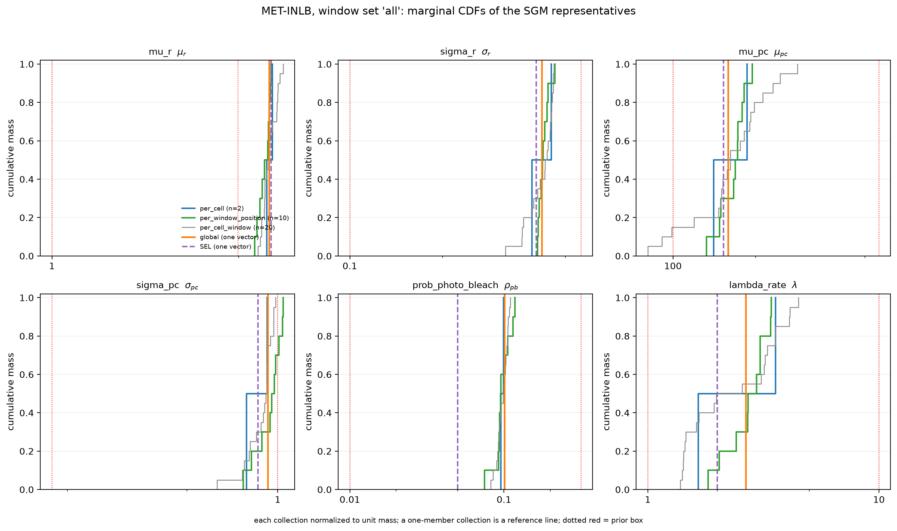
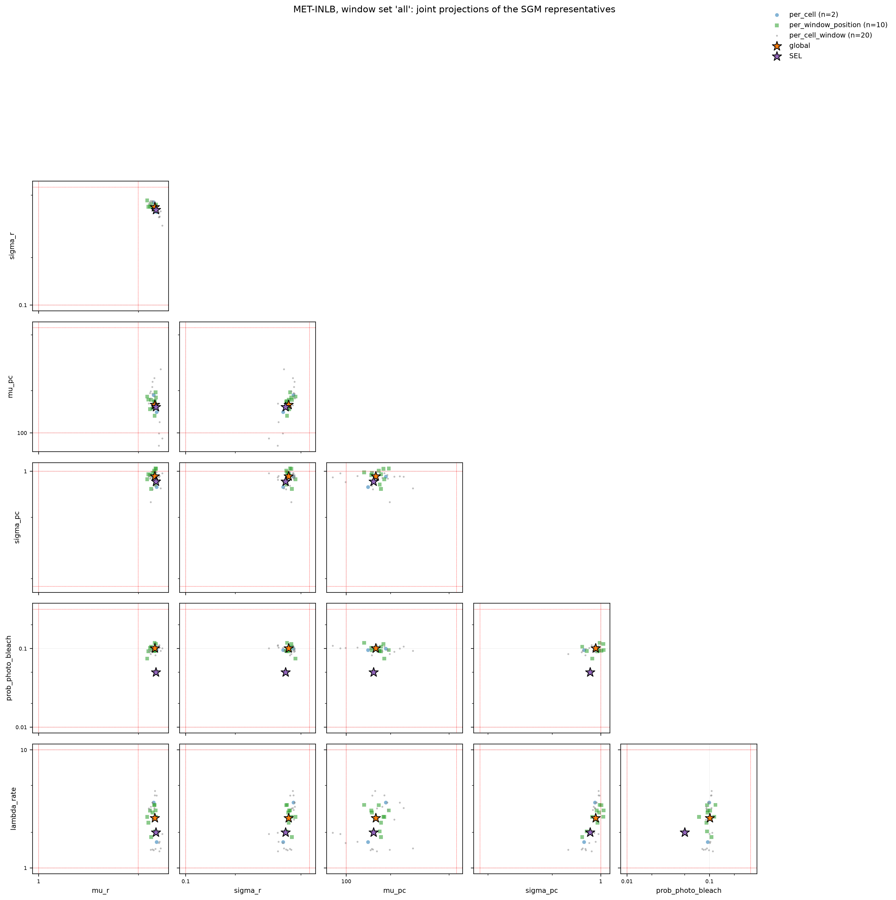
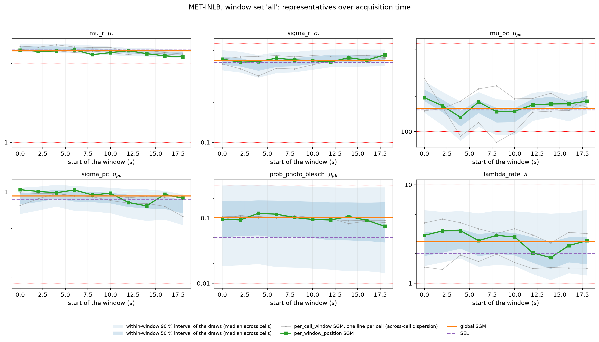
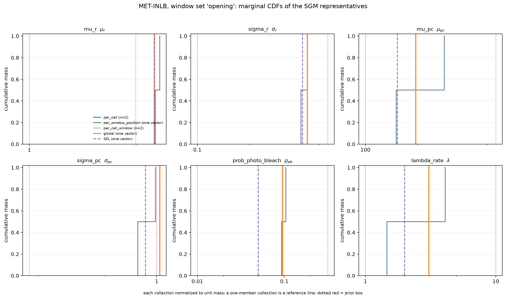
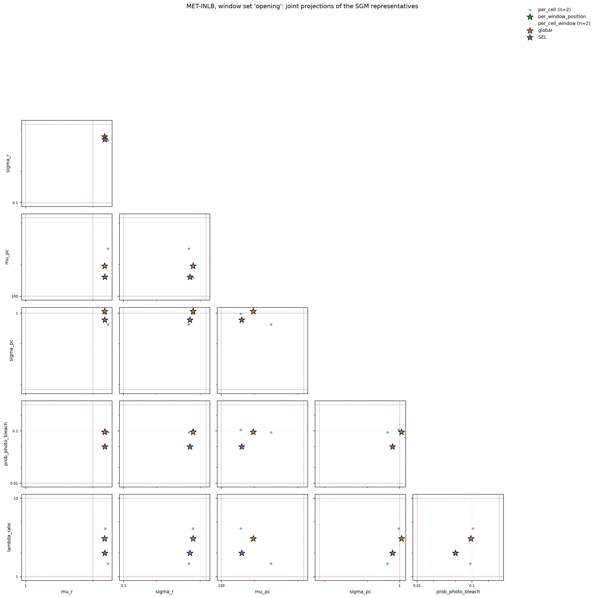
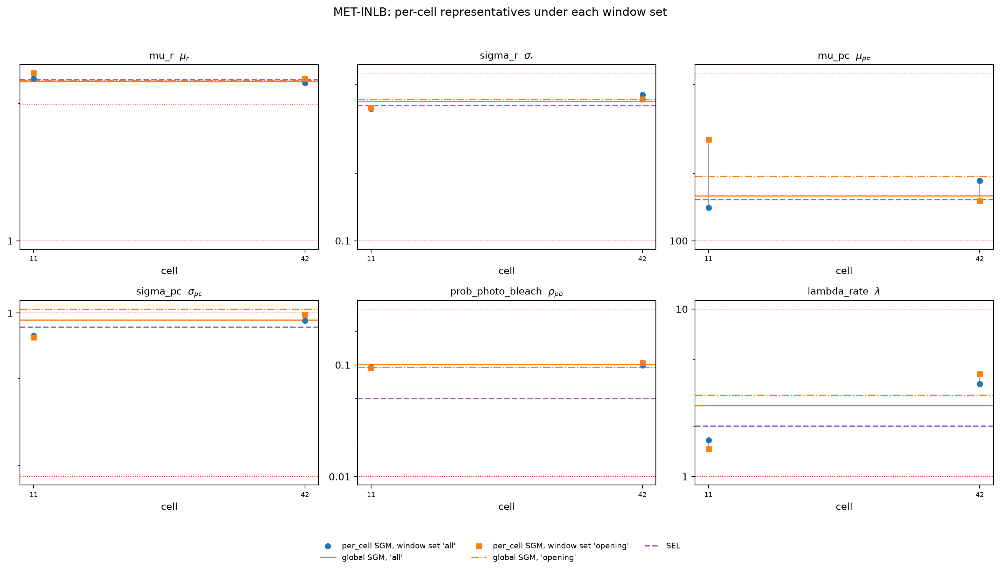

# Experiment diagnostics - SRM_AND_SBI_MONOMER_DIMER_ALP_DETECTOR_INLB_2S_50FPS_C128V42AP3LR32
Run: 2026-11-05 13:09:40 UTC
Note: Review copy (PILOT2CELLS) regenerated on the CPU from the saved product SRM_AND_SBI_MONOMER_DIMER_ALP_DETECTOR_INLB_2S_50FPS_C128V42AP3LR32_MAP_Experiment.npz; no estimation was repeated. Adopted report: /media/mars-fias/MARS_Data_Reserve_0/MARS_Data_Bank/Projects/RCL_Agent_Projects/srm-and-sbi-monomer-dimer-alp/Data_Bank/Posit/SRM_AND_SBI_MONOMER_DIMER_ALP_DETECTOR_INLB_2S_50FPS_C128V42AP3LR32_MAP_Experiment/report.md.

## Checks - 6 passed, 0 failed

| check | result | detail |
|---|---|---|
| estimates_nonempty | PASS | 600 windows estimated over experimental recordings |
| three_point_estimates_present | PASS | map_estimate, posterior_quantiles (median at level 0.50) and posterior_sgm stored for every window |
| aggregation_coverage_complete | PASS | INLB: 2 cells x 10 positions |
| aggregation_equal_window_weights | PASS | 10000 retained draws in every window, so concatenation realizes equal window and cell weights |
| aggregation_contract_matches_product | PASS | checkpoint 178e7dd91b41…, 6 keys, scale [0.3, 0.75, 0.75, 0.75, 1.5, 1.0], unrestricted, 10000 draws, geometry {'n_frames': 100, 'span_frames': 1000, 'step_frames': 100} |
| aggregation_sgm_members | PASS | 39 groups; every SGM is the retained draw its source identity names |

## Quantitative

| metric | value | expected | meaning |
|---|---|---|---|
| regenerated_from | /media/mars-fias/MARS_Data_Reserve_0/MARS_Data_Bank/Projects/RCL_Agent_Projects/srm-and-sbi-monomer-dimer-alp/Data_Bank/Posit/SRM_AND_SBI_MONOMER_DIMER_ALP_DETECTOR_INLB_2S_50FPS_C128V42AP3LR32_MAP_Experiment/SRM_AND_SBI_MONOMER_DIMER_ALP_DETECTOR_INLB_2S_50FPS_C128V42AP3LR32_MAP_Experiment.npz | - | the saved Experiment product re-rendered; its arrays are not modified. |
| conditions | 1 | - | - |
| total_estimates | 600 | - | number of (cell, chunk) windows estimated across all conditions. |
| aggregation | pooled | - | report distribution view: pooled over (cell x chunk). |
| artifact_schema | v2 / estimate definitions v2 | - | the stored computation contract; the manifest inside the .npz records the optimizer settings, draw count, quantile levels, SGM scaling, code and checkpoint identity this product was made under. |
| summary_draws | 10000 | - | flow-draws per window that the median and the SGM summarize (pool mode unrestricted). |
| n[MET-INLB] | 600 | - | estimates for condition MET-INLB (stored as 'INLB'). |
| estimator_condition | MET-INLB | - | the condition the estimator was trained for; its parameter table (6 learnable rows) is the table of every value in this report. |
| mean_log_prob | 12.5 | - | mean log-density at the returned MAP candidate (optimization diagnostic; not a calibration/quality metric). |

## Point estimates: definitions

| key | stored field | definition |
|---|---|---|
| MAP | map_estimate | numerical MAP candidate: the highest-scoring point retained by the configured gradient-ascent optimizer of the flow's log-density, initialized from the top-scoring candidate draws and stepping each coordinate in units of its interquartile range over all the candidate draws, in estimator coordinates (log10 for a log row, the value itself for a linear row). The optimization is unconstrained: prior support and convergence to a mode are not guaranteed, so a value outside the prior box is a flow optimum, not a MAP of the prior-supported posterior. |
| median | posterior_quantiles (the quantile at level 0.50, index 2) | marginal median of draws: the 0.50 quantile of each coordinate (linear interpolation between order statistics), taken independently per coordinate over the observation's flow-draws, in estimator coordinates (log10 for a log row, the value itself for a linear row). A coordinate-wise composite: the resulting vector is not necessarily a sampled vector and need not be a probable point of the joint. A physical value is the transform of this quantile. |
| SGM | posterior_sgm | SGM of draws: the sample geometric median: the complete draw minimizing the summed Euclidean distance to all other draws (an exact sample medoid) over the same flow-draws, each coordinate divided by its prior width before the distance is taken, in estimator coordinates (log10 for a log row, the value itself for a linear row). A realized draw, so its coordinates co-occurred; selecting a member avoids a coordinate-wise composite but does not by itself preserve the distribution's correlations. Distinct from an SGM of MAP vectors, from a pooled SGM of per-window SGMs, and from an SGM in physical coordinates -- each of those names its own population and scaling where it is reported. |

*one row per point estimate (evaluation.POINT_ESTIMATES); every table and figure below uses these three tokens. The three are read together; no one replaces the others.*

## MAP theta by condition (estimator coordinates)

| parameter | label | units | kind | n | median (estimator) | IQR (estimator) | median value | outside prior |
|---|---|---|---|---|---|---|---|---|
| mu_r | $\mu_{r}$ | log10 | MET-INLB | 600 | +0.353 | 0.026 | 2.256 | 94% |
| sigma_r | $\sigma_{r}$ | log10 | MET-INLB | 600 | -0.396 | 0.052 | 0.4015 | 0% |
| mu_pc | $\mu_{pc}$ | log10 | MET-INLB | 600 | +2.193 | 0.276 | 156 | 18% |
| sigma_pc | $\sigma_{pc}$ | log10 | MET-INLB | 600 | -0.084 | 0.123 | 0.8238 | 5% |
| prob_photo_bleach | $\rho_{pb}$ | log10 | MET-INLB | 600 | -0.922 | 0.086 | 0.1196 | 0% |
| lambda_rate | $\lambda$ | log10 | MET-INLB | 600 | +0.426 | 0.344 | 2.664 | 0% |

*no ground truth for experimental recordings; values are the distribution of the MAP estimate per condition (pooled over (cell x chunk)), in the row's estimator coordinate ('units': log10 for a log row, the fraction itself for a linear row). 'outside prior' is the share beyond the row's prior box. The gradient ascent is unconstrained, so an outside-prior value happens under either pool mode -- --pool-mode bounds the candidate pool, not the optimizer's steps -- and is a flow optimum rather than a MAP of the prior-supported posterior. The three tables are read together.*

## median theta by condition (estimator coordinates)

| parameter | label | units | kind | n | median (estimator) | IQR (estimator) | median value | outside prior |
|---|---|---|---|---|---|---|---|---|
| mu_r | $\mu_{r}$ | log10 | MET-INLB | 600 | +0.353 | 0.028 | 2.256 | 94% |
| sigma_r | $\sigma_{r}$ | log10 | MET-INLB | 600 | -0.395 | 0.053 | 0.4029 | 0% |
| mu_pc | $\mu_{pc}$ | log10 | MET-INLB | 600 | +2.184 | 0.289 | 152.9 | 19% |
| sigma_pc | $\sigma_{pc}$ | log10 | MET-INLB | 600 | -0.066 | 0.096 | 0.8588 | 6% |
| prob_photo_bleach | $\rho_{pb}$ | log10 | MET-INLB | 600 | -1.001 | 0.066 | 0.09986 | 0% |
| lambda_rate | $\lambda$ | log10 | MET-INLB | 600 | +0.359 | 0.358 | 2.283 | 0% |

*no ground truth for experimental recordings; values are the distribution of the median estimate per condition (pooled over (cell x chunk)), in the row's estimator coordinate ('units': log10 for a log row, the fraction itself for a linear row). 'outside prior' is the share beyond the row's prior box. The three tables are read together.*

## SGM theta by condition (estimator coordinates)

| parameter | label | units | kind | n | median (estimator) | IQR (estimator) | median value | outside prior |
|---|---|---|---|---|---|---|---|---|
| mu_r | $\mu_{r}$ | log10 | MET-INLB | 600 | +0.353 | 0.025 | 2.253 | 94% |
| sigma_r | $\sigma_{r}$ | log10 | MET-INLB | 600 | -0.395 | 0.053 | 0.403 | 0% |
| mu_pc | $\mu_{pc}$ | log10 | MET-INLB | 600 | +2.171 | 0.286 | 148.1 | 20% |
| sigma_pc | $\sigma_{pc}$ | log10 | MET-INLB | 600 | -0.067 | 0.099 | 0.857 | 6% |
| prob_photo_bleach | $\rho_{pb}$ | log10 | MET-INLB | 600 | -1.023 | 0.067 | 0.09474 | 0% |
| lambda_rate | $\lambda$ | log10 | MET-INLB | 600 | +0.376 | 0.355 | 2.376 | 0% |

*no ground truth for experimental recordings; values are the distribution of the SGM estimate per condition (pooled over (cell x chunk)), in the row's estimator coordinate ('units': log10 for a log row, the fraction itself for a linear row). 'outside prior' is the share beyond the row's prior box. The three tables are read together.*

## Point estimates compared (per parameter, estimator coordinates)

| parameter | label | units | kind | n | median MAP | median median | median SGM | IQR MAP | IQR median | IQR SGM | outside prior MAP | outside prior median | outside prior SGM |
|---|---|---|---|---|---|---|---|---|---|---|---|---|---|
| mu_r | $\mu_{r}$ | log10 | MET-INLB | 600 | +0.353 | +0.353 | +0.353 | 0.026 | 0.028 | 0.025 | 94% | 94% | 94% |
| sigma_r | $\sigma_{r}$ | log10 | MET-INLB | 600 | -0.396 | -0.395 | -0.395 | 0.052 | 0.053 | 0.053 | 0% | 0% | 0% |
| mu_pc | $\mu_{pc}$ | log10 | MET-INLB | 600 | +2.193 | +2.184 | +2.171 | 0.276 | 0.289 | 0.286 | 18% | 19% | 20% |
| sigma_pc | $\sigma_{pc}$ | log10 | MET-INLB | 600 | -0.084 | -0.066 | -0.067 | 0.123 | 0.096 | 0.099 | 5% | 6% | 6% |
| prob_photo_bleach | $\rho_{pb}$ | log10 | MET-INLB | 600 | -0.922 | -1.001 | -1.023 | 0.086 | 0.066 | 0.067 | 0% | 0% | 0% |
| lambda_rate | $\lambda$ | log10 | MET-INLB | 600 | +0.426 | +0.359 | +0.376 | 0.344 | 0.358 | 0.355 | 0% | 0% | 0% |

*the three point estimates on the same windows (pooled over (cell x chunk)), columns grouped by statistic with the estimates consecutive: the median over windows, the IQR over windows (both in the row's estimator coordinate) and the share outside the prior box, each for MAP, median and SGM (definitions above). A statement about a parameter is read from the row as a whole, never from one column.*

## Point-estimate agreement (per parameter, estimator coordinates)

| parameter | label | units | kind | n | MAP vs median | MAP vs SGM | SGM vs median | MAP outside 90% |
|---|---|---|---|---|---|---|---|---|
| mu_r | $\mu_{r}$ | dex | MET-INLB | 600 | 0.001 | 0.002 | 0.002 | 0% |
| sigma_r | $\sigma_{r}$ | dex | MET-INLB | 600 | 0.001 | 0.006 | 0.006 | 0% |
| mu_pc | $\mu_{pc}$ | dex | MET-INLB | 600 | 0.008 | 0.017 | 0.009 | 0% |
| sigma_pc | $\sigma_{pc}$ | dex | MET-INLB | 600 | 0.016 | 0.016 | 0.005 | 0% |
| prob_photo_bleach | $\rho_{pb}$ | dex | MET-INLB | 600 | 0.083 | 0.102 | 0.020 | 0% |
| lambda_rate | $\lambda$ | dex | MET-INLB | 600 | 0.042 | 0.033 | 0.013 | 0% |

*each 'X vs Y' column is the median over windows of the absolute difference between the two point estimates, in the row's unit (dex for a log row, percentage points for a linear row). 'MAP outside 90%' is the share of windows whose MAP falls outside the central 90% interval of the draws. Large gaps with a high outside share establish that the optimized candidate and the draw summaries disagree; the cause is not decided by this table and needs separate checks.*

## Within-recording drift across windows (per point estimate, stored coordinates)

| condition | parameter | estimate | cells | change first->last (median) | IQR across cells | sign consistency | cells over 0.3 dex | signed-rank p |
|---|---|---|---|---|---|---|---|---|
| MET-INLB | mu_r | MAP | 60 | -0.019 dex | 0.026 | 78% | 2% | 7.5e-05 |
| MET-INLB | mu_r | posterior median | 60 | -0.021 dex | 0.028 | 78% | 2% | 6.4e-05 |
| MET-INLB | mu_r | SGM | 60 | -0.020 dex | 0.029 | 77% | 2% | 5.8e-05 |
| MET-INLB | sigma_r | MAP | 60 | +0.011 dex | 0.086 | 58% | 2% | 1.6e-01 |
| MET-INLB | sigma_r | posterior median | 60 | +0.011 dex | 0.086 | 57% | 2% | 1.9e-01 |
| MET-INLB | sigma_r | SGM | 60 | +0.012 dex | 0.092 | 57% | 2% | 1.7e-01 |
| MET-INLB | mu_pc | MAP | 60 | -0.196 dex | 0.407 | 68% | 35% | 3.2e-05 |
| MET-INLB | mu_pc | posterior median | 60 | -0.198 dex | 0.432 | 70% | 37% | 1.2e-05 |
| MET-INLB | mu_pc | SGM | 60 | -0.203 dex | 0.421 | 70% | 38% | 8.4e-06 |
| MET-INLB | sigma_pc | MAP | 60 | -0.001 dex | 0.205 | 52% | 13% | 1.6e-01 |
| MET-INLB | sigma_pc | posterior median | 60 | +0.018 dex | 0.179 | 58% | 12% | 2.0e-02 |
| MET-INLB | sigma_pc | SGM | 60 | +0.011 dex | 0.176 | 60% | 13% | 2.9e-02 |
| MET-INLB | prob_photo_bleach | MAP | 60 | +0.055 dex | 0.070 | 80% | 8% | 3.1e-03 |
| MET-INLB | prob_photo_bleach | posterior median | 60 | -0.008 dex | 0.089 | 62% | 0% | 3.4e-01 |
| MET-INLB | prob_photo_bleach | SGM | 60 | -0.016 dex | 0.095 | 60% | 0% | 3.0e-01 |
| MET-INLB | lambda_rate | MAP | 60 | +0.113 dex | 0.283 | 67% | 15% | 2.1e-04 |
| MET-INLB | lambda_rate | posterior median | 60 | +0.089 dex | 0.235 | 62% | 13% | 1.5e-03 |
| MET-INLB | lambda_rate | SGM | 60 | +0.091 dex | 0.238 | 65% | 13% | 5.0e-04 |

*per recording, a line is fitted to each estimate against the window index and the fitted first-to-last change is taken; the row aggregates those changes across recordings. One row per point estimate (MAP, posterior median, SGM), read together: the three come from the same draws, so a difference between them describes the shape of the density along the recording. The change is in dex for a log row and in percentage points ('pp', an absolute difference of a fraction) for a linear row; 'cells over 0.3 dex' is the share whose change exceeds a factor of two and exists for log rows only ('n/a' for a linear row, which has no multiplicative tolerance). The signed-rank p states detectability, not magnitude, and no row attributes a cause: the block not inferred is marginalized here, so an imaging trend and a biological one are not separable in this stage alone.*

## Experimental aggregation and nuisance candidates

Collections of representative parameter vectors obtained by grouping the retained window posteriors (the summary draws of the per-window estimates above) in explicitly defined ways: the four constructions of the canonical table below, each for every requested window set. These are descriptive mixtures of window posteriors, not a posterior conditioned on a whole recording and not products of posteriors; the aggregation performs no neural inference on an input longer than one window and optimizes no MAP. The collections are candidates for the Nuisance DLI selection (the analysis `SRM_AND_SBI_MONOMER_DIMER_ALP_DETECTOR_Nuisance_DLI.py` reads the archive below); no construction, window set, statistic or mixture is selected here.

**Coverage.** MET-INLB: 2 of 60 cells of this product (cells [11, 42]), 20 of 600 windows, positions [0, 1, 2, 3, 4, 5, 6, 7, 8, 9], 10000 retained draws per window. This is a pilot subset, not the complete condition: MET-INLB 2 of 60 cells (cells [11, 42]), 20 of 600 windows. The original MAP and summary references above come from the adopted product; the aggregation summaries come from the retained collections named below, fresh draws of the same estimator that do not reconstruct the original sampling attempt.

**Window sets.** all = chunks [0, 1, 2, 3, 4, 5, 6, 7, 8, 9]; opening = chunks [0]. `all` is every position present in every included cell; `opening` is the first window.

**Retained clouds.** `SRM_AND_SBI_MONOMER_DIMER_ALP_DETECTOR_INLB_2S_50FPS_C128V42AP3LR32_Window_Posterior_Draws.npz`, sha256 235fcd2a3310…; `SRM_AND_SBI_MONOMER_DIMER_ALP_DETECTOR_INLB_2S_50FPS_C128V42AP3LR32_Window_Posterior_Draws_CELL42.npz` (collection label CELL42), sha256 7b7f030d3e55…. Retained draw collections (fresh clouds of the adopted estimator, collected after the Experiment run). Disclosed differences between the sources (not part of the computation contract): collection_label = [None, 'CELL42'], written_at = ['2026-11-03 15:20:35 UTC', '2026-11-03 17:17:05 UTC'].

**Methods.** Distances in estimator coordinates divided by the prior widths [0.3, 0.75, 0.75, 0.75, 1.5, 1.0] (the per-window SGM convention). A single-window group reuses the window's stored exact sample medoid; a pooled group above 10000 rows takes the collection kernel's Weiszfeld geometric median snapped to the nearest retained draw (`weiszfeld_snap`, an approximation to the exact medoid, recorded per group). Pooled marginal quantiles are mixture quantiles of the pooled draws in estimator coordinates (the stage's interpolation), endpoints transformed to physical units; representative-distribution quantiles (median, IQR, central 90 % range over a collection's representatives) use the inverse weighted empirical CDF and are empirical dispersion, not credible or confidence intervals. Unrestricted draws stay unrestricted: outside-prior mass is counted, never clipped. SGM is the default candidate statistic; the marginal-median vector of each group is stored beside it, labeled as a coordinate-wise composite. Aggregation took 0.9 s on the CPU.

**Reference.** SEL: mu_r 2.256, sigma_r 0.4029, mu_pc 152.9, sigma_pc 0.8588, prob_photo_bleach 0.05, lambda_rate 2 (physical), loaded from /media/mars-fias/MARS_Data_Reserve_0/MARS_Data_Bank/Projects/RCL_Agent_Projects/srm-and-sbi-monomer-dimer-alp/Data_Bank/Posit/SRM_AND_SBI_MONOMER_DIMER_ALP_DETECTOR_INLB_2S_50FPS_SEL_Nuisance_DLI.npz; a historical fixed scenario for comparison, neither reconstructed from the draws nor mixed into any collection.

**Supporting files (this directory).** `aggregation_candidates.npz` (every group's SGM and median vectors, mixture quantiles, identities, methods, contract and sources), `aggregation_groups.csv`, `aggregation_comparison.csv`, `aggregation_manifest.json`. Figures: `figures/aggregation_INLB_all_marginals.png`, `figures/aggregation_INLB_all_joint.png`, `figures/aggregation_INLB_opening_marginals.png`, `figures/aggregation_INLB_opening_joint.png`, `figures/aggregation_INLB_all_temporal.png`, `figures/aggregation_INLB_window_selection.png` (captions at the end of the report).

Reading rules: an acknowledged training-bound extrapolation stays visible in the outside-prior columns (the InlB PSF width lies above its prior ceiling); pairwise correlations in the joint figures are descriptive, not selection constraints; nothing here declares a winner, and membership of a reference inside intervals computed from the same draws is a compatibility diagnostic, not a validation.

## Experimental aggregation and nuisance candidates: constructions

| ID | construction | calculation | representatives per window set | interpretation |
|---|---|---|---|---|
| `reference` (SEL) | Historical fixed scenario | assembled from documented sources (its decision record); not an SGM of draws | 1 | one fixed scenario; comparison only |
| `per_cell` | One representative per cell | pool all retained draws of the cell's selected windows, equal weight per window, and select the SGM | all: 2 (MET-INLB); opening: 2 (MET-INLB) | variation between cell representatives over the declared acquisition period |
| `per_window_position` | One representative per window position | at each selected position, pool the retained draws across the included cells, equal weight per cell, and select the SGM | all: 10 (MET-INLB); opening: 1 (MET-INLB) | variation between acquisition-period representatives, cell differences compressed at each position |
| `global` | One representative of the selected collection | pool the retained draws with equal cell weight and equal selected-window weight within each cell, and select the SGM | all: 1 (MET-INLB); opening: 1 (MET-INLB) | an overall joint center of the selected collection |
| `per_cell_window` | One representative per cell-window pair | the SGM of each included cell-window posterior | all: 20 (MET-INLB); opening: 2 (MET-INLB) | variation between window representatives, cell and window identities retained |

*the canonical options; counts are per condition. An SGM of window SGMs is not an active construction; no aggregate MAP exists.*

## Experimental aggregation and nuisance candidates: equivalent groups

| group | equals | condition | cell | position |
|---|---|---|---|---|
| per_cell[opening] | per_cell_window[opening] | MET-INLB | 11 |  |
| per_cell[opening] | per_cell_window[opening] | MET-INLB | 42 |  |
| global[opening] | per_window_position[opening] | MET-INLB |  |  |

*a single-window set makes per_cell equal per_cell_window and per_window_position equal global; a single cell makes per_window_position equal per_cell_window and global equal per_cell; the computed group is reused.*

## Experimental aggregation and nuisance candidates [MET-INLB, window set all]: SGM representatives (physical units)

| construction | parameter | n | median | IQR (q25 – q75) | central 90 % range | median vs reference | outside-prior mass |
|---|---|---|---|---|---|---|---|
| per_cell | mu_r | 2 | 2.222 | 2.222 – 2.268 | 2.222 – 2.268 | -1.5 % (-0.007 dex) | 100.0 % |
| per_cell | sigma_r | 2 | 0.3898 | 0.3898 – 0.4502 | 0.3898 – 0.4502 | -3.3 % (-0.014 dex) | 0.0 % |
| per_cell | mu_pc | 2 | 140.7 | 140.7 – 185.9 | 140.7 – 185.9 | -8.0 % (-0.036 dex) | 0.0 % |
| per_cell | sigma_pc | 2 | 0.7885 | 0.7885 – 0.9215 | 0.7885 – 0.9215 | -8.2 % (-0.037 dex) | 0.0 % |
| per_cell | prob_photo_bleach | 2 | 0.09538 | 0.09538 – 0.09943 | 0.09538 – 0.09943 | +90.8 % (+0.280 dex) | 0.0 % |
| per_cell | lambda_rate | 2 | 1.654 | 1.654 – 3.577 | 1.654 – 3.577 | -17.3 % (-0.083 dex) | 0.0 % |
| per_window_position | mu_r | 10 | 2.203 | 2.164 – 2.241 | 2.123 – 2.257 | -2.3 % (-0.010 dex) | 100.0 % |
| per_window_position | sigma_r | 10 | 0.4211 | 0.4111 – 0.4363 | 0.4065 – 0.4625 | +4.5 % (+0.019 dex) | 0.0 % |
| per_window_position | mu_pc | 10 | 168.8 | 149.3 – 178.8 | 132.4 – 194.8 | +10.4 % (+0.043 dex) | 0.0 % |
| per_window_position | sigma_pc | 10 | 0.9555 | 0.8865 – 1.008 | 0.7678 – 1.042 | +11.3 % (+0.046 dex) | 30.0 % |
| per_window_position | prob_photo_bleach | 10 | 0.09483 | 0.0933 – 0.1057 | 0.07463 – 0.118 | +89.7 % (+0.278 dex) | 0.0 % |
| per_window_position | lambda_rate | 10 | 2.712 | 2.416 – 3.068 | 1.823 – 3.418 | +35.6 % (+0.132 dex) | 0.0 % |
| global | mu_r | 1 | 2.238 | 2.238 – 2.238 | 2.238 – 2.238 | -0.8 % (-0.003 dex) | 100.0 % |
| global | sigma_r | 1 | 0.4198 | 0.4198 – 0.4198 | 0.4198 – 0.4198 | +4.2 % (+0.018 dex) | 0.0 % |
| global | mu_pc | 1 | 158.9 | 158.9 – 158.9 | 158.9 – 158.9 | +3.9 % (+0.017 dex) | 0.0 % |
| global | sigma_pc | 1 | 0.9279 | 0.9279 – 0.9279 | 0.9279 – 0.9279 | +8.1 % (+0.034 dex) | 0.0 % |
| global | prob_photo_bleach | 1 | 0.1009 | 0.1009 – 0.1009 | 0.1009 – 0.1009 | +101.9 % (+0.305 dex) | 0.0 % |
| global | lambda_rate | 1 | 2.651 | 2.651 – 2.651 | 2.651 – 2.651 | +32.6 % (+0.122 dex) | 0.0 % |
| per_cell_window | mu_r | 20 | 2.233 | 2.2 – 2.303 | 2.148 – 2.333 | -1.0 % (-0.004 dex) | 100.0 % |
| per_cell_window | sigma_r | 20 | 0.43 | 0.3883 – 0.4506 | 0.3196 – 0.4571 | +6.7 % (+0.028 dex) | 0.0 % |
| per_cell_window | mu_pc | 20 | 161.7 | 146.5 – 192.1 | 80.97 – 245.8 | +5.7 % (+0.024 dex) | 15.0 % |
| per_cell_window | sigma_pc | 20 | 0.9121 | 0.8091 – 0.93 | 0.629 – 0.9705 | +6.2 % (+0.026 dex) | 0.0 % |
| per_cell_window | prob_photo_bleach | 20 | 0.09878 | 0.09183 – 0.1043 | 0.08191 – 0.1083 | +97.6 % (+0.296 dex) | 0.0 % |
| per_cell_window | lambda_rate | 20 | 1.982 | 1.447 – 3.293 | 1.381 – 4.115 | -0.9 % (-0.004 dex) | 0.0 % |

*window set all = chunks [0, 1, 2, 3, 4, 5, 6, 7, 8, 9]; quantiles over the collection's representatives by the inverse weighted empirical CDF (empirical dispersion across representatives, not posterior credible intervals); for one representative every column is that vector. 'outside-prior mass' is the share of representatives beyond the row's prior box.*

## Experimental aggregation and nuisance candidates [MET-INLB, window set all]: global representative and reference (physical units)

| parameter | global SGM (a draw) | global median vector (composite) | pooled 90 % interval | reference | global SGM vs reference | pooled draws outside prior |
|---|---|---|---|---|---|---|
| mu_r | 2.238 | 2.242 | 2.132 – 2.378 | 2.256 | -0.8 % | 100.0 % |
| sigma_r | 0.4198 | 0.4268 | 0.3171 – 0.5127 | 0.4029 | +4.2 % | 0.7 % |
| mu_pc | 158.9 | 171.9 | 76.64 – 266 | 152.9 | +3.9 % | 11.7 % |
| sigma_pc | 0.9279 | 0.8924 | 0.603 – 1.098 | 0.8588 | +8.1 % | 22.4 % |
| prob_photo_bleach | 0.1009 | 0.1023 | 0.01676 – 0.3062 | 0.05 | +101.9 % | 5.3 % |
| lambda_rate | 2.651 | 2.532 | 0.9394 – 6.28 | 2 | +32.6 % | 7.1 % |

*the global SGM is retained draw cell 42, chunk 6, index 917 (weiszfeld_snap; 200000 pooled draws); the pooled 90 % interval is a mixture quantile of the pooled draws, a different quantity from the dispersion of representatives.*

## Experimental aggregation and nuisance candidates [MET-INLB, window set opening]: SGM representatives (physical units)

| construction | parameter | n | median | IQR (q25 – q75) | central 90 % range | median vs reference | outside-prior mass |
|---|---|---|---|---|---|---|---|
| per_cell | mu_r | 2 | 2.268 | 2.268 – 2.333 | 2.268 – 2.333 | +0.5 % (+0.002 dex) | 100.0 % |
| per_cell | sigma_r | 2 | 0.3943 | 0.3943 – 0.43 | 0.3943 – 0.43 | -2.1 % (-0.009 dex) | 0.0 % |
| per_cell | mu_pc | 2 | 150.4 | 150.4 – 284.3 | 150.4 – 284.3 | -1.6 % (-0.007 dex) | 0.0 % |
| per_cell | sigma_pc | 2 | 0.7731 | 0.7731 – 0.9832 | 0.7731 – 0.9832 | -10.0 % (-0.046 dex) | 0.0 % |
| per_cell | prob_photo_bleach | 2 | 0.0932 | 0.0932 – 0.1043 | 0.0932 – 0.1043 | +86.4 % (+0.270 dex) | 0.0 % |
| per_cell | lambda_rate | 2 | 1.461 | 1.461 – 4.099 | 1.461 – 4.099 | -27.0 % (-0.136 dex) | 0.0 % |
| per_window_position | mu_r | 1 | 2.251 | 2.251 – 2.251 | 2.251 – 2.251 | -0.2 % (-0.001 dex) | 100.0 % |
| per_window_position | sigma_r | 1 | 0.4292 | 0.4292 – 0.4292 | 0.4292 – 0.4292 | +6.5 % (+0.027 dex) | 0.0 % |
| per_window_position | mu_pc | 1 | 194.8 | 194.8 – 194.8 | 194.8 – 194.8 | +27.4 % (+0.105 dex) | 0.0 % |
| per_window_position | sigma_pc | 1 | 1.042 | 1.042 – 1.042 | 1.042 – 1.042 | +21.3 % (+0.084 dex) | 100.0 % |
| per_window_position | prob_photo_bleach | 1 | 0.0956 | 0.0956 – 0.0956 | 0.0956 – 0.0956 | +91.2 % (+0.281 dex) | 0.0 % |
| per_window_position | lambda_rate | 1 | 3.068 | 3.068 – 3.068 | 3.068 – 3.068 | +53.4 % (+0.186 dex) | 0.0 % |
| global | mu_r | 1 | 2.251 | 2.251 – 2.251 | 2.251 – 2.251 | -0.2 % (-0.001 dex) | 100.0 % |
| global | sigma_r | 1 | 0.4292 | 0.4292 – 0.4292 | 0.4292 – 0.4292 | +6.5 % (+0.027 dex) | 0.0 % |
| global | mu_pc | 1 | 194.8 | 194.8 – 194.8 | 194.8 – 194.8 | +27.4 % (+0.105 dex) | 0.0 % |
| global | sigma_pc | 1 | 1.042 | 1.042 – 1.042 | 1.042 – 1.042 | +21.3 % (+0.084 dex) | 100.0 % |
| global | prob_photo_bleach | 1 | 0.0956 | 0.0956 – 0.0956 | 0.0956 – 0.0956 | +91.2 % (+0.281 dex) | 0.0 % |
| global | lambda_rate | 1 | 3.068 | 3.068 – 3.068 | 3.068 – 3.068 | +53.4 % (+0.186 dex) | 0.0 % |
| per_cell_window | mu_r | 2 | 2.268 | 2.268 – 2.333 | 2.268 – 2.333 | +0.5 % (+0.002 dex) | 100.0 % |
| per_cell_window | sigma_r | 2 | 0.3943 | 0.3943 – 0.43 | 0.3943 – 0.43 | -2.1 % (-0.009 dex) | 0.0 % |
| per_cell_window | mu_pc | 2 | 150.4 | 150.4 – 284.3 | 150.4 – 284.3 | -1.6 % (-0.007 dex) | 0.0 % |
| per_cell_window | sigma_pc | 2 | 0.7731 | 0.7731 – 0.9832 | 0.7731 – 0.9832 | -10.0 % (-0.046 dex) | 0.0 % |
| per_cell_window | prob_photo_bleach | 2 | 0.0932 | 0.0932 – 0.1043 | 0.0932 – 0.1043 | +86.4 % (+0.270 dex) | 0.0 % |
| per_cell_window | lambda_rate | 2 | 1.461 | 1.461 – 4.099 | 1.461 – 4.099 | -27.0 % (-0.136 dex) | 0.0 % |

*window set opening = chunks [0]; quantiles over the collection's representatives by the inverse weighted empirical CDF (empirical dispersion across representatives, not posterior credible intervals); for one representative every column is that vector. 'outside-prior mass' is the share of representatives beyond the row's prior box.*

## Experimental aggregation and nuisance candidates [MET-INLB, window set opening]: global representative and reference (physical units)

| parameter | global SGM (a draw) | global median vector (composite) | pooled 90 % interval | reference | global SGM vs reference | pooled draws outside prior |
|---|---|---|---|---|---|---|
| mu_r | 2.251 | 2.297 | 2.208 – 2.39 | 2.256 | -0.2 % | 100.0 % |
| sigma_r | 0.4292 | 0.4188 | 0.3492 – 0.5061 | 0.4029 | +6.5 % | 0.7 % |
| mu_pc | 194.8 | 199 | 112.4 – 344.9 | 152.9 | +27.4 % | 2.1 % |
| sigma_pc | 1.042 | 0.9113 | 0.5846 – 1.105 | 0.8588 | +21.3 % | 27.0 % |
| prob_photo_bleach | 0.0956 | 0.1039 | 0.01833 – 0.315 | 0.05 | +91.2 % | 5.5 % |
| lambda_rate | 3.068 | 3.102 | 0.8718 – 6.319 | 2 | +53.4 % | 10.5 % |

*the global SGM is retained draw cell 42, chunk 0, index 4983 (weiszfeld_snap; 20000 pooled draws); the pooled 90 % interval is a mixture quantile of the pooled draws, a different quantity from the dispersion of representatives.*

## Experimental aggregation and nuisance candidates [MET-INLB, window set all]: source uncertainty against representative dispersion (physical units)

| parameter | within-window 90 % width (median over windows) | per-cell pooled 90 % width (median over cells) | global pooled 90 % interval | central 90 % range of per_cell SGMs | central 90 % range of per_cell_window SGMs |
|---|---|---|---|---|---|
| mu_r | 0.1628 | 0.2177 | 2.132 – 2.378 | 2.222 – 2.268 (n=2) | 2.148 – 2.333 (n=20) |
| sigma_r | 0.139 | 0.1604 | 0.3171 – 0.5127 | 0.3898 – 0.4502 (n=2) | 0.3196 – 0.4571 (n=20) |
| mu_pc | 89.77 | 173.5 | 76.64 – 266 | 140.7 – 185.9 (n=2) | 80.97 – 245.8 (n=20) |
| sigma_pc | 0.4216 | 0.4731 | 0.603 – 1.098 | 0.7885 – 0.9215 (n=2) | 0.629 – 0.9705 (n=20) |
| prob_photo_bleach | 0.2927 | 0.2886 | 0.01676 – 0.3062 | 0.09538 – 0.09943 (n=2) | 0.08191 – 0.1083 (n=20) |
| lambda_rate | 3.847 | 4.178 | 0.9394 – 6.28 | 1.654 – 3.577 (n=2) | 1.381 – 4.115 (n=20) |

*the first three columns are intervals of input or pooled posteriors (retained posterior uncertainty; mixture quantiles for the pooled ones); the last two are the dispersion of selected representatives (compression). They are different quantities and are never read as calibrated uncertainty.*

## Experimental aggregation and nuisance candidates [MET-INLB]: SGM versus marginal-median vector of the per_cell groups (median / max |difference|, stored coordinates)

| window set | mu_r | sigma_r | mu_pc | sigma_pc | prob_photo_bleach | lambda_rate |
|---|---|---|---|---|---|---|
| all | 0.002 / 0.003 | 0.002 / 0.003 | 0.011 / 0.012 | 0.016 / 0.025 | 0.022 / 0.022 | 0.015 / 0.027 |
| opening | 0.002 / 0.003 | 0.007 / 0.011 | 0.004 / 0.006 | 0.008 / 0.014 | 0.022 / 0.033 | 0.011 / 0.016 |

*the marginal-median vector is a coordinate-wise composite whose coordinates need not have occurred together; it is stored beside the SGM and must be named explicitly by a selection that uses it.*

## What these mean

A check **PASS** means the invariant held; a **FAIL** aborts the run immediately with a located error message.

- **estimates_nonempty** -- at least one experimental window was estimated.
- **three_point_estimates_present** -- the product contract: no estimate is reported without the other two.
- **aggregation_coverage_complete** -- every included cell carries every requested window position; conditions are never pooled together.
- **aggregation_equal_window_weights** -- the equal weights of the mixtures are realized by equal draw counts.
- **aggregation_contract_matches_product** -- the retained clouds and this product share one computation contract.
- **aggregation_sgm_members** -- each group's SGM equals the retained draw (cell, chunk, draw index) it records; a median vector is never claimed as a draw.

## Figures

*Within-recording drift, condition MET-INLB: the MAP, posterior median and SGM as the median across recordings at each window, over the per-window central 50 % and 90 % intervals of the draws (median across recordings). Dotted red lines are the prior bounds. The three lines share one draw set, so the band is drawn once.*

*mu_r ($\mu_{r}$). Left: per-condition distribution of the MAP (pooled over (cell x chunk)). Right: each window's median +/- IQR of its draws per condition (within-window spread), the MAP overlaid. The SGM is tabulated above and its gap to the median is in the agreement table.*

*sigma_r ($\sigma_{r}$). Left: per-condition distribution of the MAP (pooled over (cell x chunk)). Right: each window's median +/- IQR of its draws per condition (within-window spread), the MAP overlaid. The SGM is tabulated above and its gap to the median is in the agreement table.*

*mu_pc ($\mu_{pc}$). Left: per-condition distribution of the MAP (pooled over (cell x chunk)). Right: each window's median +/- IQR of its draws per condition (within-window spread), the MAP overlaid. The SGM is tabulated above and its gap to the median is in the agreement table.*

*sigma_pc ($\sigma_{pc}$). Left: per-condition distribution of the MAP (pooled over (cell x chunk)). Right: each window's median +/- IQR of its draws per condition (within-window spread), the MAP overlaid. The SGM is tabulated above and its gap to the median is in the agreement table.*

*prob_photo_bleach ($\rho_{pb}$). Left: per-condition distribution of the MAP (pooled over (cell x chunk)). Right: each window's median +/- IQR of its draws per condition (within-window spread), the MAP overlaid. The SGM is tabulated above and its gap to the median is in the agreement table.*

*lambda_rate ($\lambda$). Left: per-condition distribution of the MAP (pooled over (cell x chunk)). Right: each window's median +/- IQR of its draws per condition (within-window spread), the MAP overlaid. The SGM is tabulated above and its gap to the median is in the agreement table.*

*mu_r ($\mu_{r}$), MET-INLB. The three point estimates per window, one panel each (MAP, median, SGM): recordings along the x axis ordered by their median value, one point per window, the recording's median of that estimate as the line, and the IQR of the draws (median over the recording's windows of the per-window Q25 and Q75) as the band, drawn once and identical on every panel. The estimate axis is clipped to the prior box widened by 40 %; values beyond it are counted in the tables, not drawn.*

*sigma_r ($\sigma_{r}$), MET-INLB. The three point estimates per window, one panel each (MAP, median, SGM): recordings along the x axis ordered by their median value, one point per window, the recording's median of that estimate as the line, and the IQR of the draws (median over the recording's windows of the per-window Q25 and Q75) as the band, drawn once and identical on every panel. The estimate axis is clipped to the prior box widened by 40 %; values beyond it are counted in the tables, not drawn.*

*mu_pc ($\mu_{pc}$), MET-INLB. The three point estimates per window, one panel each (MAP, median, SGM): recordings along the x axis ordered by their median value, one point per window, the recording's median of that estimate as the line, and the IQR of the draws (median over the recording's windows of the per-window Q25 and Q75) as the band, drawn once and identical on every panel. The estimate axis is clipped to the prior box widened by 40 %; values beyond it are counted in the tables, not drawn.*

*sigma_pc ($\sigma_{pc}$), MET-INLB. The three point estimates per window, one panel each (MAP, median, SGM): recordings along the x axis ordered by their median value, one point per window, the recording's median of that estimate as the line, and the IQR of the draws (median over the recording's windows of the per-window Q25 and Q75) as the band, drawn once and identical on every panel. The estimate axis is clipped to the prior box widened by 40 %; values beyond it are counted in the tables, not drawn.*

*prob_photo_bleach ($\rho_{pb}$), MET-INLB. The three point estimates per window, one panel each (MAP, median, SGM): recordings along the x axis ordered by their median value, one point per window, the recording's median of that estimate as the line, and the IQR of the draws (median over the recording's windows of the per-window Q25 and Q75) as the band, drawn once and identical on every panel. The estimate axis is clipped to the prior box widened by 40 %; values beyond it are counted in the tables, not drawn.*

*lambda_rate ($\lambda$), MET-INLB. The three point estimates per window, one panel each (MAP, median, SGM): recordings along the x axis ordered by their median value, one point per window, the recording's median of that estimate as the line, and the IQR of the draws (median over the recording's windows of the per-window Q25 and Q75) as the band, drawn once and identical on every panel. The estimate axis is clipped to the prior box widened by 40 %; values beyond it are counted in the tables, not drawn.*

*MET-INLB, window set all = chunks [0, 1, 2, 3, 4, 5, 6, 7, 8, 9]: normalized empirical CDFs of the SGM representatives of every construction, physical units; the global representative and the reference are vertical lines. Dispersion across representatives, not posterior uncertainty.*

*MET-INLB, window set all = chunks [0, 1, 2, 3, 4, 5, 6, 7, 8, 9]: pairwise projections of the representatives (co-occurring coordinates of retained draws); correlations are descriptive, no relation is imposed.*

*MET-INLB, window set all = chunks [0, 1, 2, 3, 4, 5, 6, 7, 8, 9]: per_cell_window SGMs (thin lines, one per cell: across-cell dispersion), per_window_position SGMs (bold), the global SGM and the reference (horizontal lines), over the within-window 50 % and 90 % intervals of the draws (median across cells: retained posterior uncertainty). x = window start in seconds (step 2 s).*

*MET-INLB, window set opening = chunks [0]: normalized empirical CDFs of the SGM representatives of every construction, physical units; the global representative and the reference are vertical lines. Dispersion across representatives, not posterior uncertainty.*

*MET-INLB, window set opening = chunks [0]: pairwise projections of the representatives (co-occurring coordinates of retained draws); correlations are descriptive, no relation is imposed.*

*MET-INLB: the per_cell SGM of every cell under each requested window set (all = chunks [0, 1, 2, 3, 4, 5, 6, 7, 8, 9]; opening = chunks [0]), cell identity preserved (a thin line joins the same cell), with the global SGM of each set and the reference.*
