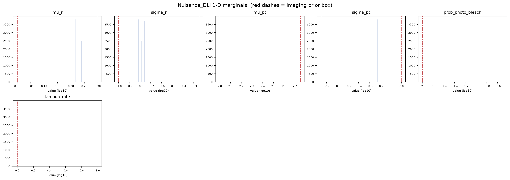
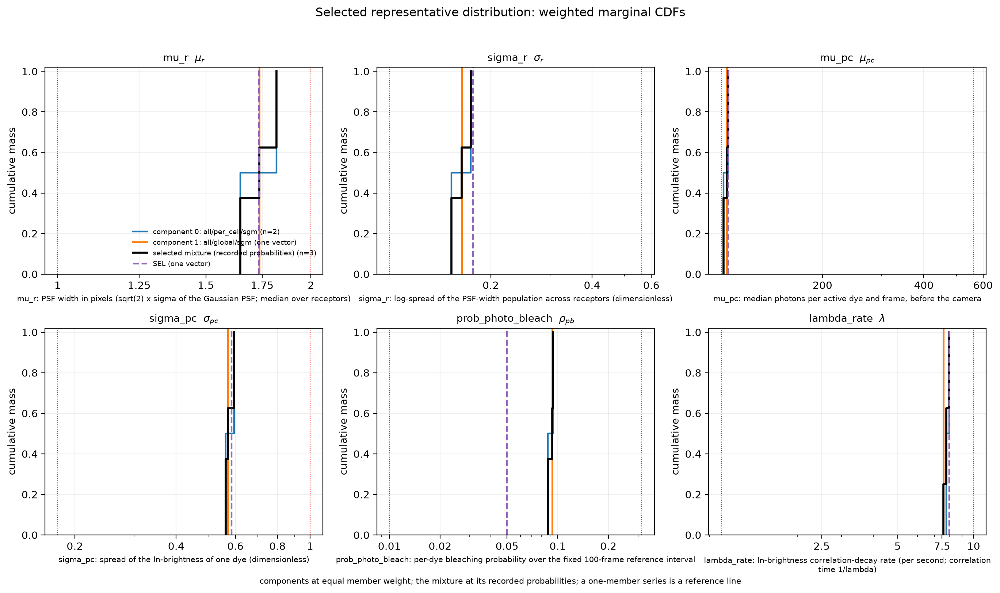
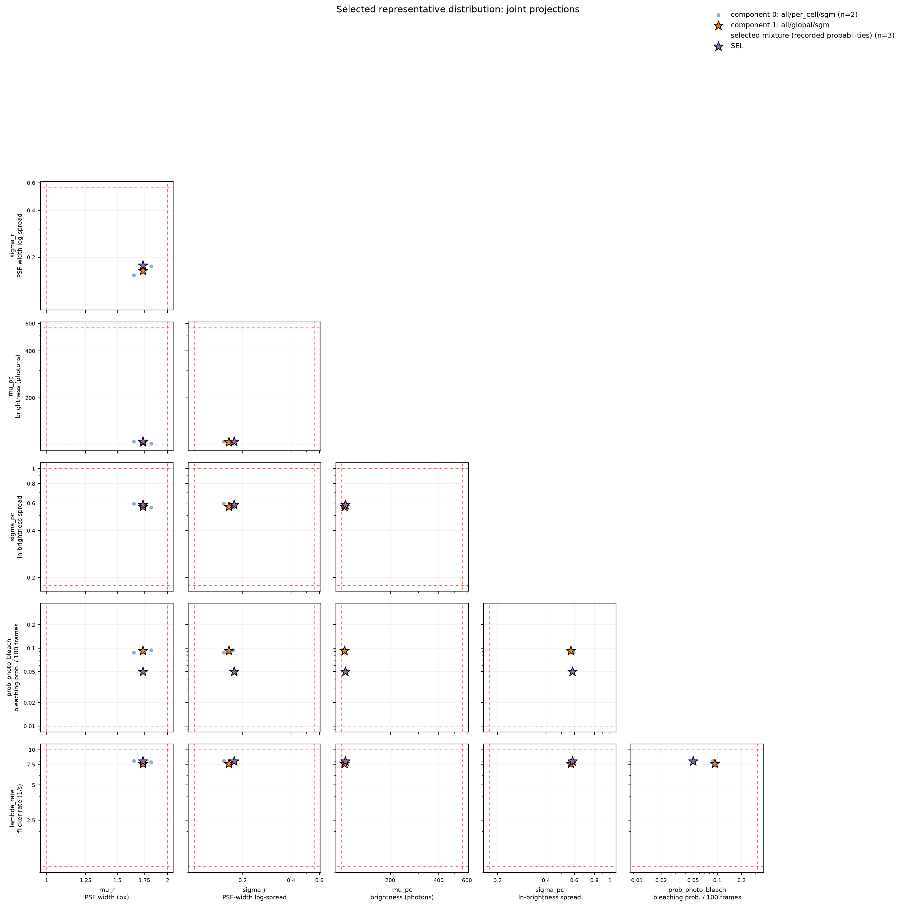

# Nuisance_DLI diagnostics - SRM_AND_SBI_MONOMER_DIMER_ALP_DETECTOR_FAB_2S_50FPS
Run: 2026-11-05 14:15:56 UTC

## Checks - 6 passed, 0 failed

| check | result | detail |
|---|---|---|
| file(artifact) | PASS | exists, 3502 bytes |
| parameter_keys_in_table_order | PASS | 6 keys: mu_r, sigma_r, mu_pc, sigma_pc, prob_photo_bleach, lambda_rate |
| shape(draws) | PASS | (10000, 6) (expected (10000, 6)) |
| no_nan_inf(draws) | PASS | clean |
| draws_inside_prior_box | PASS | 0.0000 of 10000 draws have a parameter outside the box |
| representative_probabilities_normalized | PASS | 3 vectors; total probability 1.000000000 |

## Nuisance_DLI provenance

| field | value |
|---|---|
| artifact | /home/mars-fias/Documents/Projects/RCL_Agent_Projects/srm-and-sbi/srm-and-sbi-monomer-dimer-alp/Script_Bank/Analysis/Evidence/Experiment_Aggregation_2026-11-05/example_build/EXAMPLE_Nuisance_DLI.npz |
| posterior_sample_pool_choice | empirical_representatives |
| pool_mode | bounded |
| parameters | 6 |
| marginal draws | 10000 |

*How the calibrated imaging is represented for production marginalization.*

## Per-parameter marginal summary (log10)

| parameter | median | [p05, p95] | prior box | frac outside prior |
|---|---|---|---|---|
| mu_r | +0.239 | [+0.217, +0.260] | [+0.00, +0.30] | 0.000 |
| sigma_r | -0.785 | [-0.816, -0.758] | [-1.00, -0.25] | 0.000 |
| mu_pc | +2.017 | [+2.008, +2.021] | [+2.00, +2.75] | 0.000 |
| sigma_pc | -0.244 | [-0.251, -0.226] | [-0.75, +0.00] | 0.000 |
| prob_photo_bleach | -1.033 | [-1.058, -1.027] | [-2.00, -0.50] | 0.000 |
| lambda_rate | +0.893 | [+0.881, +0.904] | [+0.00, +1.00] | 0.000 |

*Drawn from the built nuisance, so this is exactly what production will sample. 'frac outside prior' is > 0 only for pool_mode='unrestricted'; bounded and the box forms stay within the prior box.*

## empirical_representatives: components

| component | source Experiment | condition | window set | grouping | statistic | weight | members | probability per member |
|---|---|---|---|---|---|---|---|---|
| 0 | SRM_AND_SBI_MONOMER_DIMER_ALP_DETECTOR_FAB_2S_50FPS_C128V42A | FAB | all | per_cell | sgm | 0.750000 | 2 | 0.375000 |
| 1 | SRM_AND_SBI_MONOMER_DIMER_ALP_DETECTOR_FAB_2S_50FPS_C128V42A | FAB | all | global | sgm | 0.250000 | 1 | 0.250000 |

*rationale: Illustration of the interface on the two-cell pilot archive: the per-cell representatives over all ten windows beside the global representative; weights are an example, not a decision. | archive /media/mars-fias/MARS_Data_Reserve_0/MARS_Data_Bank/Projects/RCL_Agent_Projects/srm-and-sbi-monomer-dimer-alp/Data_Bank/Posit/SRM_AND_SBI_MONOMER_DIMER_ALP_DETECTOR_FAB_2S_50FPS_C128V42A_MAP_Experiment_PILOT2CELLSR1/aggregation_candidates.npz (sha256 47c6155fb77f…) | NOTE This is a pilot subset, not the complete condition: MET-FAB 2 of 60 cells (cells [4, 26]), 20 of 600 windows. The original MAP and summary references above come from the adopted product; the aggregation summaries come from the retained collections named below, fresh draws of the same estimator that do not reconstruct the original sampling attempt. | 3 member rows -> 3 unique vectors; the rows are retained joint draws (SGMs)*

## empirical_representatives: weighted marginal summary (physical units; inverse weighted CDF)

| parameter | median | IQR | central 90 % range | outside-prior mass |
|---|---|---|---|---|
| mu_r | 1.7357 | 1.6486 – 1.8205 | 1.6486 – 1.8205 | 0.0 % |
| sigma_r | 0.16391 | 0.15288 – 0.17461 | 0.15288 – 0.17461 | 0.0 % |
| mu_pc | 103.92 | 101.74 – 104.85 | 101.74 – 104.85 | 0.0 % |
| sigma_pc | 0.56964 | 0.56138 – 0.59444 | 0.56138 – 0.59444 | 0.0 % |
| prob_photo_bleach | 0.092643 | 0.087556 – 0.093887 | 0.087556 – 0.093887 | 0.0 % |
| lambda_rate | 7.81 | 7.595 – 8.0149 | 7.595 – 8.0149 | 0.0 % |

*empirical dispersion of the selected representatives under their probabilities, not a credible interval; total outside-prior mass 0.0 %.*

## What these mean

A check **PASS** means the invariant held; a **FAIL** aborts the run immediately with a located error message.

- **file** -- the output file exists on disk and is non-empty (the write succeeded).
- **shape** -- the array has the expected dimensions.
- **no_nan_inf** -- the array contains no NaN and no infinite values.
- **parameter_keys_in_table_order** -- the artifact's parameter order equals the detector table's, so the DLI stage maps every draw onto the right imaging row.
- **draws_inside_prior_box** -- the bounded pool and the box constructions must stay inside the imaging prior box; only pool_mode='unrestricted' may place mass outside it.
- **representative_probabilities_normalized** -- the stored per-vector probabilities sum to one; every member of component k carries weight_k / n_k.

## Figures

*1-D marginal of each imaging parameter under the built nuisance (sampled from the artifact); red dashes mark the imaging prior box.*

*Weighted empirical CDFs of the selected mixture beside its components (each normalized to unit mass) and the reference, physical units.*

*Pairwise projections of the selected vectors (marker size follows the recorded probability) beside the components and the reference.*
