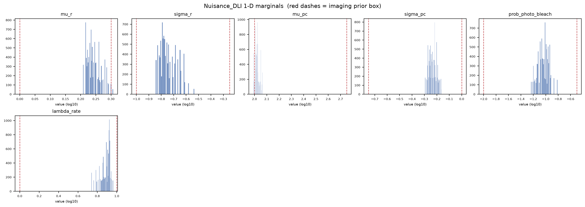
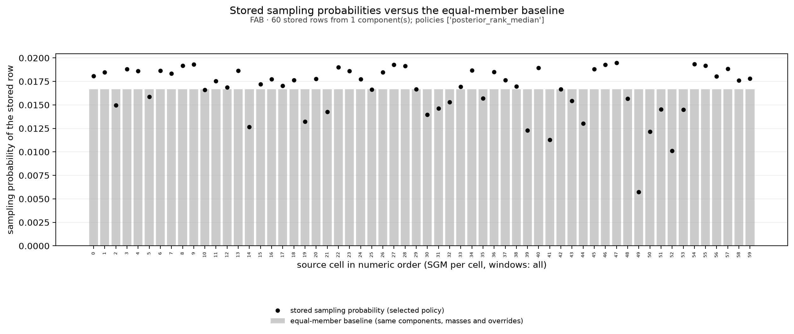
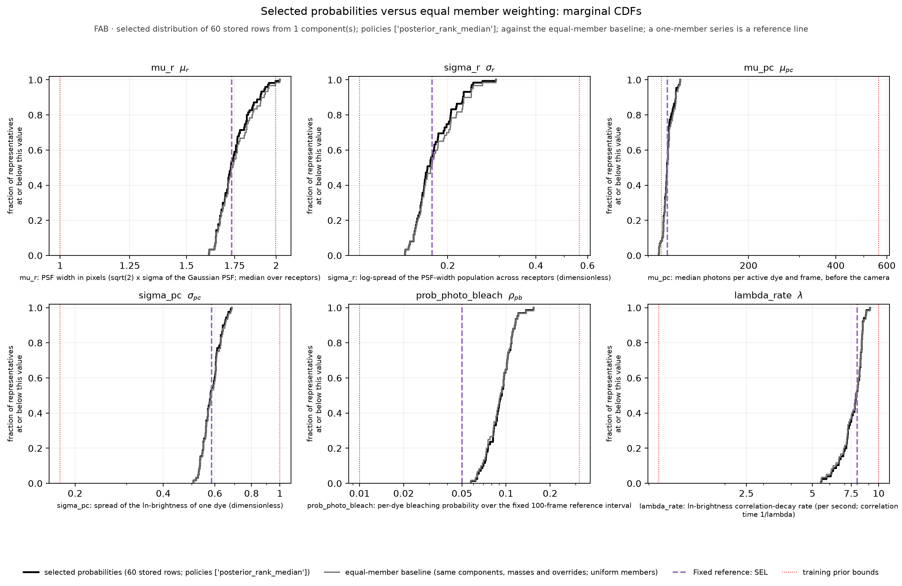
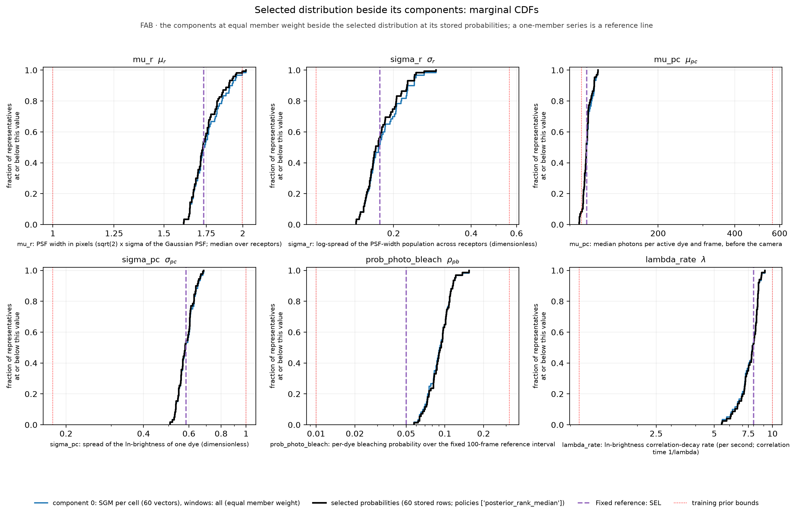
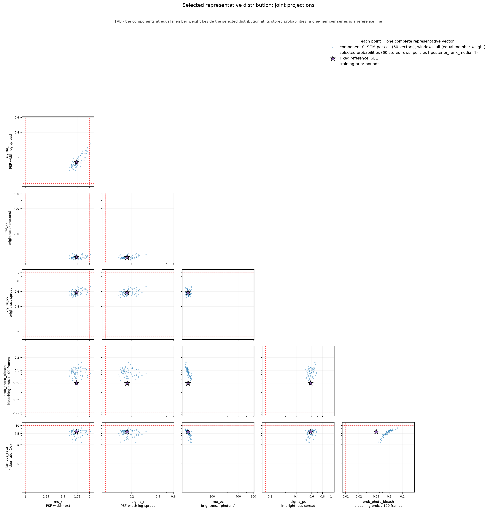

# Nuisance_DLI diagnostics - SRM_AND_SBI_MONOMER_DIMER_ALP_DETECTOR_FAB_2S_50FPS
Run: 2026-11-06 15:38:44 UTC

## Checks - 6 passed, 0 failed

| check | result | detail |
|---|---|---|
| file(artifact) | PASS | exists, 10580 bytes |
| parameter_keys_in_table_order | PASS | 6 keys: mu_r, sigma_r, mu_pc, sigma_pc, prob_photo_bleach, lambda_rate |
| shape(draws) | PASS | (10000, 6) (expected (10000, 6)) |
| no_nan_inf(draws) | PASS | clean |
| representative_probabilities_normalized | PASS | 60 vectors; total probability 1.000000000; 0 row(s) at zero |
| representative_row_provenance | PASS | 60 memberships over 60 stored rows |

## Quantitative

| metric | value | expected | meaning |
|---|---|---|---|
| frac_draws_outside_prior | 0.0938 | - | share of draws with at least one parameter outside the imaging prior box; permitted only under pool_mode='unrestricted', where it is a property of the calibration pool, not a defect. |

## Nuisance_DLI provenance

| field | value |
|---|---|
| artifact | Script_Bank/Analysis/Evidence/Experiment_Compatibility_2026-11-06/illustrative_build/SRM_AND_SBI_MONOMER_DIMER_ALP_DETECTOR_FAB_2S_50FPS_ILLUSTRATIVERANK_Nuisance_DLI.npz |
| posterior_sample_pool_choice | empirical_representatives |
| pool_mode | unrestricted |
| parameters | 6 |
| marginal draws | 10000 |

*How the calibrated imaging is represented for production marginalization.*

## Per-parameter marginal summary (log10)

| parameter | median | [p05, p95] | prior box | frac outside prior |
|---|---|---|---|---|
| mu_r | +0.238 | [+0.215, +0.286] | [+0.00, +0.30] | 0.005 |
| sigma_r | -0.769 | [-0.832, -0.618] | [-1.00, -0.25] | 0.000 |
| mu_pc | +2.019 | [+1.992, +2.051] | [+2.00, +2.75] | 0.088 |
| sigma_pc | -0.236 | [-0.280, -0.178] | [-0.75, +0.00] | 0.000 |
| prob_photo_bleach | -1.028 | [-1.196, -0.916] | [-2.00, -0.50] | 0.000 |
| lambda_rate | +0.897 | [+0.783, +0.942] | [+0.00, +1.00] | 0.000 |

*Drawn from the built nuisance, so this is exactly what production will sample. 'frac outside prior' is > 0 only for pool_mode='unrestricted'; bounded and the box forms stay within the prior box.*

## empirical_representatives: selection

| component | source Experiment | condition | window set | grouping | statistic | component mass | member policy | members / positive / zero | member probability (range) | effective members 1/sum(p^2) |
|---|---|---|---|---|---|---|---|---|---|---|
| 0 | SRM_AND_SBI_MONOMER_DIMER_ALP_DETECTOR_FAB_2S_50FPS_C128V42A | FAB | all | SGM per cell (`per_cell`) | sgm | 1.000000 | posterior_rank_median | 60 / 60 / 0 | 0.005738 – 0.019489 | 58.49 |

*rationale: Illustrative interface example: one SGM per cell over all ten 2 s windows with consensus (median-rank) member weighting, to show the dry-run, the report and the exports. No acquisition period, construction, weighting or treatment is selected by this file. | archive /media/mars-fias/MARS_Data_Reserve_0/MARS_Data_Bank/Projects/RCL_Agent_Projects/srm-and-sbi-monomer-dimer-alp/Data_Bank/Posit/SRM_AND_SBI_MONOMER_DIMER_ALP_DETECTOR_FAB_2S_50FPS_C128V42A_MAP_Experiment_COHORT60RANKSR2/aggregation_candidates.npz (sha256 a24f973dfb89…) | NOTE Complete cohort: MET-FAB 60 of 60 cells, 600 of 600 windows. The original MAP and summary references above come from the adopted product; the aggregation summaries come from the retained collections named below, fresh draws of the same estimator that do not reconstruct the original sampling attempt. | 60 member rows -> 60 unique vectors (0 at zero probability); effective rows 1/sum(p^2) over the stored rows = 58.49 (equal-member baseline 60.00); the effective number is a concentration measure of the sampling probabilities, within the stated normalization scope, not a count of independent experiments | the rows are retained joint draws (SGMs); the compatibility scores describe the original SGM candidates*

## empirical_representatives: weighted marginal summary (physical units; inverse weighted CDF)

| parameter | median | IQR | central 90 % range | outside-prior mass |
|---|---|---|---|---|
| mu_r | 1.7281 | 1.6774 – 1.8171 | 1.642 – 1.9313 | 0.6 % |
| sigma_r | 0.17038 | 0.1616 – 0.20169 | 0.14727 – 0.2409 | 0.0 % |
| mu_pc | 104.55 | 102.6 – 106.62 | 98.718 – 112.43 | 8.3 % |
| sigma_pc | 0.58054 | 0.55085 – 0.60912 | 0.52911 – 0.66332 | 0.0 % |
| prob_photo_bleach | 0.093844 | 0.08146 – 0.1053 | 0.063668 – 0.11935 | 0.0 % |
| lambda_rate | 7.8849 | 7.1866 – 8.3422 | 6.0662 – 8.7418 | 0.0 % |

*empirical dispersion of the selected representatives under their probabilities, not a credible interval; total outside-prior mass 8.9 %.*

## empirical_representatives: exports

Per-member record (identities, compatibility score, status, references, contribution, stored row): `representatives_members.csv`; per stored row (probability, equal-member baseline probability, memberships by recorded identity, the stored estimator coordinates `<key>_stored_log10` and the physical values `<key>_physical`): `representatives_rows.csv`; both beside this report. Member policies in this artifact: ['posterior_rank_median']. The equal-member baseline uses the same components, component masses, duplicate consolidation and overrides with uniform members; it isolates the member weighting.

## What these mean

A check **PASS** means the invariant held; a **FAIL** aborts the run immediately with a located error message.

- **file** -- the output file exists on disk and is non-empty (the write succeeded).
- **shape** -- the array has the expected dimensions.
- **no_nan_inf** -- the array contains no NaN and no infinite values.
- **parameter_keys_in_table_order** -- the artifact's parameter order equals the detector table's, so the DLI stage maps every draw onto the right imaging row.
- **representative_probabilities_normalized** -- the stored per-vector probabilities sum to one; a component's members carry weight_k / n_k under uniform weighting, or the normalized median compatibility ranks under posterior_rank_median (a zero score is exactly zero probability, kept).
- **representative_row_provenance** -- every stored row names the members that contributed to it, by recorded identity, and their contributions add up to its probability.

## Figures

*1-D marginal of each imaging parameter under the built nuisance (sampled from the artifact); red dashes mark the imaging prior box.*

*FAB · 60 stored rows from 1 component(s); policies ['posterior_rank_median']. Black dots: the probability actually stored for each row of the artifact (what production samples); gray bars: the equal-member baseline (same components, masses and overrides, uniform members). Red crosses mark rows at exactly zero: a sampling outcome of the selected policy, not a data-quality verdict. These are probabilities, not Experiment's raw ranks.*

*Weighted empirical CDFs (physical units; the fraction of a series' mass at or below the x value) of the selected distribution at its stored probabilities, the equal-member baseline built from the same components, component masses, duplicate consolidation and overrides with uniform members (the comparison isolates the member weighting) and the fixed reference. Summary numbers use the inverse weighted empirical CDF. Dotted red lines are the training-prior bounds.*

*Each component's representatives at equal member weight (normalized to unit mass) beside the selected distribution and the reference. A component selected with the marginal-median statistic is labeled as a marginal-median vector, never as an SGM. Dotted red lines are the training-prior bounds.*

*Pairwise projections of the selected vectors (marker size follows the stored probability; a zero-probability row is drawn at the smallest size) beside the components and the reference; each point is one complete vector. Dotted red lines are the training-prior bounds.*
