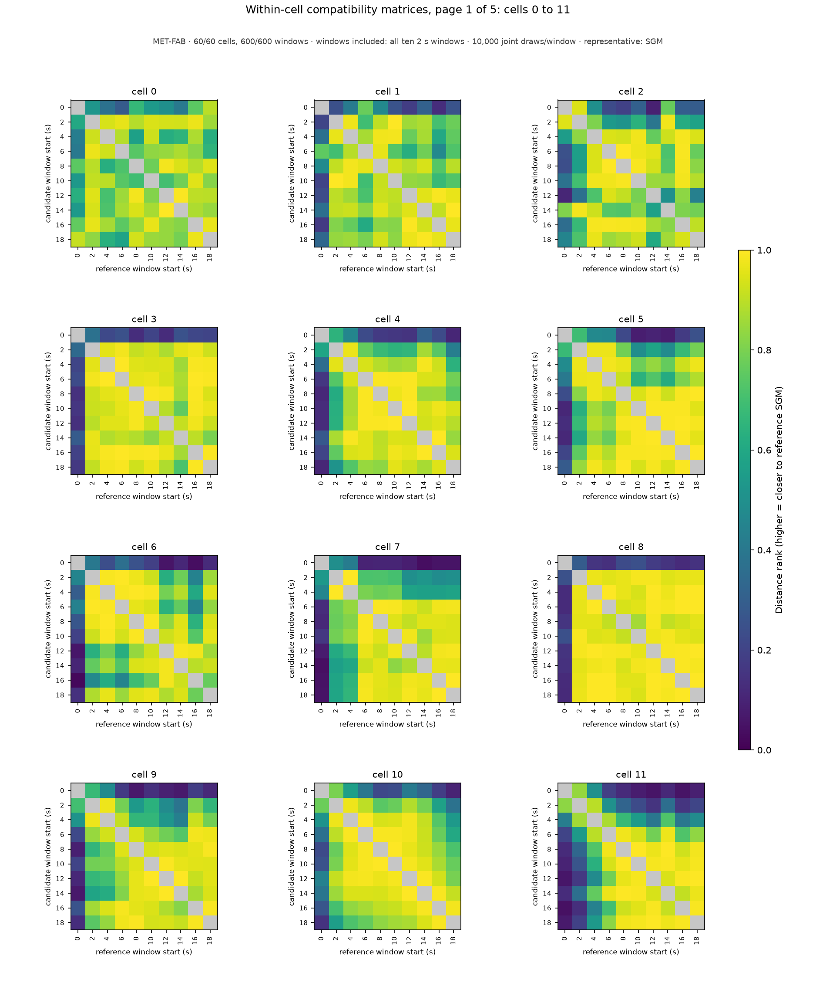
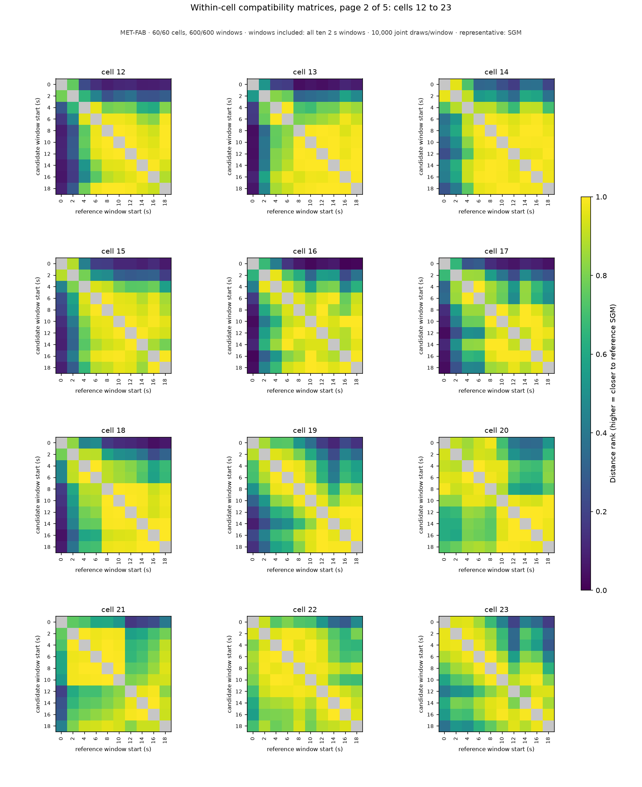
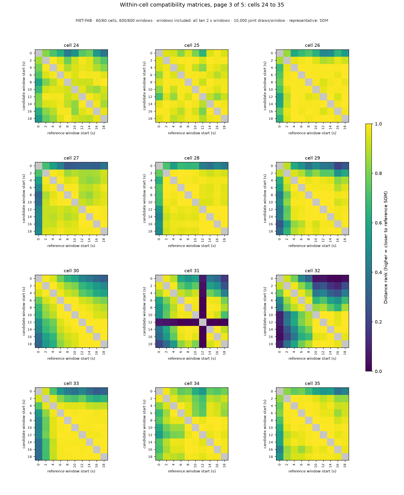
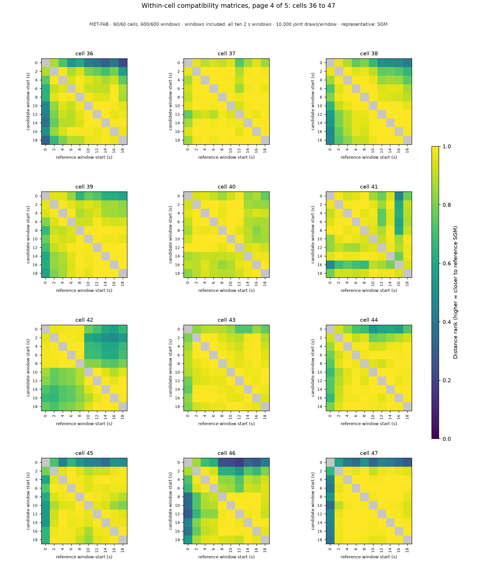
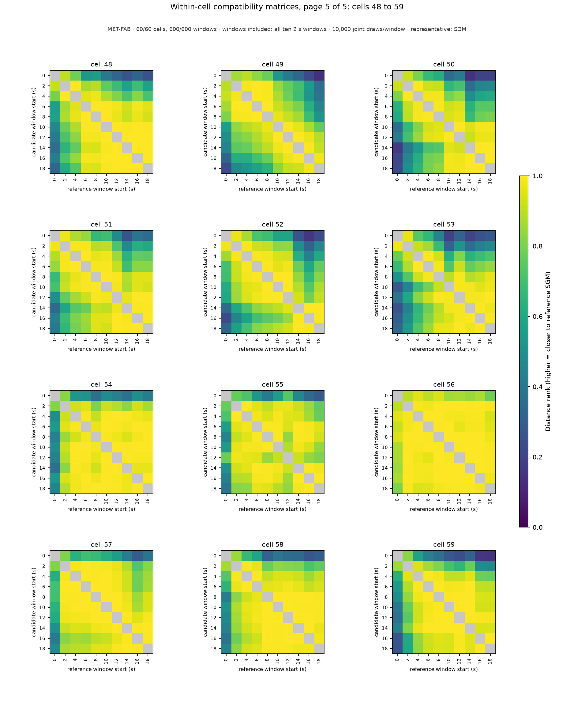

# Within-cell compatibility matrices: MET-FAB, windows included: all ten 2 s windows

MET-FAB · 60/60 cells, 600/600 windows · windows included: all ten 2 s windows · 10,000 joint draws/window · representative: SGM

Each panel is one cell's window-to-window distance-rank matrix: rows are candidate windows, columns reference windows (both labeled by window start time in seconds); color is the share of the reference window's draws strictly farther from its own SGM than the candidate window's SGM (0–1, one scale for every panel); the self comparison is gray (excluded). Row medians (the within-cell scores) are the `compatibility_score` column of [aggregation_groups.csv](../../../../aggregation_groups.csv); every pairwise value is in [aggregation_compatibility.csv](../../../../aggregation_compatibility.csv); the matrices themselves are the `compatibility_block_*` arrays of [aggregation_candidates.npz](../../../../aggregation_candidates.npz). A zero is a centrality outcome, not a data-quality classification; raw-data notes and training-prior flags stay separate. Back to the [report](../../../../report.md).

| cell | page | within-cell scores by window start (s) |
|---|---|---|
| 0 | [page_01.png](page_01.png) | 0: 0.526, 2: 0.935, 4: 0.650, 6: 0.835, 8: 0.889, 10: 0.786, 12: 0.895, 14: 0.870, 16: 0.844, 18: 0.840 |
| 1 | [page_01.png](page_01.png) | 0: 0.256, 2: 0.858, 4: 0.868, 6: 0.732, 8: 0.909, 10: 0.831, 12: 0.903, 14: 0.907, 16: 0.817, 18: 0.854 |
| 2 | [page_01.png](page_01.png) | 0: 0.301, 2: 0.620, 4: 0.934, 6: 0.945, 8: 0.935, 10: 0.888, 12: 0.720, 14: 0.807, 16: 0.903, 18: 0.862 |
| 3 | [page_01.png](page_01.png) | 0: 0.211, 2: 0.937, 4: 0.951, 6: 0.970, 8: 0.958, 10: 0.926, 12: 0.928, 14: 0.885, 16: 0.989, 18: 0.926 |
| 4 | [page_01.png](page_01.png) | 0: 0.227, 2: 0.679, 4: 0.887, 6: 0.942, 8: 0.856, 10: 0.941, 12: 0.932, 14: 0.943, 16: 0.945, 18: 0.847 |
| 5 | [page_01.png](page_01.png) | 0: 0.220, 2: 0.677, 4: 0.925, 6: 0.803, 8: 0.948, 10: 0.957, 12: 0.987, 14: 0.951, 16: 0.991, 18: 0.942 |
| 6 | [page_01.png](page_01.png) | 0: 0.189, 2: 0.855, 4: 0.953, 6: 0.839, 8: 0.949, 10: 0.935, 12: 0.842, 14: 0.897, 16: 0.688, 18: 0.880 |
| 7 | [page_01.png](page_01.png) | 0: 0.098, 2: 0.532, 4: 0.580, 6: 0.958, 8: 0.948, 10: 0.943, 12: 0.920, 14: 0.882, 16: 0.961, 18: 0.955 |
| 8 | [page_01.png](page_01.png) | 0: 0.152, 2: 0.966, 4: 0.973, 6: 0.987, 8: 0.933, 10: 0.957, 12: 0.989, 14: 0.983, 16: 0.992, 18: 0.986 |
| 9 | [page_01.png](page_01.png) | 0: 0.138, 2: 0.658, 4: 0.663, 6: 0.849, 8: 0.945, 10: 0.950, 12: 0.915, 14: 0.870, 16: 0.942, 18: 0.935 |
| 10 | [page_01.png](page_01.png) | 0: 0.329, 2: 0.775, 4: 0.941, 6: 0.921, 8: 0.925, 10: 0.957, 12: 0.970, 14: 0.942, 16: 0.903, 18: 0.834 |
| 11 | [page_01.png](page_01.png) | 0: 0.114, 2: 0.323, 4: 0.550, 6: 0.834, 8: 0.970, 10: 0.962, 12: 0.943, 14: 0.940, 16: 0.910, 18: 0.974 |
| 12 | [page_02.png](page_02.png) | 0: 0.107, 2: 0.327, 4: 0.786, 6: 0.960, 8: 0.961, 10: 0.969, 12: 0.971, 14: 0.941, 16: 0.885, 18: 0.956 |
| 13 | [page_02.png](page_02.png) | 0: 0.077, 2: 0.467, 4: 0.785, 6: 0.858, 8: 0.949, 10: 0.979, 12: 0.971, 14: 0.993, 16: 0.974, 18: 0.982 |
| 14 | [page_02.png](page_02.png) | 0: 0.343, 2: 0.567, 4: 0.891, 6: 0.957, 8: 0.975, 10: 0.989, 12: 0.964, 14: 0.975, 16: 0.977, 18: 0.977 |
| 15 | [page_02.png](page_02.png) | 0: 0.121, 2: 0.312, 4: 0.777, 6: 0.950, 8: 0.930, 10: 0.963, 12: 0.948, 14: 0.869, 16: 0.967, 18: 0.890 |
| 16 | [page_02.png](page_02.png) | 0: 0.067, 2: 0.555, 4: 0.783, 6: 0.919, 8: 0.866, 10: 0.943, 12: 0.926, 14: 0.915, 16: 0.867, 18: 0.952 |
| 17 | [page_02.png](page_02.png) | 0: 0.102, 2: 0.479, 4: 0.778, 6: 0.769, 8: 0.857, 10: 0.892, 12: 0.889, 14: 0.894, 16: 0.955, 18: 0.855 |
| 18 | [page_02.png](page_02.png) | 0: 0.126, 2: 0.492, 4: 0.817, 6: 0.837, 8: 0.918, 10: 0.939, 12: 0.937, 14: 0.987, 16: 0.933, 18: 0.971 |
| 19 | [page_02.png](page_02.png) | 0: 0.364, 2: 0.608, 4: 0.717, 6: 0.707, 8: 0.864, 10: 0.882, 12: 0.865, 14: 0.671, 16: 0.900, 18: 0.820 |
| 20 | [page_02.png](page_02.png) | 0: 0.697, 2: 0.765, 4: 0.898, 6: 0.946, 8: 0.889, 10: 0.946, 12: 0.852, 14: 0.808, 16: 0.793, 18: 0.877 |
| 21 | [page_02.png](page_02.png) | 0: 0.527, 2: 0.787, 4: 0.910, 6: 0.928, 8: 0.952, 10: 0.930, 12: 0.777, 14: 0.802, 16: 0.874, 18: 0.919 |
| 22 | [page_02.png](page_02.png) | 0: 0.714, 2: 0.945, 4: 0.949, 6: 0.955, 8: 0.965, 10: 0.951, 12: 0.973, 14: 0.884, 16: 0.815, 18: 0.880 |
| 23 | [page_02.png](page_02.png) | 0: 0.441, 2: 0.735, 4: 0.699, 6: 0.877, 8: 0.908, 10: 0.898, 12: 0.819, 14: 0.867, 16: 0.944, 18: 0.757 |
| 24 | [page_03.png](page_03.png) | 0: 0.631, 2: 0.925, 4: 0.945, 6: 0.981, 8: 0.924, 10: 0.935, 12: 0.953, 14: 0.943, 16: 0.955, 18: 0.913 |
| 25 | [page_03.png](page_03.png) | 0: 0.942, 2: 0.989, 4: 0.947, 6: 0.960, 8: 0.985, 10: 0.981, 12: 0.919, 14: 0.983, 16: 0.983, 18: 0.974 |
| 26 | [page_03.png](page_03.png) | 0: 0.633, 2: 0.951, 4: 0.995, 6: 0.990, 8: 0.991, 10: 0.992, 12: 0.969, 14: 0.991, 16: 0.982, 18: 0.993 |
| 27 | [page_03.png](page_03.png) | 0: 0.320, 2: 0.872, 4: 0.918, 6: 0.968, 8: 0.912, 10: 0.937, 12: 0.941, 14: 0.911, 16: 0.949, 18: 0.964 |
| 28 | [page_03.png](page_03.png) | 0: 0.556, 2: 0.952, 4: 0.980, 6: 0.978, 8: 0.982, 10: 0.966, 12: 0.974, 14: 0.961, 16: 0.982, 18: 0.966 |
| 29 | [page_03.png](page_03.png) | 0: 0.392, 2: 0.746, 4: 0.960, 6: 0.981, 8: 0.987, 10: 0.989, 12: 0.981, 14: 0.986, 16: 0.935, 18: 0.958 |
| 30 | [page_03.png](page_03.png) | 0: 0.600, 2: 0.804, 4: 0.887, 6: 0.930, 8: 0.930, 10: 0.945, 12: 0.985, 14: 0.968, 16: 0.927, 18: 0.903 |
| 31 | [page_03.png](page_03.png) | 0: 0.523, 2: 0.670, 4: 0.860, 6: 0.937, 8: 0.890, 10: 0.923, 12: 0.008, 14: 0.906, 16: 0.954, 18: 0.804 |
| 32 | [page_03.png](page_03.png) | 0: 0.056, 2: 0.266, 4: 0.449, 6: 0.683, 8: 0.846, 10: 0.891, 12: 0.898, 14: 0.794, 16: 0.687, 18: 0.887 |
| 33 | [page_03.png](page_03.png) | 0: 0.419, 2: 0.737, 4: 0.951, 6: 0.987, 8: 0.991, 10: 0.991, 12: 0.987, 14: 0.988, 16: 0.989, 18: 0.989 |
| 34 | [page_03.png](page_03.png) | 0: 0.764, 2: 0.903, 4: 0.932, 6: 0.854, 8: 0.970, 10: 0.982, 12: 0.961, 14: 0.973, 16: 0.982, 18: 0.960 |
| 35 | [page_03.png](page_03.png) | 0: 0.584, 2: 0.942, 4: 0.984, 6: 0.971, 8: 0.990, 10: 0.989, 12: 0.970, 14: 0.985, 16: 0.931, 18: 0.974 |
| 36 | [page_04.png](page_04.png) | 0: 0.415, 2: 0.804, 4: 0.924, 6: 0.911, 8: 0.961, 10: 0.959, 12: 0.961, 14: 0.949, 16: 0.971, 18: 0.892 |
| 37 | [page_04.png](page_04.png) | 0: 0.910, 2: 0.996, 4: 0.994, 6: 0.986, 8: 0.996, 10: 0.991, 12: 0.948, 14: 0.984, 16: 0.998, 18: 0.993 |
| 38 | [page_04.png](page_04.png) | 0: 0.665, 2: 0.899, 4: 0.860, 6: 0.957, 8: 0.954, 10: 0.993, 12: 0.965, 14: 0.966, 16: 0.962, 18: 0.920 |
| 39 | [page_04.png](page_04.png) | 0: 0.721, 2: 0.929, 4: 0.916, 6: 0.939, 8: 0.988, 10: 0.962, 12: 0.992, 14: 0.977, 16: 0.981, 18: 0.959 |
| 40 | [page_04.png](page_04.png) | 0: 0.911, 2: 0.979, 4: 0.964, 6: 0.979, 8: 0.961, 10: 0.991, 12: 0.985, 14: 0.915, 16: 0.905, 18: 0.906 |
| 41 | [page_04.png](page_04.png) | 0: 0.934, 2: 0.980, 4: 0.953, 6: 0.961, 8: 0.971, 10: 0.963, 12: 0.913, 14: 0.973, 16: 0.746, 18: 0.930 |
| 42 | [page_04.png](page_04.png) | 0: 0.775, 2: 0.594, 4: 0.677, 6: 0.693, 8: 0.820, 10: 0.886, 12: 0.886, 14: 0.825, 16: 0.810, 18: 0.858 |
| 43 | [page_04.png](page_04.png) | 0: 0.846, 2: 0.950, 4: 0.978, 6: 0.990, 8: 0.975, 10: 0.978, 12: 0.967, 14: 0.986, 16: 0.991, 18: 0.970 |
| 44 | [page_04.png](page_04.png) | 0: 0.681, 2: 0.907, 4: 0.979, 6: 0.988, 8: 0.973, 10: 0.986, 12: 0.972, 14: 0.993, 16: 0.982, 18: 0.991 |
| 45 | [page_04.png](page_04.png) | 0: 0.495, 2: 0.956, 4: 0.986, 6: 0.976, 8: 0.970, 10: 0.942, 12: 0.976, 14: 0.971, 16: 0.977, 18: 0.971 |
| 46 | [page_04.png](page_04.png) | 0: 0.326, 2: 0.732, 4: 0.860, 6: 0.903, 8: 0.947, 10: 0.935, 12: 0.914, 14: 0.980, 16: 0.962, 18: 0.946 |
| 47 | [page_04.png](page_04.png) | 0: 0.406, 2: 0.969, 4: 0.997, 6: 0.998, 8: 0.993, 10: 0.982, 12: 0.993, 14: 0.998, 16: 0.995, 18: 0.978 |
| 48 | [page_05.png](page_05.png) | 0: 0.395, 2: 0.757, 4: 0.822, 6: 0.956, 8: 0.964, 10: 0.993, 12: 0.985, 14: 0.945, 16: 0.986, 18: 0.953 |
| 49 | [page_05.png](page_05.png) | 0: 0.522, 2: 0.840, 4: 0.875, 6: 0.865, 8: 0.915, 10: 0.892, 12: 0.889, 14: 0.899, 16: 0.773, 18: 0.641 |
| 50 | [page_05.png](page_05.png) | 0: 0.408, 2: 0.710, 4: 0.806, 6: 0.909, 8: 0.900, 10: 0.949, 12: 0.952, 14: 0.738, 16: 0.808, 18: 0.836 |
| 51 | [page_05.png](page_05.png) | 0: 0.667, 2: 0.891, 4: 0.884, 6: 0.913, 8: 0.953, 10: 0.949, 12: 0.968, 14: 0.903, 16: 0.954, 18: 0.934 |
| 52 | [page_05.png](page_05.png) | 0: 0.585, 2: 0.837, 4: 0.937, 6: 0.924, 8: 0.916, 10: 0.889, 12: 0.935, 14: 0.874, 16: 0.750, 18: 0.858 |
| 53 | [page_05.png](page_05.png) | 0: 0.318, 2: 0.518, 4: 0.770, 6: 0.847, 8: 0.914, 10: 0.915, 12: 0.985, 14: 0.897, 16: 0.907, 18: 0.964 |
| 54 | [page_05.png](page_05.png) | 0: 0.483, 2: 0.890, 4: 0.979, 6: 0.990, 8: 0.975, 10: 0.997, 12: 0.992, 14: 0.967, 16: 0.982, 18: 0.993 |
| 55 | [page_05.png](page_05.png) | 0: 0.521, 2: 0.919, 4: 0.947, 6: 0.982, 8: 0.953, 10: 0.965, 12: 0.913, 14: 0.978, 16: 0.961, 18: 0.893 |
| 56 | [page_05.png](page_05.png) | 0: 0.876, 2: 0.995, 4: 0.988, 6: 0.987, 8: 0.997, 10: 0.997, 12: 0.993, 14: 0.994, 16: 0.996, 18: 0.983 |
| 57 | [page_05.png](page_05.png) | 0: 0.624, 2: 0.969, 4: 0.978, 6: 0.984, 8: 0.994, 10: 0.987, 12: 0.986, 14: 0.975, 16: 0.900, 18: 0.950 |
| 58 | [page_05.png](page_05.png) | 0: 0.355, 2: 0.820, 4: 0.922, 6: 0.961, 8: 0.992, 10: 0.993, 12: 0.991, 14: 0.971, 16: 0.984, 18: 0.974 |
| 59 | [page_05.png](page_05.png) | 0: 0.315, 2: 0.771, 4: 0.909, 6: 0.983, 8: 0.979, 10: 0.937, 12: 0.986, 14: 0.965, 16: 0.944, 18: 0.938 |

## Pages

### Page 1: cells 0, 1, 2, 3, 4, 5, 6, 7, 8, 9, 10, 11

### Page 2: cells 12, 13, 14, 15, 16, 17, 18, 19, 20, 21, 22, 23

### Page 3: cells 24, 25, 26, 27, 28, 29, 30, 31, 32, 33, 34, 35

### Page 4: cells 36, 37, 38, 39, 40, 41, 42, 43, 44, 45, 46, 47

### Page 5: cells 48, 49, 50, 51, 52, 53, 54, 55, 56, 57, 58, 59

