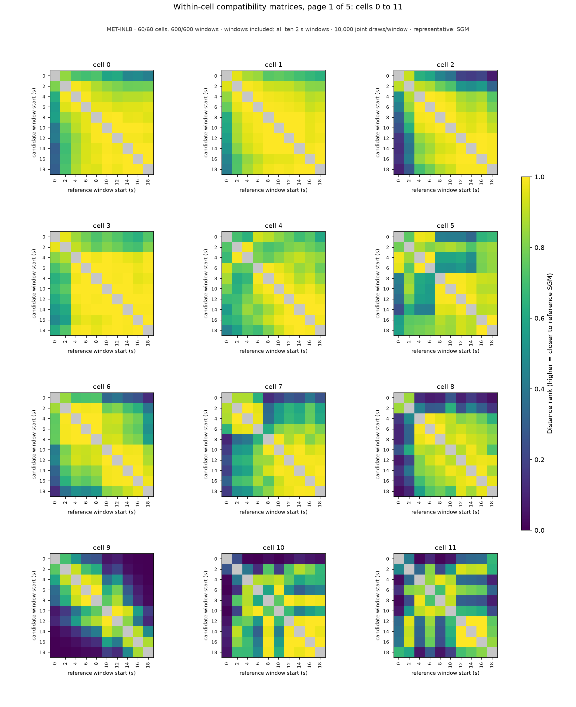
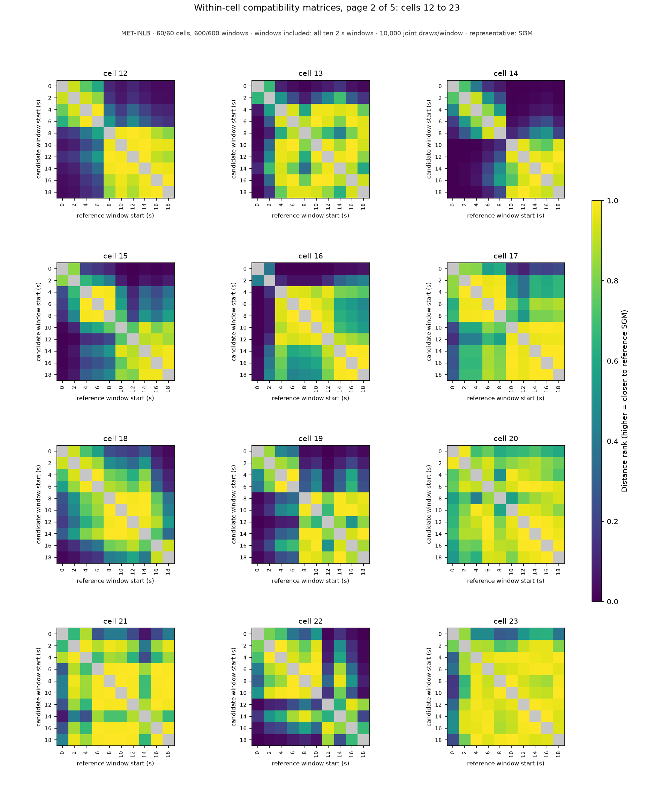
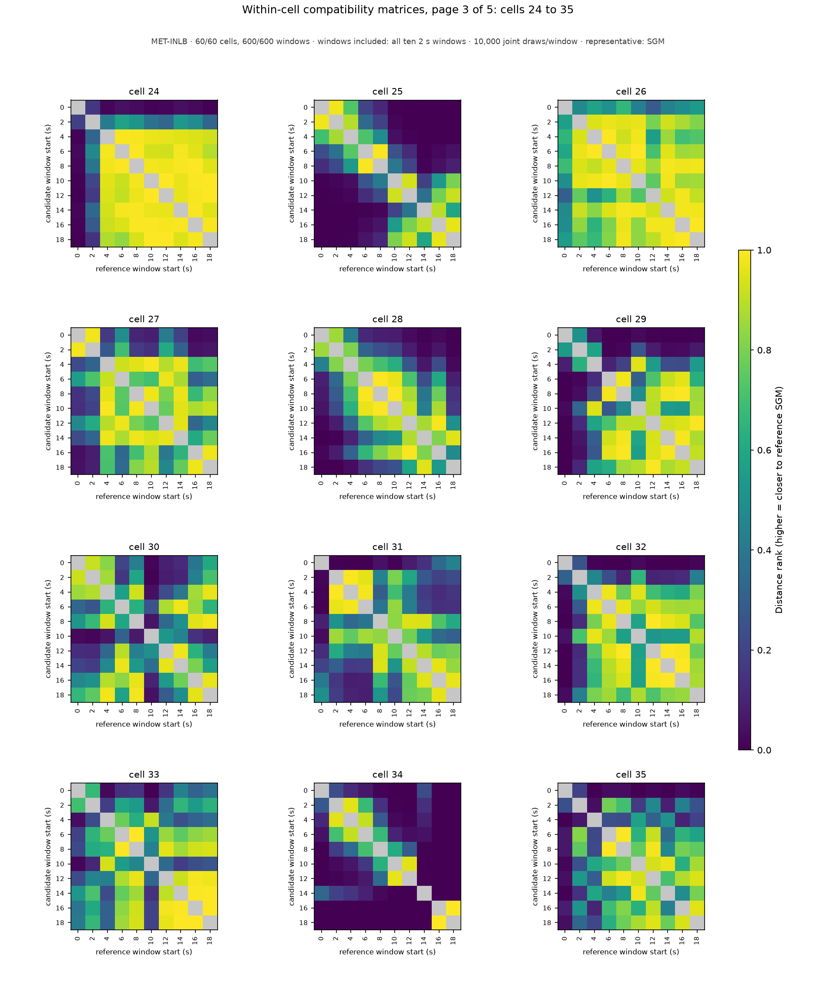
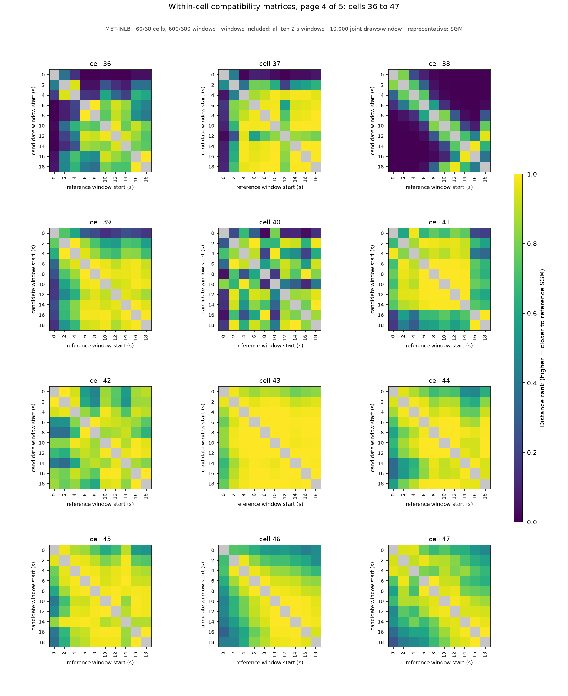
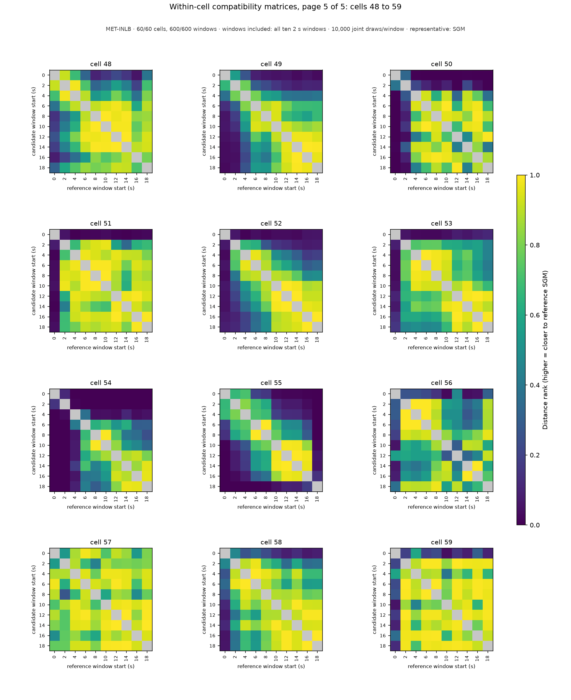

# Within-cell compatibility matrices: MET-INLB, windows included: all ten 2 s windows

MET-INLB · 60/60 cells, 600/600 windows · windows included: all ten 2 s windows · 10,000 joint draws/window · representative: SGM

Each panel is one cell's window-to-window distance-rank matrix: rows are candidate windows, columns reference windows (both labeled by window start time in seconds); color is the share of the reference window's draws strictly farther from its own SGM than the candidate window's SGM (0–1, one scale for every panel); the self comparison is gray (excluded). Row medians (the within-cell scores) are the `compatibility_score` column of [aggregation_groups.csv](../../../../aggregation_groups.csv); every pairwise value is in [aggregation_compatibility.csv](../../../../aggregation_compatibility.csv); the matrices themselves are the `compatibility_block_*` arrays of [aggregation_candidates.npz](../../../../aggregation_candidates.npz). A zero is a centrality outcome, not a data-quality classification; raw-data notes and training-prior flags stay separate. Back to the [report](../../../../report.md).

| cell | page | within-cell scores by window start (s) |
|---|---|---|
| 0 | [page_01.png](page_01.png) | 0: 0.606, 2: 0.807, 4: 0.904, 6: 0.950, 8: 0.965, 10: 0.991, 12: 0.969, 14: 0.963, 16: 0.971, 18: 0.957 |
| 1 | [page_01.png](page_01.png) | 0: 0.740, 2: 0.916, 4: 0.965, 6: 0.971, 8: 0.979, 10: 0.986, 12: 0.977, 14: 0.988, 16: 0.954, 18: 0.977 |
| 2 | [page_01.png](page_01.png) | 0: 0.383, 2: 0.720, 4: 0.873, 6: 0.905, 8: 0.964, 10: 0.956, 12: 0.962, 14: 0.937, 16: 0.965, 18: 0.880 |
| 3 | [page_01.png](page_01.png) | 0: 0.733, 2: 0.809, 4: 0.980, 6: 0.995, 8: 0.979, 10: 0.997, 12: 0.997, 14: 0.993, 16: 0.973, 18: 0.990 |
| 4 | [page_01.png](page_01.png) | 0: 0.738, 2: 0.780, 4: 0.839, 6: 0.879, 8: 0.884, 10: 0.954, 12: 0.957, 14: 0.862, 16: 0.922, 18: 0.804 |
| 5 | [page_01.png](page_01.png) | 0: 0.650, 2: 0.836, 4: 0.804, 6: 0.740, 8: 0.912, 10: 0.889, 12: 0.929, 14: 0.896, 16: 0.854, 18: 0.848 |
| 6 | [page_01.png](page_01.png) | 0: 0.385, 2: 0.816, 4: 0.917, 6: 0.905, 8: 0.933, 10: 0.926, 12: 0.935, 14: 0.851, 16: 0.802, 18: 0.528 |
| 7 | [page_01.png](page_01.png) | 0: 0.282, 2: 0.651, 4: 0.667, 6: 0.834, 8: 0.810, 10: 0.932, 12: 0.854, 14: 0.938, 16: 0.868, 18: 0.828 |
| 8 | [page_01.png](page_01.png) | 0: 0.100, 2: 0.300, 4: 0.820, 6: 0.884, 8: 0.923, 10: 0.889, 12: 0.922, 14: 0.866, 16: 0.855, 18: 0.732 |
| 9 | [page_01.png](page_01.png) | 0: 0.081, 2: 0.209, 4: 0.526, 6: 0.631, 8: 0.622, 10: 0.556, 12: 0.553, 14: 0.420, 16: 0.135, 18: 0.031 |
| 10 | [page_01.png](page_01.png) | 0: 0.037, 2: 0.662, 4: 0.667, 6: 0.446, 8: 0.887, 10: 0.627, 12: 0.774, 14: 0.906, 16: 0.821, 18: 0.682 |
| 11 | [page_01.png](page_01.png) | 0: 0.306, 2: 0.648, 4: 0.343, 6: 0.792, 8: 0.288, 10: 0.650, 12: 0.751, 14: 0.782, 16: 0.768, 18: 0.599 |
| 12 | [page_02.png](page_02.png) | 0: 0.102, 2: 0.139, 4: 0.329, 6: 0.475, 8: 0.823, 10: 0.963, 12: 0.872, 14: 0.971, 16: 0.890, 18: 0.832 |
| 13 | [page_02.png](page_02.png) | 0: 0.051, 2: 0.303, 4: 0.948, 6: 0.945, 8: 0.675, 10: 0.930, 12: 0.945, 14: 0.775, 16: 0.929, 18: 0.838 |
| 14 | [page_02.png](page_02.png) | 0: 0.010, 2: 0.029, 4: 0.070, 6: 0.186, 8: 0.281, 10: 0.131, 12: 0.256, 14: 0.490, 16: 0.565, 18: 0.225 |
| 15 | [page_02.png](page_02.png) | 0: 0.018, 2: 0.084, 4: 0.364, 6: 0.452, 8: 0.527, 10: 0.734, 12: 0.225, 14: 0.526, 16: 0.345, 18: 0.468 |
| 16 | [page_02.png](page_02.png) | 0: 0.005, 2: 0.137, 4: 0.801, 6: 0.599, 8: 0.634, 10: 0.688, 12: 0.909, 14: 0.685, 16: 0.590, 18: 0.514 |
| 17 | [page_02.png](page_02.png) | 0: 0.232, 2: 0.659, 4: 0.664, 6: 0.872, 8: 0.799, 10: 0.828, 12: 0.665, 14: 0.878, 16: 0.872, 18: 0.883 |
| 18 | [page_02.png](page_02.png) | 0: 0.243, 2: 0.492, 4: 0.747, 6: 0.847, 8: 0.783, 10: 0.808, 12: 0.758, 14: 0.807, 16: 0.755, 18: 0.404 |
| 19 | [page_02.png](page_02.png) | 0: 0.038, 2: 0.130, 4: 0.411, 6: 0.392, 8: 0.812, 10: 0.673, 12: 0.521, 14: 0.830, 16: 0.680, 18: 0.855 |
| 20 | [page_02.png](page_02.png) | 0: 0.669, 2: 0.860, 4: 0.869, 6: 0.947, 8: 0.783, 10: 0.906, 12: 0.956, 14: 0.950, 16: 0.899, 18: 0.934 |
| 21 | [page_02.png](page_02.png) | 0: 0.407, 2: 0.890, 4: 0.848, 6: 0.989, 8: 0.990, 10: 0.990, 12: 0.984, 14: 0.712, 16: 0.986, 18: 0.989 |
| 22 | [page_02.png](page_02.png) | 0: 0.285, 2: 0.764, 4: 0.708, 6: 0.873, 8: 0.752, 10: 0.781, 12: 0.239, 14: 0.636, 16: 0.396, 18: 0.073 |
| 23 | [page_02.png](page_02.png) | 0: 0.480, 2: 0.876, 4: 0.976, 6: 0.958, 8: 0.914, 10: 0.934, 12: 0.966, 14: 0.957, 16: 0.960, 18: 0.956 |
| 24 | [page_03.png](page_03.png) | 0: 0.026, 2: 0.409, 4: 0.954, 6: 0.934, 8: 0.980, 10: 0.969, 12: 0.966, 14: 0.968, 16: 0.986, 18: 0.941 |
| 25 | [page_03.png](page_03.png) | 0: 0.006, 2: 0.013, 4: 0.040, 6: 0.239, 8: 0.208, 10: 0.268, 12: 0.233, 14: 0.014, 16: 0.057, 18: 0.115 |
| 26 | [page_03.png](page_03.png) | 0: 0.485, 2: 0.929, 4: 0.849, 6: 0.954, 8: 0.965, 10: 0.963, 12: 0.762, 14: 0.947, 16: 0.834, 18: 0.834 |
| 27 | [page_03.png](page_03.png) | 0: 0.166, 2: 0.275, 4: 0.890, 6: 0.718, 8: 0.801, 10: 0.876, 12: 0.730, 14: 0.879, 16: 0.651, 18: 0.710 |
| 28 | [page_03.png](page_03.png) | 0: 0.078, 2: 0.201, 4: 0.434, 6: 0.609, 8: 0.706, 10: 0.638, 12: 0.734, 14: 0.472, 16: 0.660, 18: 0.214 |
| 29 | [page_03.png](page_03.png) | 0: 0.004, 2: 0.073, 4: 0.236, 6: 0.628, 8: 0.852, 10: 0.533, 12: 0.899, 14: 0.878, 16: 0.908, 18: 0.861 |
| 30 | [page_03.png](page_03.png) | 0: 0.390, 2: 0.433, 4: 0.854, 6: 0.646, 8: 0.593, 10: 0.087, 12: 0.430, 14: 0.532, 16: 0.777, 18: 0.661 |
| 31 | [page_03.png](page_03.png) | 0: 0.047, 2: 0.443, 4: 0.297, 6: 0.382, 8: 0.612, 10: 0.757, 12: 0.762, 14: 0.518, 16: 0.402, 18: 0.497 |
| 32 | [page_03.png](page_03.png) | 0: 0.004, 2: 0.240, 4: 0.695, 6: 0.861, 8: 0.794, 10: 0.569, 12: 0.773, 14: 0.856, 16: 0.872, 18: 0.798 |
| 33 | [page_03.png](page_03.png) | 0: 0.155, 2: 0.546, 4: 0.357, 6: 0.773, 8: 0.861, 10: 0.267, 12: 0.878, 14: 0.763, 16: 0.831, 18: 0.855 |
| 34 | [page_03.png](page_03.png) | 0: 0.009, 2: 0.134, 4: 0.087, 6: 0.048, 8: 0.182, 10: 0.026, 12: 0.008, 14: 0.023, 16: 0.000, 18: 0.000 |
| 35 | [page_03.png](page_03.png) | 0: 0.018, 2: 0.252, 4: 0.234, 6: 0.642, 8: 0.754, 10: 0.687, 12: 0.881, 14: 0.536, 16: 0.634, 18: 0.772 |
| 36 | [page_04.png](page_04.png) | 0: 0.010, 2: 0.264, 4: 0.335, 6: 0.536, 8: 0.500, 10: 0.766, 12: 0.849, 14: 0.792, 16: 0.704, 18: 0.655 |
| 37 | [page_04.png](page_04.png) | 0: 0.033, 2: 0.574, 4: 0.959, 6: 0.944, 8: 0.967, 10: 0.990, 12: 0.793, 14: 0.976, 16: 0.979, 18: 0.982 |
| 38 | [page_04.png](page_04.png) | 0: 0.002, 2: 0.006, 4: 0.014, 6: 0.134, 8: 0.136, 10: 0.154, 12: 0.273, 14: 0.048, 16: 0.021, 18: 0.320 |
| 39 | [page_04.png](page_04.png) | 0: 0.231, 2: 0.718, 4: 0.822, 6: 0.955, 8: 0.961, 10: 0.942, 12: 0.892, 14: 0.954, 16: 0.982, 18: 0.923 |
| 40 | [page_04.png](page_04.png) | 0: 0.137, 2: 0.848, 4: 0.619, 6: 0.816, 8: 0.712, 10: 0.405, 12: 0.872, 14: 0.783, 16: 0.693, 18: 0.830 |
| 41 | [page_04.png](page_04.png) | 0: 0.691, 2: 0.918, 4: 0.888, 6: 0.984, 8: 0.972, 10: 0.949, 12: 0.960, 14: 0.921, 16: 0.671, 18: 0.567 |
| 42 | [page_04.png](page_04.png) | 0: 0.848, 2: 0.849, 4: 0.895, 6: 0.850, 8: 0.766, 10: 0.940, 12: 0.910, 14: 0.855, 16: 0.892, 18: 0.839 |
| 43 | [page_04.png](page_04.png) | 0: 0.850, 2: 0.967, 4: 0.988, 6: 0.998, 8: 0.997, 10: 0.996, 12: 0.997, 14: 0.984, 16: 0.996, 18: 0.996 |
| 44 | [page_04.png](page_04.png) | 0: 0.709, 2: 0.880, 4: 0.924, 6: 0.982, 8: 0.981, 10: 0.955, 12: 0.966, 14: 0.907, 16: 0.913, 18: 0.963 |
| 45 | [page_04.png](page_04.png) | 0: 0.741, 2: 0.906, 4: 0.964, 6: 0.953, 8: 0.978, 10: 0.927, 12: 0.962, 14: 0.931, 16: 0.914, 18: 0.899 |
| 46 | [page_04.png](page_04.png) | 0: 0.551, 2: 0.697, 4: 0.840, 6: 0.916, 8: 0.921, 10: 0.960, 12: 0.969, 14: 0.948, 16: 0.877, 18: 0.896 |
| 47 | [page_04.png](page_04.png) | 0: 0.674, 2: 0.885, 4: 0.807, 6: 0.769, 8: 0.795, 10: 0.889, 12: 0.930, 14: 0.791, 16: 0.732, 18: 0.675 |
| 48 | [page_05.png](page_05.png) | 0: 0.222, 2: 0.559, 4: 0.698, 6: 0.908, 8: 0.849, 10: 0.882, 12: 0.938, 14: 0.920, 16: 0.733, 18: 0.790 |
| 49 | [page_05.png](page_05.png) | 0: 0.059, 2: 0.158, 4: 0.390, 6: 0.687, 8: 0.628, 10: 0.866, 12: 0.752, 14: 0.559, 16: 0.489, 18: 0.541 |
| 50 | [page_05.png](page_05.png) | 0: 0.001, 2: 0.092, 4: 0.626, 6: 0.916, 8: 0.895, 10: 0.926, 12: 0.671, 14: 0.807, 16: 0.874, 18: 0.701 |
| 51 | [page_05.png](page_05.png) | 0: 0.015, 2: 0.674, 4: 0.910, 6: 0.944, 8: 0.906, 10: 0.916, 12: 0.944, 14: 0.838, 16: 0.927, 18: 0.878 |
| 52 | [page_05.png](page_05.png) | 0: 0.033, 2: 0.129, 4: 0.416, 6: 0.585, 8: 0.747, 10: 0.872, 12: 0.869, 14: 0.767, 16: 0.499, 18: 0.490 |
| 53 | [page_05.png](page_05.png) | 0: 0.052, 2: 0.609, 4: 0.742, 6: 0.732, 8: 0.743, 10: 0.885, 12: 0.733, 14: 0.797, 16: 0.606, 18: 0.492 |
| 54 | [page_05.png](page_05.png) | 0: 0.000, 2: 0.000, 4: 0.038, 6: 0.411, 8: 0.357, 10: 0.461, 12: 0.769, 14: 0.581, 16: 0.406, 18: 0.418 |
| 55 | [page_05.png](page_05.png) | 0: 0.024, 2: 0.123, 4: 0.191, 6: 0.483, 8: 0.562, 10: 0.717, 12: 0.536, 14: 0.541, 16: 0.300, 18: 0.006 |
| 56 | [page_05.png](page_05.png) | 0: 0.226, 2: 0.552, 4: 0.500, 6: 0.597, 8: 0.841, 10: 0.623, 12: 0.564, 14: 0.468, 16: 0.552, 18: 0.898 |
| 57 | [page_05.png](page_05.png) | 0: 0.848, 2: 0.797, 4: 0.947, 6: 0.940, 8: 0.768, 10: 0.939, 12: 0.965, 14: 0.955, 16: 0.844, 18: 0.936 |
| 58 | [page_05.png](page_05.png) | 0: 0.140, 2: 0.590, 4: 0.905, 6: 0.788, 8: 0.875, 10: 0.911, 12: 0.878, 14: 0.925, 16: 0.780, 18: 0.795 |
| 59 | [page_05.png](page_05.png) | 0: 0.192, 2: 0.977, 4: 0.827, 6: 0.982, 8: 0.971, 10: 0.813, 12: 0.983, 14: 0.926, 16: 0.953, 18: 0.979 |

## Pages

### Page 1: cells 0, 1, 2, 3, 4, 5, 6, 7, 8, 9, 10, 11

### Page 2: cells 12, 13, 14, 15, 16, 17, 18, 19, 20, 21, 22, 23

### Page 3: cells 24, 25, 26, 27, 28, 29, 30, 31, 32, 33, 34, 35

### Page 4: cells 36, 37, 38, 39, 40, 41, 42, 43, 44, 45, 46, 47

### Page 5: cells 48, 49, 50, 51, 52, 53, 54, 55, 56, 57, 58, 59

