# Experiment diagnostics - SRM_AND_SBI_MONOMER_DIMER_ALP_DETECTOR_INLB_2S_50FPS_C128V42AP3LR32
Run: 2026-11-06 15:36:49 UTC
Note: Review copy (COHORT60RANKSR2) regenerated on the CPU from the saved product SRM_AND_SBI_MONOMER_DIMER_ALP_DETECTOR_INLB_2S_50FPS_C128V42AP3LR32_MAP_Experiment.npz; no estimation was repeated. Adopted report: /media/mars-fias/MARS_Data_Reserve_0/MARS_Data_Bank/Projects/RCL_Agent_Projects/srm-and-sbi-monomer-dimer-alp/Data_Bank/Posit/SRM_AND_SBI_MONOMER_DIMER_ALP_DETECTOR_INLB_2S_50FPS_C128V42AP3LR32_MAP_Experiment/report.md.

## Checks - 8 passed, 0 failed

| check | result | detail |
|---|---|---|
| estimates_nonempty | PASS | 600 windows estimated over experimental recordings |
| three_point_estimates_present | PASS | map_estimate, posterior_quantiles (median at level 0.50) and posterior_sgm stored for every window |
| aggregation_coverage_complete | PASS | INLB: 60 cells x 10 positions |
| aggregation_equal_window_weights | PASS | 10000 retained draws in every window, so concatenation realizes equal window and cell weights |
| aggregation_contract_matches_product | PASS | checkpoint 178e7dd91b41…, 6 keys, scale [0.3, 0.75, 0.75, 0.75, 1.5, 1.0], unrestricted, 10000 draws, geometry {'n_frames': 100, 'span_frames': 1000, 'step_frames': 100}; input conversion verified: every source (60) records the same input conversion; the reference product does not record one |
| aggregation_identities_in_product | PASS | 600 supplied windows, all windows of this product |
| aggregation_sgm_members | PASS | 793 groups; every SGM is the retained draw its source identity names |
| aggregation_archive_reads_back | PASS | format 2, 62 rank blocks, 793 groups re-validated |

## Quantitative

| metric | value | expected | meaning |
|---|---|---|---|
| regenerated_from | /media/mars-fias/MARS_Data_Reserve_0/MARS_Data_Bank/Projects/RCL_Agent_Projects/srm-and-sbi-monomer-dimer-alp/Data_Bank/Posit/SRM_AND_SBI_MONOMER_DIMER_ALP_DETECTOR_INLB_2S_50FPS_C128V42AP3LR32_MAP_Experiment/SRM_AND_SBI_MONOMER_DIMER_ALP_DETECTOR_INLB_2S_50FPS_C128V42AP3LR32_MAP_Experiment.npz | - | the saved Experiment product re-rendered; its arrays are not modified. |
| conditions | 1 | - | - |
| total_estimates | 600 | - | number of (cell, chunk) windows estimated across all conditions. |
| aggregation | pooled | - | report distribution view: pooled over (cell x chunk). |
| artifact_schema | v2 / estimate definitions v2 | - | the stored computation contract; the manifest inside the .npz records the optimizer settings, draw count, quantile levels, SGM scaling, code and checkpoint identity this product was made under. |
| summary_draws | 10000 | - | flow-draws per window that the median and the SGM summarize (pool mode unrestricted). |
| n[MET-INLB] | 600 | - | estimates for condition MET-INLB (stored as 'INLB'). |
| estimator_condition | MET-INLB | - | the condition the estimator was trained for; its parameter table (6 learnable rows) is the table of every value in this report. |
| mean_log_prob | 12.5 | - | mean log-density at the returned MAP candidate (optimization diagnostic; not a calibration/quality metric). |

## Point estimates: definitions

| key | stored field | definition |
|---|---|---|
| MAP | map_estimate | numerical MAP candidate: the highest-scoring point retained by the configured gradient-ascent optimizer of the flow's log-density, initialized from the top-scoring candidate draws and stepping each coordinate in units of its interquartile range over all the candidate draws, in estimator coordinates (log10 for a log row, the value itself for a linear row). The optimization is unconstrained: prior support and convergence to a mode are not guaranteed, so a value outside the prior box is a flow optimum, not a MAP of the prior-supported posterior. |
| median | posterior_quantiles (the quantile at level 0.50, index 2) | marginal median of draws: the 0.50 quantile of each coordinate (linear interpolation between order statistics), taken independently per coordinate over the observation's flow-draws, in estimator coordinates (log10 for a log row, the value itself for a linear row). A coordinate-wise composite: the resulting vector is not necessarily a sampled vector and need not be a probable point of the joint. A physical value is the transform of this quantile. |
| SGM | posterior_sgm | SGM of draws: the sample geometric median: the complete draw minimizing the summed Euclidean distance to all other draws (an exact sample medoid) over the same flow-draws, each coordinate divided by its prior width before the distance is taken, in estimator coordinates (log10 for a log row, the value itself for a linear row). A realized draw, so its coordinates co-occurred; selecting a member avoids a coordinate-wise composite but does not by itself preserve the distribution's correlations. Distinct from an SGM of MAP vectors, from a pooled SGM of per-window SGMs, and from an SGM in physical coordinates -- each of those names its own population and scaling where it is reported. |

*one row per point estimate (evaluation.POINT_ESTIMATES); every table and figure below uses these three tokens. The three are read together; no one replaces the others.*

## Data scope

| data | condition | cells | windows | draws | coverage |
|---|---|---|---|---|---|
| original Experiment summaries (the tables and diagnostic figures) | MET-INLB | 60 | 600 | 10000 flow-draws per window summarized when the product was written; the draws themselves were not retained | every cell of the product |
| retained-cloud aggregation | MET-INLB | 60 of 60 | 600 of 600 | 10,000 joint draws retained per window | complete cohort |

*the two scopes are stated separately: the original diagnostics summarize the product's own windows; the aggregation groups retained joint draws (the product's own, or compatible collections of the same estimator drawn after the run). A pilot subset never relabels the original figures.*

## MAP theta by condition (estimator coordinates)

| parameter | label | units | kind | n | median (estimator) | IQR (estimator) | median value | outside prior |
|---|---|---|---|---|---|---|---|---|
| mu_r | $\mu_{r}$ | log10 | MET-INLB | 600 | +0.353 | 0.026 | 2.256 | 94% |
| sigma_r | $\sigma_{r}$ | log10 | MET-INLB | 600 | -0.396 | 0.052 | 0.4015 | 0% |
| mu_pc | $\mu_{pc}$ | log10 | MET-INLB | 600 | +2.193 | 0.276 | 156 | 18% |
| sigma_pc | $\sigma_{pc}$ | log10 | MET-INLB | 600 | -0.084 | 0.123 | 0.8238 | 5% |
| prob_photo_bleach | $\rho_{pb}$ | log10 | MET-INLB | 600 | -0.922 | 0.086 | 0.1196 | 0% |
| lambda_rate | $\lambda$ | log10 | MET-INLB | 600 | +0.426 | 0.344 | 2.664 | 0% |

*no ground truth for experimental recordings; values are the distribution of the MAP estimate per condition (pooled over (cell x chunk)), in the row's estimator coordinate ('units': log10 for a log row, the fraction itself for a linear row). 'outside prior' is the share beyond the row's prior box. The gradient ascent is unconstrained, so an outside-prior value happens under either pool mode -- --pool-mode bounds the candidate pool, not the optimizer's steps -- and is a flow optimum rather than a MAP of the prior-supported posterior. The three tables are read together.*

## median theta by condition (estimator coordinates)

| parameter | label | units | kind | n | median (estimator) | IQR (estimator) | median value | outside prior |
|---|---|---|---|---|---|---|---|---|
| mu_r | $\mu_{r}$ | log10 | MET-INLB | 600 | +0.353 | 0.028 | 2.256 | 94% |
| sigma_r | $\sigma_{r}$ | log10 | MET-INLB | 600 | -0.395 | 0.053 | 0.4029 | 0% |
| mu_pc | $\mu_{pc}$ | log10 | MET-INLB | 600 | +2.184 | 0.289 | 152.9 | 19% |
| sigma_pc | $\sigma_{pc}$ | log10 | MET-INLB | 600 | -0.066 | 0.096 | 0.8588 | 6% |
| prob_photo_bleach | $\rho_{pb}$ | log10 | MET-INLB | 600 | -1.001 | 0.066 | 0.09986 | 0% |
| lambda_rate | $\lambda$ | log10 | MET-INLB | 600 | +0.359 | 0.358 | 2.283 | 0% |

*no ground truth for experimental recordings; values are the distribution of the median estimate per condition (pooled over (cell x chunk)), in the row's estimator coordinate ('units': log10 for a log row, the fraction itself for a linear row). 'outside prior' is the share beyond the row's prior box. The three tables are read together.*

## SGM theta by condition (estimator coordinates)

| parameter | label | units | kind | n | median (estimator) | IQR (estimator) | median value | outside prior |
|---|---|---|---|---|---|---|---|---|
| mu_r | $\mu_{r}$ | log10 | MET-INLB | 600 | +0.353 | 0.025 | 2.253 | 94% |
| sigma_r | $\sigma_{r}$ | log10 | MET-INLB | 600 | -0.395 | 0.053 | 0.403 | 0% |
| mu_pc | $\mu_{pc}$ | log10 | MET-INLB | 600 | +2.171 | 0.286 | 148.1 | 20% |
| sigma_pc | $\sigma_{pc}$ | log10 | MET-INLB | 600 | -0.067 | 0.099 | 0.857 | 6% |
| prob_photo_bleach | $\rho_{pb}$ | log10 | MET-INLB | 600 | -1.023 | 0.067 | 0.09474 | 0% |
| lambda_rate | $\lambda$ | log10 | MET-INLB | 600 | +0.376 | 0.355 | 2.376 | 0% |

*no ground truth for experimental recordings; values are the distribution of the SGM estimate per condition (pooled over (cell x chunk)), in the row's estimator coordinate ('units': log10 for a log row, the fraction itself for a linear row). 'outside prior' is the share beyond the row's prior box. The three tables are read together.*

## Point estimates compared (per parameter, estimator coordinates)

| parameter | label | units | kind | n | median MAP | median median | median SGM | IQR MAP | IQR median | IQR SGM | outside prior MAP | outside prior median | outside prior SGM |
|---|---|---|---|---|---|---|---|---|---|---|---|---|---|
| mu_r | $\mu_{r}$ | log10 | MET-INLB | 600 | +0.353 | +0.353 | +0.353 | 0.026 | 0.028 | 0.025 | 94% | 94% | 94% |
| sigma_r | $\sigma_{r}$ | log10 | MET-INLB | 600 | -0.396 | -0.395 | -0.395 | 0.052 | 0.053 | 0.053 | 0% | 0% | 0% |
| mu_pc | $\mu_{pc}$ | log10 | MET-INLB | 600 | +2.193 | +2.184 | +2.171 | 0.276 | 0.289 | 0.286 | 18% | 19% | 20% |
| sigma_pc | $\sigma_{pc}$ | log10 | MET-INLB | 600 | -0.084 | -0.066 | -0.067 | 0.123 | 0.096 | 0.099 | 5% | 6% | 6% |
| prob_photo_bleach | $\rho_{pb}$ | log10 | MET-INLB | 600 | -0.922 | -1.001 | -1.023 | 0.086 | 0.066 | 0.067 | 0% | 0% | 0% |
| lambda_rate | $\lambda$ | log10 | MET-INLB | 600 | +0.426 | +0.359 | +0.376 | 0.344 | 0.358 | 0.355 | 0% | 0% | 0% |

*the three point estimates on the same windows (pooled over (cell x chunk)), columns grouped by statistic with the estimates consecutive: the median over windows, the IQR over windows (both in the row's estimator coordinate) and the share outside the prior box, each for MAP, median and SGM (definitions above). A statement about a parameter is read from the row as a whole, never from one column.*

## Point-estimate agreement (per parameter, estimator coordinates)

| parameter | label | units | kind | n | MAP vs median | MAP vs SGM | SGM vs median | MAP outside 90% |
|---|---|---|---|---|---|---|---|---|
| mu_r | $\mu_{r}$ | dex | MET-INLB | 600 | 0.001 | 0.002 | 0.002 | 0% |
| sigma_r | $\sigma_{r}$ | dex | MET-INLB | 600 | 0.001 | 0.006 | 0.006 | 0% |
| mu_pc | $\mu_{pc}$ | dex | MET-INLB | 600 | 0.008 | 0.017 | 0.009 | 0% |
| sigma_pc | $\sigma_{pc}$ | dex | MET-INLB | 600 | 0.016 | 0.016 | 0.005 | 0% |
| prob_photo_bleach | $\rho_{pb}$ | dex | MET-INLB | 600 | 0.083 | 0.102 | 0.020 | 0% |
| lambda_rate | $\lambda$ | dex | MET-INLB | 600 | 0.042 | 0.033 | 0.013 | 0% |

*each 'X vs Y' column is the median over windows of the absolute difference between the two point estimates, in the row's unit (dex for a log row, percentage points for a linear row). 'MAP outside 90%' is the share of windows whose MAP falls outside the central 90% interval of the draws. Large gaps with a high outside share establish that the optimized candidate and the draw summaries disagree; the cause is not decided by this table and needs separate checks.*

## Within-recording drift across windows (per point estimate, stored coordinates)

| condition | parameter | estimate | cells | change first->last (median) | IQR across cells | sign consistency | cells over 0.3 dex | signed-rank p |
|---|---|---|---|---|---|---|---|---|
| MET-INLB | mu_r | MAP | 60 | -0.019 dex | 0.026 | 78% | 2% | 7.5e-05 |
| MET-INLB | mu_r | posterior median | 60 | -0.021 dex | 0.028 | 78% | 2% | 6.4e-05 |
| MET-INLB | mu_r | SGM | 60 | -0.020 dex | 0.029 | 77% | 2% | 5.8e-05 |
| MET-INLB | sigma_r | MAP | 60 | +0.011 dex | 0.086 | 58% | 2% | 1.6e-01 |
| MET-INLB | sigma_r | posterior median | 60 | +0.011 dex | 0.086 | 57% | 2% | 1.9e-01 |
| MET-INLB | sigma_r | SGM | 60 | +0.012 dex | 0.092 | 57% | 2% | 1.7e-01 |
| MET-INLB | mu_pc | MAP | 60 | -0.196 dex | 0.407 | 68% | 35% | 3.2e-05 |
| MET-INLB | mu_pc | posterior median | 60 | -0.198 dex | 0.432 | 70% | 37% | 1.2e-05 |
| MET-INLB | mu_pc | SGM | 60 | -0.203 dex | 0.421 | 70% | 38% | 8.4e-06 |
| MET-INLB | sigma_pc | MAP | 60 | -0.001 dex | 0.205 | 52% | 13% | 1.6e-01 |
| MET-INLB | sigma_pc | posterior median | 60 | +0.018 dex | 0.179 | 58% | 12% | 2.0e-02 |
| MET-INLB | sigma_pc | SGM | 60 | +0.011 dex | 0.176 | 60% | 13% | 2.9e-02 |
| MET-INLB | prob_photo_bleach | MAP | 60 | +0.055 dex | 0.070 | 80% | 8% | 3.1e-03 |
| MET-INLB | prob_photo_bleach | posterior median | 60 | -0.008 dex | 0.089 | 62% | 0% | 3.4e-01 |
| MET-INLB | prob_photo_bleach | SGM | 60 | -0.016 dex | 0.095 | 60% | 0% | 3.0e-01 |
| MET-INLB | lambda_rate | MAP | 60 | +0.113 dex | 0.283 | 67% | 15% | 2.1e-04 |
| MET-INLB | lambda_rate | posterior median | 60 | +0.089 dex | 0.235 | 62% | 13% | 1.5e-03 |
| MET-INLB | lambda_rate | SGM | 60 | +0.091 dex | 0.238 | 65% | 13% | 5.0e-04 |

*per recording, a line is fitted to each estimate against the window index and the fitted first-to-last change is taken; the row aggregates those changes across recordings. One row per point estimate (MAP, posterior median, SGM), read together: the three come from the same draws, so a difference between them describes the shape of the density along the recording. The change is in dex for a log row and in percentage points ('pp', an absolute difference of a fraction) for a linear row; 'cells over 0.3 dex' is the share whose change exceeds a factor of two and exists for log rows only ('n/a' for a linear row, which has no multiplicative tolerance). The signed-rank p states detectability, not magnitude, and no row attributes a cause: the block not inferred is marginalized here, so an imaging trend and a biological one are not separable in this stage alone.*

## Experimental aggregation and nuisance candidates

Collections of representative parameter vectors obtained by grouping the retained window posteriors (the summary draws of the per-window estimates above) in explicitly defined ways: the four constructions of the canonical table below, each for every requested window set. The INPUTS are mixtures of window posteriors (the pooled retained draws of a group, equal weight per window); the OUTPUTS exported below are collections of point representatives, one complete vector per group, which do not themselves retain the complete input mixtures (the mixture quantiles stored beside each representative are summaries of the pooled draws, not the draws). These are descriptive groupings, not a posterior conditioned on a whole recording and not products of posteriors; the aggregation performs no neural inference on an input longer than one window and optimizes no MAP. The collections are candidates for the Nuisance DLI selection (the analysis `SRM_AND_SBI_MONOMER_DIMER_ALP_DETECTOR_Nuisance_DLI.py` reads the archive below); no construction, window set, statistic or mixture is selected here.

**Coverage.** MET-INLB: complete cohort, 60 of 60 cells of this product (identities in aggregation_groups.csv), 600 of 600 windows, positions [0, 1, 2, 3, 4, 5, 6, 7, 8, 9], 10000 retained draws per window. Complete cohort: MET-INLB 60 of 60 cells, 600 of 600 windows. The original MAP and summary references above come from the adopted product; the aggregation summaries come from the retained collections named below, fresh draws of the same estimator that do not reconstruct the original sampling attempt.

**Window sets.** all = chunks [0, 1, 2, 3, 4, 5, 6, 7, 8, 9]; opening = chunks [0]. `all` is every position of the declared window geometry (100-frame windows, step 100 frames, recording span 1000 frames: positions [0, 1, 2, 3, 4, 5, 6, 7, 8, 9]), and every included cell must carry every position a set requests; `opening` is the first window. A deliberate subset is named explicitly; nothing is dropped silently.

**Two independent choices.** (1) Windows included: `all` = all ten 2 s windows, `opening` = opening 0–2 s window only (this is all a window set selects). (2) Samples pooled before one representative is selected: within a cell (one vector per cell), across the included cells at one window position (one vector per position), across the included dataset (one vector), or separately for every cell–window pair (one vector per window). `all` describes the window selection only: under `all` the per-cell construction still returns one vector per cell. With `opening`, per-cell equals per-cell-window and per-position equals global, so overlapping curves and points in the opening figures are expected and are listed in the equivalent-groups table, not missing output.

**Retained clouds.** 60 retained draw collections, each named with its path, collection label and sha256 in aggregation_manifest.json (`sources`): first `SRM_AND_SBI_MONOMER_DIMER_ALP_DETECTOR_INLB_2S_50FPS_C128V42AP3LR32_Window_Posterior_Draws.npz`, last `SRM_AND_SBI_MONOMER_DIMER_ALP_DETECTOR_INLB_2S_50FPS_C128V42AP3LR32_Window_Posterior_Draws_COHORTCELL9.npz`; 59 carry a collection label (CELL42, COHORTCELL0, COHORTCELL1, …). Retained draw collections (fresh clouds of the adopted estimator, collected after the Experiment run). Every supplied identity (condition, cell, chunk) is a window of this product. Input conversion (preprocessing): verified: every source (60) records the same input conversion; the reference product does not record one; recorded as `read_cell_chunks(domain='stored'): 16-bit raw frames to 8-bit, normalize_video in the sampler`. Disclosed differences between the sources (not part of the computation contract; listed per source in aggregation_manifest.json under `disclosed_source_differences`): 60 distinct collection label values, 59 distinct seed policy values, 2 distinct implementation sha256 values, written between 2026-11-03 15:20:35 UTC and 2026-11-05 16:43:45 UTC.

**Methods.** Distances in estimator coordinates divided by the prior widths [0.3, 0.75, 0.75, 0.75, 1.5, 1.0] (the per-window SGM convention). A single-window group reuses the window's stored exact sample medoid; a pooled group above 10000 rows takes the collection kernel's Weiszfeld geometric median snapped to the nearest retained draw (`weiszfeld_snap`, an approximation to the exact medoid, recorded per group). Pooled marginal quantiles are mixture quantiles of the pooled draws in estimator coordinates (the stage's interpolation), endpoints transformed to physical units; representative-distribution quantiles (median, IQR, central 90 % range over a collection's representatives) use the inverse weighted empirical CDF and are empirical dispersion, not credible or confidence intervals. Unrestricted draws stay unrestricted: outside-prior mass is counted, never clipped. SGM is the default candidate statistic; the marginal-median vector of each group is stored beside it, labeled as a coordinate-wise composite. Aggregation took 27.4 s on the CPU.

**Reference.** SEL: mu_r 2.256, sigma_r 0.4029, mu_pc 152.9, sigma_pc 0.8588, prob_photo_bleach 0.05, lambda_rate 2 (physical), loaded from /media/mars-fias/MARS_Data_Reserve_0/MARS_Data_Bank/Projects/RCL_Agent_Projects/srm-and-sbi-monomer-dimer-alp/Data_Bank/Posit/SRM_AND_SBI_MONOMER_DIMER_ALP_DETECTOR_INLB_2S_50FPS_SEL_Nuisance_DLI.npz. Its current method, per the artifact's own decision record (the per-parameter table below): the median over the per-window posterior medians of the adopted Experiment product, transformed to physical units, followed by the documented parameter-specific selections. A historical fixed scenario for comparison, neither reconstructed from the draws nor mixed into any collection.

**Supporting files (this directory).** [aggregation_candidates.npz](aggregation_candidates.npz) (every group's SGM and median vectors, mixture quantiles, identities, methods, contract, sources and the target binding), [aggregation_groups.csv](aggregation_groups.csv), [aggregation_comparison.csv](aggregation_comparison.csv), [aggregation_compatibility.csv](aggregation_compatibility.csv) (every pairwise distance rank), [aggregation_manifest.json](aggregation_manifest.json). Figures: [aggregation_INLB_all_marginals.png](figures/aggregation_INLB_all_marginals.png), [aggregation_INLB_all_joint.png](figures/aggregation_INLB_all_joint.png), [aggregation_INLB_opening_marginals.png](figures/aggregation_INLB_opening_marginals.png), [aggregation_INLB_opening_joint.png](figures/aggregation_INLB_opening_joint.png), [aggregation_INLB_all_temporal.png](figures/aggregation_INLB_all_temporal.png), [aggregation_INLB_window_selection.png](figures/aggregation_INLB_window_selection.png); posterior compatibility (the subsection at the end of this section): [aggregation_INLB_all_compatibility_cells.png](figures/aggregation_INLB_all_compatibility_cells.png), [aggregation_INLB_opening_compatibility_cells.png](figures/aggregation_INLB_opening_compatibility_cells.png), [aggregation_INLB_all_compatibility_windows.png](figures/aggregation_INLB_all_compatibility_windows.png), [within-cell matrix atlas INLB/all](compatibility/INLB/all/windows/index.md) (captions at the end of the report).

Reading rules: an acknowledged training-bound extrapolation stays visible in the outside-prior columns (the InlB PSF width lies above its prior ceiling); pairwise correlations in the joint figures are descriptive, not selection constraints; nothing here declares a winner, and membership of a reference inside intervals computed from the same draws is a compatibility diagnostic, not a validation.

## Experimental aggregation and nuisance candidates: constructions

| ID | visible description | samples pooled before one SGM is selected | calculation | representatives per window set | interpretation |
|---|---|---|---|---|---|
| `reference` (SEL) | Existing fixed nuisance vector: SEL | loaded from the reference artifact and its selection record (nothing pooled) | median over the per-window posterior medians of the adopted Experiment product (physical units), followed by the documented parameter-specific selections (per-parameter record below); not an SGM of draws | 1 | one fixed scenario; comparison only |
| `per_cell` | One SGM vector per cell | all selected window clouds from one cell | pool all retained draws of the cell's selected windows, equal weight per window, and select the SGM | all: 60 (MET-INLB); opening: 60 (MET-INLB) | variation between cell representatives over the declared acquisition period |
| `per_window_position` | One SGM vector per window position | the clouds at the same position across the included cells | at each selected position, pool the retained draws across the included cells, equal weight per cell, and select the SGM | all: 10 (MET-INLB); opening: 1 (MET-INLB) | variation between acquisition-period representatives, cell differences compressed at each position |
| `global` | One SGM vector for the included dataset | all selected cell-window clouds | pool the retained draws with equal cell weight and equal selected-window weight within each cell, and select the SGM | all: 1 (MET-INLB); opening: 1 (MET-INLB) | an overall joint center of the selected collection |
| `per_cell_window` | One SGM vector per cell–window pair | one window's own cloud | the SGM of each included cell-window posterior | all: 600 (MET-INLB); opening: 60 (MET-INLB) | variation between window representatives, cell and window identities retained |

*the canonical options; counts are per condition. Legends shorten the descriptions to 'SGM per cell', 'SGM per window position', 'SGM for included dataset', 'SGM per cell–window' and 'Fixed reference: SEL', with the actual number of vectors. An SGM of window SGMs is not an active construction; no aggregate MAP exists.*

## Experimental aggregation and nuisance candidates: the reference SEL per parameter (its decision record)

| parameter | value (physical) | in prior box | source (current method) | limitation |
|---|---|---|---|---|
| mu_r | 2.256 | no (acknowledged) | adopted InlB detector estimator C128V42AP3LR32, record ..._INLB_2S_50FPS_C128V42AP3LR32_MAP_Experiment, median over the 600 per-window posterior medians (ten 2 s windows of the sixty recordings), transformed to physical units; MAP and SGM aggregates read beside it (MAP 2.256, SGM 2.253). Declared reference scenario: the estimator recovers mu_r on synthetic videos inside the prior box (MAE 0.009 dex, r 0.99) and returns, on the recordings, values beyond its training range (above the 2.0 px edge in 94 % of windows and in 57 of 60 recordings); retained under the source hierarchy because the recordings are read as wider than any in-box value and no in-box value is better supported (the lead, 2026-10-27). The localization per-detection width 1.47 against 1.36 for Fab (sec. 6.7 caveat 3) is the same direction and a different quantity | an extrapolation of the learned flow beyond its tested imaging domain, which does not independently establish the physical PSF width of the InlB recordings; the in-domain value at the exact prior ceiling, 10^0.3 = 1.9952623 px, is the sensitivity scenario SEL_MU_R, and neither choice establishes the physical width; falls 0.02 dex along a recording; point estimate retained as produced, precision not established |
| sigma_r | 0.4029 | yes | adopted InlB detector estimator C128V42AP3LR32, same record and aggregation (MAP 0.4015, SGM 0.403); localization reference 0.42 as fitted (sec. 6.2). Neural estimate retained as a working value: synthetic recovery is demonstrated within the training domain (MAE 0.029 dex, r 0.98); experimental use here accompanies the extrapolated PSF-width estimate | the assembled vector lies outside the tested joint domain through mu_r; wider than Fab's 0.177; no within-recording trend (+0.01 dex, not significant); experimental accuracy model-dependent |
| mu_pc | 152.9 | yes | adopted InlB detector estimator C128V42AP3LR32, same record and aggregation (MAP 156, SGM 148.1). Neural estimate retained as a working value: synthetic recovery is demonstrated within the training domain (MAE 0.024 dex, r 0.99); experimental use here accompanies the extrapolated PSF-width estimate. The localization per-detection brightness 690 against 386 for Fab is a spot-level sum (sec. 6.7 caveat 3); the per-dye ratio to Fab here is 1.46 | window spread 0.29 dex and a fall of 0.20 dex along a recording (over 0.3 dex in 35 to 38 % of recordings), markedly less stable than Fab's; 18 to 20 % of windows below the 100-photon prior edge; a window median across a strong within-recording decline; a per-dye value under the labeling and camera assumptions |
| sigma_pc | 0.8588 | yes | adopted InlB detector estimator C128V42AP3LR32, same record and aggregation (MAP 0.8238, SGM 0.857); localization reference 0.55 as fitted (sec. 6.2). Neural estimate retained as a working value: synthetic recovery is demonstrated within the training domain (MAE 0.074 dex, r 0.92); experimental use here accompanies the extrapolated PSF-width estimate | the same conditioning as mu_pc; 5 to 6 % of windows above the 1.0 prior edge; experimental accuracy model-dependent |
| prob_photo_bleach | 0.05 | yes | declared: an explicit shared-rate assumption, the same dye, illumination, camera settings and 100-frame reference interval as MET-FAB, so the Fab empirically anchored value 0.05 is adopted as the practical baseline in the absence of an InlB decline analysis (the lead, 2026-10-27). The adopted estimator's own value (median 0.100, MAP 0.120) plays no part: it does not recover the parameter (r 0.02) | no measurement on the InlB recordings supports it; the swift track-termination rate for InlB (0.014 per frame against 0.010 for Fab, Rahm et al. 2021) does not establish a change in per-dye bleaching; the faster-loss value 0.10 is the declared sensitivity scenario SEL_PB10; an InlB decline analysis would supply an independent empirical constraint, not a direct measurement of this parameter, and is deferred |
| lambda_rate | 2 | yes | declared, the rounded neural-based working choice from the adopted InlB detector estimator C128V42AP3LR32 (median 2.283 per second, MAP 2.664, SGM 2.376; window spread 0.36 dex); partially recovered (MAE 0.206 dex, r 0.53), so its digits are not retained; no InlB localization anchor exists | unstable across windows and conditioned on the extrapolated PSF-width estimate; the unrounded neural medians differ by a factor of about 3.5 between the conditions (2.28 against 8.10) and the selected values by a factor of four (2 against 8), a difference the model attributes to the recordings and the record does not explain; Fab's value 8 is the shared-rate sensitivity scenario SEL_LAMBDA, a useful comparison that does not establish that both conditions must share one inferred effective flicker rate; rises 0.09 dex along a recording |

*copied from the reference artifact's selection record; the reference is a fixed scenario and its limitations travel with it.*

## Experimental aggregation and nuisance candidates: equivalent groups

| group | equals | condition | cell | position |
|---|---|---|---|---|
| per_cell[opening] | per_cell_window[opening] | MET-INLB | 0 |  |
| per_cell[opening] | per_cell_window[opening] | MET-INLB | 1 |  |
| per_cell[opening] | per_cell_window[opening] | MET-INLB | 2 |  |
| per_cell[opening] | per_cell_window[opening] | MET-INLB | 3 |  |
| per_cell[opening] | per_cell_window[opening] | MET-INLB | 4 |  |
| per_cell[opening] | per_cell_window[opening] | MET-INLB | 5 |  |
| per_cell[opening] | per_cell_window[opening] | MET-INLB | 6 |  |
| per_cell[opening] | per_cell_window[opening] | MET-INLB | 7 |  |
| per_cell[opening] | per_cell_window[opening] | MET-INLB | 8 |  |
| per_cell[opening] | per_cell_window[opening] | MET-INLB | 9 |  |
| per_cell[opening] | per_cell_window[opening] | MET-INLB | 10 |  |
| per_cell[opening] | per_cell_window[opening] | MET-INLB | 11 |  |
| per_cell[opening] | per_cell_window[opening] | MET-INLB | 12 |  |
| per_cell[opening] | per_cell_window[opening] | MET-INLB | 13 |  |
| per_cell[opening] | per_cell_window[opening] | MET-INLB | 14 |  |
| per_cell[opening] | per_cell_window[opening] | MET-INLB | 15 |  |
| per_cell[opening] | per_cell_window[opening] | MET-INLB | 16 |  |
| per_cell[opening] | per_cell_window[opening] | MET-INLB | 17 |  |
| per_cell[opening] | per_cell_window[opening] | MET-INLB | 18 |  |
| per_cell[opening] | per_cell_window[opening] | MET-INLB | 19 |  |
| per_cell[opening] | per_cell_window[opening] | MET-INLB | 20 |  |
| per_cell[opening] | per_cell_window[opening] | MET-INLB | 21 |  |
| per_cell[opening] | per_cell_window[opening] | MET-INLB | 22 |  |
| per_cell[opening] | per_cell_window[opening] | MET-INLB | 23 |  |
| per_cell[opening] | per_cell_window[opening] | MET-INLB | 24 |  |
| per_cell[opening] | per_cell_window[opening] | MET-INLB | 25 |  |
| per_cell[opening] | per_cell_window[opening] | MET-INLB | 26 |  |
| per_cell[opening] | per_cell_window[opening] | MET-INLB | 27 |  |
| per_cell[opening] | per_cell_window[opening] | MET-INLB | 28 |  |
| per_cell[opening] | per_cell_window[opening] | MET-INLB | 29 |  |
| per_cell[opening] | per_cell_window[opening] | MET-INLB | 30 |  |
| per_cell[opening] | per_cell_window[opening] | MET-INLB | 31 |  |
| per_cell[opening] | per_cell_window[opening] | MET-INLB | 32 |  |
| per_cell[opening] | per_cell_window[opening] | MET-INLB | 33 |  |
| per_cell[opening] | per_cell_window[opening] | MET-INLB | 34 |  |
| per_cell[opening] | per_cell_window[opening] | MET-INLB | 35 |  |
| per_cell[opening] | per_cell_window[opening] | MET-INLB | 36 |  |
| per_cell[opening] | per_cell_window[opening] | MET-INLB | 37 |  |
| per_cell[opening] | per_cell_window[opening] | MET-INLB | 38 |  |
| per_cell[opening] | per_cell_window[opening] | MET-INLB | 39 |  |
| per_cell[opening] | per_cell_window[opening] | MET-INLB | 40 |  |
| per_cell[opening] | per_cell_window[opening] | MET-INLB | 41 |  |
| per_cell[opening] | per_cell_window[opening] | MET-INLB | 42 |  |
| per_cell[opening] | per_cell_window[opening] | MET-INLB | 43 |  |
| per_cell[opening] | per_cell_window[opening] | MET-INLB | 44 |  |
| per_cell[opening] | per_cell_window[opening] | MET-INLB | 45 |  |
| per_cell[opening] | per_cell_window[opening] | MET-INLB | 46 |  |
| per_cell[opening] | per_cell_window[opening] | MET-INLB | 47 |  |
| per_cell[opening] | per_cell_window[opening] | MET-INLB | 48 |  |
| per_cell[opening] | per_cell_window[opening] | MET-INLB | 49 |  |
| per_cell[opening] | per_cell_window[opening] | MET-INLB | 50 |  |
| per_cell[opening] | per_cell_window[opening] | MET-INLB | 51 |  |
| per_cell[opening] | per_cell_window[opening] | MET-INLB | 52 |  |
| per_cell[opening] | per_cell_window[opening] | MET-INLB | 53 |  |
| per_cell[opening] | per_cell_window[opening] | MET-INLB | 54 |  |
| per_cell[opening] | per_cell_window[opening] | MET-INLB | 55 |  |
| per_cell[opening] | per_cell_window[opening] | MET-INLB | 56 |  |
| per_cell[opening] | per_cell_window[opening] | MET-INLB | 57 |  |
| per_cell[opening] | per_cell_window[opening] | MET-INLB | 58 |  |
| per_cell[opening] | per_cell_window[opening] | MET-INLB | 59 |  |

*a single-window set makes per_cell equal per_cell_window and per_window_position equal global; a single cell makes per_window_position equal per_cell_window and global equal per_cell; the computed group is reused. 1 further rows in aggregation_groups.csv.*

## Experimental aggregation and nuisance candidates [MET-INLB, window set all]: SGM representatives (physical units)

| construction | parameter | n | median | IQR (q25 – q75) | central 90 % range | median vs reference | outside-prior mass |
|---|---|---|---|---|---|---|---|
| SGM per cell (`per_cell`) | mu_r | 60 | 2.255 | 2.178 – 2.287 | 1.996 – 2.321 | -0.0 % (-0.000 dex) | 96.7 % |
| SGM per cell (`per_cell`) | sigma_r | 60 | 0.4026 | 0.3764 – 0.4191 | 0.3378 – 0.4354 | -0.1 % (-0.000 dex) | 0.0 % |
| SGM per cell (`per_cell`) | mu_pc | 60 | 151.3 | 114.8 – 200.7 | 63.24 – 331 | -1.0 % (-0.004 dex) | 15.0 % |
| SGM per cell (`per_cell`) | sigma_pc | 60 | 0.8367 | 0.7667 – 0.9356 | 0.6321 – 0.9794 | -2.6 % (-0.011 dex) | 1.7 % |
| SGM per cell (`per_cell`) | prob_photo_bleach | 60 | 0.09213 | 0.08483 – 0.09584 | 0.06646 – 0.1017 | +84.3 % (+0.265 dex) | 0.0 % |
| SGM per cell (`per_cell`) | lambda_rate | 60 | 2.321 | 1.739 – 3.569 | 1.515 – 6.397 | +16.0 % (+0.065 dex) | 0.0 % |
| SGM per window position (`per_window_position`) | mu_r | 10 | 2.239 | 2.218 – 2.246 | 2.165 – 2.298 | -0.7 % (-0.003 dex) | 100.0 % |
| SGM per window position (`per_window_position`) | sigma_r | 10 | 0.3933 | 0.3914 – 0.4081 | 0.3728 – 0.4201 | -2.4 % (-0.010 dex) | 0.0 % |
| SGM per window position (`per_window_position`) | mu_pc | 10 | 139.2 | 137.6 – 162.5 | 134.7 – 254.3 | -8.9 % (-0.041 dex) | 0.0 % |
| SGM per window position (`per_window_position`) | sigma_pc | 10 | 0.8325 | 0.8299 – 0.8379 | 0.6694 – 0.8889 | -3.1 % (-0.014 dex) | 0.0 % |
| SGM per window position (`per_window_position`) | prob_photo_bleach | 10 | 0.08975 | 0.08481 – 0.09233 | 0.08194 – 0.09737 | +79.5 % (+0.254 dex) | 0.0 % |
| SGM per window position (`per_window_position`) | lambda_rate | 10 | 2.589 | 2.539 – 2.754 | 2.127 – 2.968 | +29.4 % (+0.112 dex) | 0.0 % |
| SGM for included dataset (`global`) | mu_r | 1 | 2.215 | 2.215 – 2.215 | 2.215 – 2.215 | -1.8 % (-0.008 dex) | 100.0 % |
| SGM for included dataset (`global`) | sigma_r | 1 | 0.3881 | 0.3881 – 0.3881 | 0.3881 – 0.3881 | -3.7 % (-0.016 dex) | 0.0 % |
| SGM for included dataset (`global`) | mu_pc | 1 | 149.2 | 149.2 – 149.2 | 149.2 – 149.2 | -2.4 % (-0.011 dex) | 0.0 % |
| SGM for included dataset (`global`) | sigma_pc | 1 | 0.8494 | 0.8494 – 0.8494 | 0.8494 – 0.8494 | -1.1 % (-0.005 dex) | 0.0 % |
| SGM for included dataset (`global`) | prob_photo_bleach | 1 | 0.08356 | 0.08356 – 0.08356 | 0.08356 – 0.08356 | +67.1 % (+0.223 dex) | 0.0 % |
| SGM for included dataset (`global`) | lambda_rate | 1 | 2.584 | 2.584 – 2.584 | 2.584 – 2.584 | +29.2 % (+0.111 dex) | 0.0 % |
| SGM per cell–window (`per_cell_window`) | mu_r | 600 | 2.254 | 2.169 – 2.305 | 1.973 – 2.338 | -0.1 % (-0.000 dex) | 94.7 % |
| SGM per cell–window (`per_cell_window`) | sigma_r | 600 | 0.403 | 0.3738 – 0.4251 | 0.3116 – 0.4452 | +0.0 % (+0.000 dex) | 0.3 % |
| SGM per cell–window (`per_cell_window`) | mu_pc | 600 | 147.8 | 108.6 – 211.1 | 65.13 – 468.7 | -3.4 % (-0.015 dex) | 20.5 % |
| SGM per cell–window (`per_cell_window`) | sigma_pc | 600 | 0.8507 | 0.7547 – 0.9426 | 0.5345 – 1.012 | -0.9 % (-0.004 dex) | 7.8 % |
| SGM per cell–window (`per_cell_window`) | prob_photo_bleach | 600 | 0.09514 | 0.08619 – 0.1009 | 0.06281 – 0.1083 | +90.3 % (+0.279 dex) | 0.0 % |
| SGM per cell–window (`per_cell_window`) | lambda_rate | 600 | 2.353 | 1.624 – 3.627 | 1.391 – 6.899 | +17.6 % (+0.071 dex) | 0.3 % |

*window set all = chunks [0, 1, 2, 3, 4, 5, 6, 7, 8, 9]; quantiles over the collection's representatives by the inverse weighted empirical CDF (empirical dispersion across representatives, not posterior credible intervals); for one representative every column is that vector. 'outside-prior mass' is the share of representatives beyond the row's prior box.*

## Experimental aggregation and nuisance candidates [MET-INLB, window set all]: global representative and reference (physical units)

| parameter | global SGM (a draw) | global median vector (composite) | pooled 90 % interval | reference | global SGM vs reference | pooled draws outside prior |
|---|---|---|---|---|---|---|
| mu_r | 2.215 | 2.248 | 1.966 – 2.382 | 2.256 | -1.8 % | 93.9 % |
| sigma_r | 0.3881 | 0.3991 | 0.2947 – 0.4902 | 0.4029 | -3.7 % | 0.6 % |
| mu_pc | 149.2 | 150.7 | 59.06 – 463.7 | 152.9 | -2.4 % | 23.2 % |
| sigma_pc | 0.8494 | 0.8551 | 0.4812 – 1.108 | 0.8588 | -1.1 % | 19.7 % |
| prob_photo_bleach | 0.08356 | 0.09547 | 0.0159 – 0.3026 | 0.05 | +67.1 % | 5.1 % |
| lambda_rate | 2.584 | 2.614 | 0.9486 – 8.089 | 2 | +29.2 % | 7.7 % |

*the global SGM is retained draw cell 31, chunk 9, index 1175 (weiszfeld_snap; 6000000 pooled draws); the pooled 90 % interval is a mixture quantile of the pooled draws, a different quantity from the dispersion of representatives.*

## Experimental aggregation and nuisance candidates [MET-INLB, window set opening]: SGM representatives (physical units)

| construction | parameter | n | median | IQR (q25 – q75) | central 90 % range | median vs reference | outside-prior mass |
|---|---|---|---|---|---|---|---|
| SGM per cell (`per_cell`) | mu_r | 60 | 2.258 | 2.187 – 2.304 | 2.097 – 2.333 | +0.1 % (+0.000 dex) | 100.0 % |
| SGM per cell (`per_cell`) | sigma_r | 60 | 0.3925 | 0.358 – 0.4131 | 0.2892 – 0.4287 | -2.6 % (-0.011 dex) | 0.0 % |
| SGM per cell (`per_cell`) | mu_pc | 60 | 273.1 | 130.6 – 481.6 | 48.14 – 530.1 | +78.6 % (+0.252 dex) | 15.0 % |
| SGM per cell (`per_cell`) | sigma_pc | 60 | 0.7595 | 0.5306 – 0.8885 | 0.3435 – 1.006 | -11.6 % (-0.053 dex) | 8.3 % |
| SGM per cell (`per_cell`) | prob_photo_bleach | 60 | 0.09094 | 0.08529 – 0.09861 | 0.07745 – 0.1056 | +81.9 % (+0.260 dex) | 0.0 % |
| SGM per cell (`per_cell`) | lambda_rate | 60 | 1.896 | 1.585 – 2.844 | 1.385 – 7.081 | -5.2 % (-0.023 dex) | 0.0 % |
| SGM per window position (`per_window_position`) | mu_r | 1 | 2.239 | 2.239 – 2.239 | 2.239 – 2.239 | -0.7 % (-0.003 dex) | 100.0 % |
| SGM per window position (`per_window_position`) | sigma_r | 1 | 0.3728 | 0.3728 – 0.3728 | 0.3728 – 0.3728 | -7.5 % (-0.034 dex) | 0.0 % |
| SGM per window position (`per_window_position`) | mu_pc | 1 | 254.3 | 254.3 – 254.3 | 254.3 – 254.3 | +66.3 % (+0.221 dex) | 0.0 % |
| SGM per window position (`per_window_position`) | sigma_pc | 1 | 0.6694 | 0.6694 – 0.6694 | 0.6694 – 0.6694 | -22.0 % (-0.108 dex) | 0.0 % |
| SGM per window position (`per_window_position`) | prob_photo_bleach | 1 | 0.08648 | 0.08648 – 0.08648 | 0.08648 – 0.08648 | +73.0 % (+0.238 dex) | 0.0 % |
| SGM per window position (`per_window_position`) | lambda_rate | 1 | 2.127 | 2.127 – 2.127 | 2.127 – 2.127 | +6.3 % (+0.027 dex) | 0.0 % |
| SGM for included dataset (`global`) | mu_r | 1 | 2.239 | 2.239 – 2.239 | 2.239 – 2.239 | -0.7 % (-0.003 dex) | 100.0 % |
| SGM for included dataset (`global`) | sigma_r | 1 | 0.3728 | 0.3728 – 0.3728 | 0.3728 – 0.3728 | -7.5 % (-0.034 dex) | 0.0 % |
| SGM for included dataset (`global`) | mu_pc | 1 | 254.3 | 254.3 – 254.3 | 254.3 – 254.3 | +66.3 % (+0.221 dex) | 0.0 % |
| SGM for included dataset (`global`) | sigma_pc | 1 | 0.6694 | 0.6694 – 0.6694 | 0.6694 – 0.6694 | -22.0 % (-0.108 dex) | 0.0 % |
| SGM for included dataset (`global`) | prob_photo_bleach | 1 | 0.08648 | 0.08648 – 0.08648 | 0.08648 – 0.08648 | +73.0 % (+0.238 dex) | 0.0 % |
| SGM for included dataset (`global`) | lambda_rate | 1 | 2.127 | 2.127 – 2.127 | 2.127 – 2.127 | +6.3 % (+0.027 dex) | 0.0 % |
| SGM per cell–window (`per_cell_window`) | mu_r | 60 | 2.258 | 2.187 – 2.304 | 2.097 – 2.333 | +0.1 % (+0.000 dex) | 100.0 % |
| SGM per cell–window (`per_cell_window`) | sigma_r | 60 | 0.3925 | 0.358 – 0.4131 | 0.2892 – 0.4287 | -2.6 % (-0.011 dex) | 0.0 % |
| SGM per cell–window (`per_cell_window`) | mu_pc | 60 | 273.1 | 130.6 – 481.6 | 48.14 – 530.1 | +78.6 % (+0.252 dex) | 15.0 % |
| SGM per cell–window (`per_cell_window`) | sigma_pc | 60 | 0.7595 | 0.5306 – 0.8885 | 0.3435 – 1.006 | -11.6 % (-0.053 dex) | 8.3 % |
| SGM per cell–window (`per_cell_window`) | prob_photo_bleach | 60 | 0.09094 | 0.08529 – 0.09861 | 0.07745 – 0.1056 | +81.9 % (+0.260 dex) | 0.0 % |
| SGM per cell–window (`per_cell_window`) | lambda_rate | 60 | 1.896 | 1.585 – 2.844 | 1.385 – 7.081 | -5.2 % (-0.023 dex) | 0.0 % |

*window set opening = chunks [0]; quantiles over the collection's representatives by the inverse weighted empirical CDF (empirical dispersion across representatives, not posterior credible intervals); for one representative every column is that vector. 'outside-prior mass' is the share of representatives beyond the row's prior box.*

## Experimental aggregation and nuisance candidates [MET-INLB, window set opening]: global representative and reference (physical units)

| parameter | global SGM (a draw) | global median vector (composite) | pooled 90 % interval | reference | global SGM vs reference | pooled draws outside prior |
|---|---|---|---|---|---|---|
| mu_r | 2.239 | 2.253 | 2.086 – 2.386 | 2.256 | -0.7 % | 99.4 % |
| sigma_r | 0.3728 | 0.39 | 0.2714 – 0.4802 | 0.4029 | -7.5 % | 0.2 % |
| mu_pc | 254.3 | 274.4 | 56.53 – 562.8 | 152.9 | +66.3 % | 20.8 % |
| sigma_pc | 0.6694 | 0.7392 | 0.3118 – 1.092 | 0.8588 | -22.0 % | 14.2 % |
| prob_photo_bleach | 0.08648 | 0.09475 | 0.01684 – 0.3072 | 0.05 | +73.0 % | 5.2 % |
| lambda_rate | 2.127 | 2.189 | 0.8797 – 7.693 | 2 | +6.3 % | 10.4 % |

*the global SGM is retained draw cell 40, chunk 0, index 8809 (weiszfeld_snap; 600000 pooled draws); the pooled 90 % interval is a mixture quantile of the pooled draws, a different quantity from the dispersion of representatives.*

## Experimental aggregation and nuisance candidates [MET-INLB, window set all]: source uncertainty against representative dispersion (physical units)

| parameter | within-window 90 % width (median over windows) | per-cell pooled 90 % width (median over cells) | global pooled 90 % interval | central 90 % range of per_cell SGMs | central 90 % range of per_cell_window SGMs |
|---|---|---|---|---|---|
| mu_r | 0.1699 | 0.231 | 1.966 – 2.382 | 1.996 – 2.321 (n=60) | 1.973 – 2.338 (n=600) |
| sigma_r | 0.1428 | 0.1614 | 0.2947 – 0.4902 | 0.3378 – 0.4354 (n=60) | 0.3116 – 0.4452 (n=600) |
| mu_pc | 87.59 | 189.1 | 59.06 – 463.7 | 63.24 – 331 (n=60) | 65.13 – 468.7 (n=600) |
| sigma_pc | 0.4241 | 0.5046 | 0.4812 – 1.108 | 0.6321 – 0.9794 (n=60) | 0.5345 – 1.012 (n=600) |
| prob_photo_bleach | 0.2863 | 0.2862 | 0.0159 – 0.3026 | 0.06646 – 0.1017 (n=60) | 0.06281 – 0.1083 (n=600) |
| lambda_rate | 4.055 | 4.605 | 0.9486 – 8.089 | 1.515 – 6.397 (n=60) | 1.391 – 6.899 (n=600) |

*the first three columns are intervals of input or pooled posteriors (retained posterior uncertainty; mixture quantiles for the pooled ones); the last two are the dispersion of selected representatives (compression). They are different quantities and are never read as calibrated uncertainty.*

## Experimental aggregation and nuisance candidates [MET-INLB]: SGM versus marginal-median vector of the per_cell groups (median / max |difference|, stored coordinates)

| window set | mu_r | sigma_r | mu_pc | sigma_pc | prob_photo_bleach | lambda_rate |
|---|---|---|---|---|---|---|
| all | 0.002 / 0.015 | 0.005 / 0.034 | 0.011 / 0.036 | 0.007 / 0.041 | 0.027 / 0.078 | 0.015 / 0.075 |
| opening | 0.002 / 0.008 | 0.004 / 0.019 | 0.007 / 0.024 | 0.006 / 0.016 | 0.021 / 0.057 | 0.012 / 0.046 |

*the marginal-median vector is a coordinate-wise composite whose coordinates need not have occurred together; it is stored beside the SGM and must be named explicitly by a selection that uses it.*

## Experimental aggregation and nuisance candidates: posterior compatibility of SGM representatives

For every rank-scored representative, each other group of its block is a reference posterior: that group's retained cloud (for one SGM per cell, the equal-window mixture of the cell's selected windows; for one SGM per cell–window, the window's own cloud) with the group's own existing SGM. The distance rank R_ij of candidate SGM v_i against reference j is the share of reference j's draws that lie strictly farther from v_j than v_i does, with distances in estimator coordinates divided by the prior widths [0.3, 0.75, 0.75, 0.75, 1.5, 1.0] (log10 coordinates are not transformed again). Rows are candidates, columns references; the self comparison is excluded by identity; the matrix is generally asymmetric because every reference has its own spread. The candidate's score is the ordinary median of its row over the other references (two middle ranks averaged when their number is even), a raw score that is not normalized across candidates. A rank near one means the candidate sits closer to the reference's SGM than most of that reference's draws; near zero, almost every reference draw is closer. The rank describes radial centrality, not posterior density, not membership in a joint credible region and not the validity of a recording.

**Reference populations.** One SGM per cell: the other included cells of the same condition and window set; each reference is its own equal-window cloud mixture. One SGM per cell–window: the other selected windows of the same cell and condition; each reference is one window's own cloud. One SGM per window position: no rank policy in this scope (uniform selection remains available). One SGM for the included dataset: no same-level peer (uniform selection remains available). Under a single-window set such as `opening`, the per-cell score is computed across cells while the within-cell window score is unavailable (no other selected window): the identical vectors of the two constructions keep their own availability, and no score is copied between equivalent groups.

**Zeros and availability.** A median compatibility score of exactly zero means that a majority of the candidate's reference ranks are zero (at least half of the other references place the candidate beyond all of their draws); some references may still assign it a high rank. It is a valid centrality outcome of a valid recording, distinct from an unavailable score (`insufficient_peers`: a singleton reference set, no score, zero references), and it is not a data-quality classification: nothing is removed, excluded or curated on its account. Experiment reports raw median ranks only; turning scores into sampling probabilities is the Nuisance DLI constructor's explicit choice (`member_weighting`). Training-prior flags stay separate (`sgm_outside_prior_keys` in aggregation_groups.csv: whether the SGM itself lies outside the training prior, a different quantity from the outside-box fractions of the pooled draws).

**Files.** Scores, statuses and reference counts per group: [aggregation_groups.csv](aggregation_groups.csv); every pairwise rank: [aggregation_compatibility.csv](aggregation_compatibility.csv); the rank-matrix blocks and the protocol `sgm_distance_rank_v1`: [aggregation_candidates.npz](aggregation_candidates.npz) (archive format 2, manifest section `compatibility`). Computation took 0.8 s on the CPU. The figures (captions at the end of the report) show raw median ranks; the complete within-cell matrices of every cell are in the linked atlas pages, twelve cells per page.

## Experimental aggregation and nuisance candidates: posterior compatibility of SGM representatives: scope and availability

| condition | window set | grouping | matrices | candidates | references per candidate | status | zero scores (centrality outcomes, not defective recordings) |
|---|---|---|---|---|---|---|---|
| MET-INLB | all | SGM per cell (`per_cell`) | 1 | 60 | 59 | computed | 0 |
| MET-INLB | all | SGM per window position (`per_window_position`) | 0 | 10 | - | not applicable (no rank policy) | - |
| MET-INLB | all | SGM for included dataset (`global`) | 0 | 1 | - | not applicable (no rank policy) | - |
| MET-INLB | all | SGM per cell–window (`per_cell_window`) | 60 | 600 | 9 | computed | 4 (cell 34 window start 16 s, cell 34 window start 18 s, cell 54 window start 0 s, cell 54 window start 2 s) |
| MET-INLB | opening | SGM per cell (`per_cell`) | 1 | 60 | 59 | computed | 3 (cell 24, cell 49, cell 58) |
| MET-INLB | opening | SGM per window position (`per_window_position`) | 0 | 1 | - | not applicable (no rank policy) | - |
| MET-INLB | opening | SGM for included dataset (`global`) | 0 | 1 | - | not applicable (no rank policy) | - |
| MET-INLB | opening | SGM per cell–window (`per_cell_window`) | 0 | 60 | - | unavailable: no other selected window within a cell (insufficient_peers) | - |

*a matrix is one block of candidates against references (per_cell: one block over the included cells; per_cell_window: one block per cell over its selected windows); 'unavailable' keeps the groups with no score and zero references, never a fabricated 0 or 1.*

## Experimental aggregation and nuisance candidates: posterior compatibility of SGM representatives [MET-INLB, window set opening]: window scores

Not computed: no other selected window within a cell (opening 0–2 s window only); the within-cell window scores are unavailable (insufficient_peers) and no heat map of artificial zeros is drawn. The per-cell scores across cells remain available above.

## What these mean

A check **PASS** means the invariant held; a **FAIL** aborts the run immediately with a located error message.

- **estimates_nonempty** -- at least one experimental window was estimated.
- **three_point_estimates_present** -- the product contract: no estimate is reported without the other two.
- **aggregation_coverage_complete** -- every included cell carries every requested window position; conditions are never pooled together.
- **aggregation_equal_window_weights** -- the equal weights of the mixtures are realized by equal draw counts.
- **aggregation_contract_matches_product** -- the retained clouds and this product share one computation contract; the input conversion is compared between the supplied collections as well, and 'unavailable' means no source records it (not verified).
- **aggregation_identities_in_product** -- every supplied (condition, cell, chunk) identity belongs to the source Experiment product.
- **aggregation_sgm_members** -- each group's SGM equals the retained draw (cell, chunk, draw index) it records; a median vector is never claimed as a draw.
- **aggregation_archive_reads_back** -- the written candidate archive is read back through the constructor's reader, which re-validates the compatibility blocks (dimensions, identities, masked diagonals, rank bounds, stored scores against the row medians).

## Figures

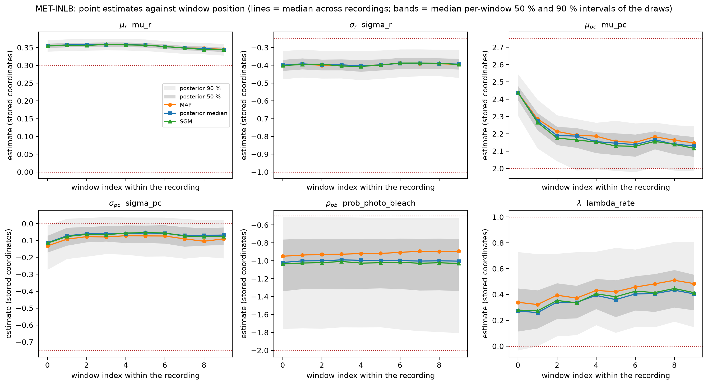

*Within-recording drift, condition MET-INLB: the MAP, posterior median and SGM as the median across recordings at each window, over the per-window central 50 % and 90 % intervals of the draws (median across recordings). Dotted red lines are the prior bounds. The three lines share one draw set, so the band is drawn once. Source: the original Experiment summaries (MET-INLB: 60 cells, 600 windows), not the retained clouds of the aggregation.*

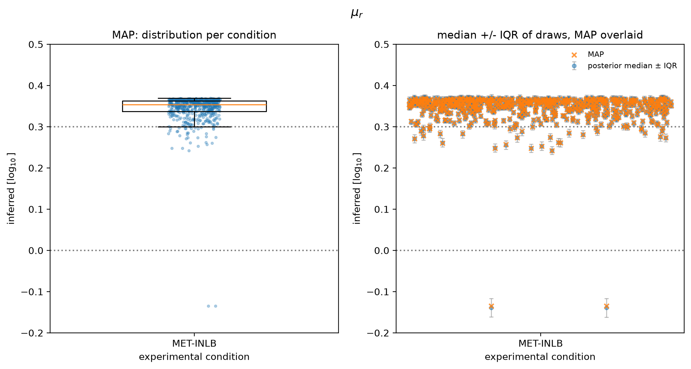

*mu_r ($\mu_{r}$). Left: per-condition distribution of the MAP (pooled over (cell x chunk)). Right: each window's median +/- IQR of its draws per condition (within-window spread), the MAP overlaid. The SGM is tabulated above and its gap to the median is in the agreement table. Source: the original Experiment summaries (MET-INLB: 60 cells, 600 windows), not the retained clouds of the aggregation.*

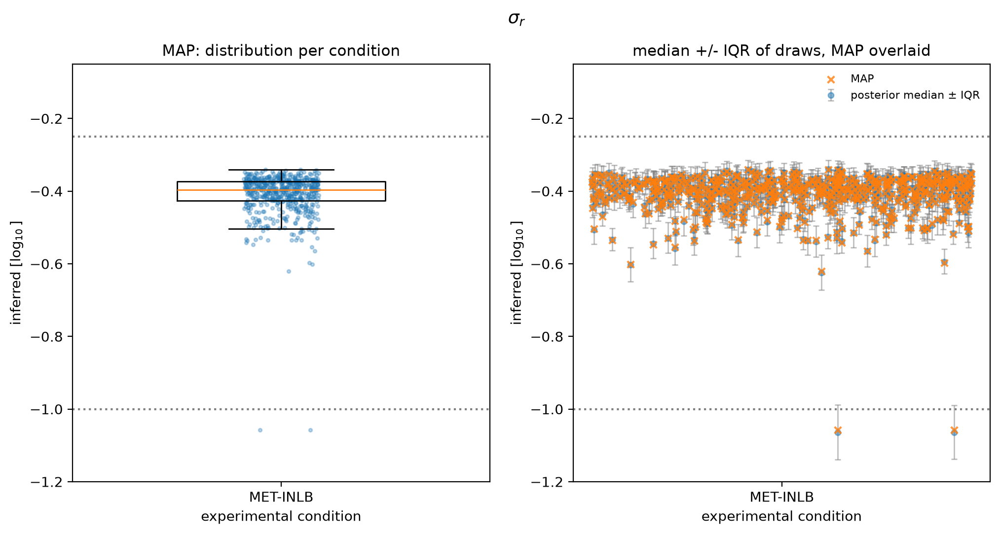

*sigma_r ($\sigma_{r}$). Left: per-condition distribution of the MAP (pooled over (cell x chunk)). Right: each window's median +/- IQR of its draws per condition (within-window spread), the MAP overlaid. The SGM is tabulated above and its gap to the median is in the agreement table. Source: the original Experiment summaries (MET-INLB: 60 cells, 600 windows), not the retained clouds of the aggregation.*

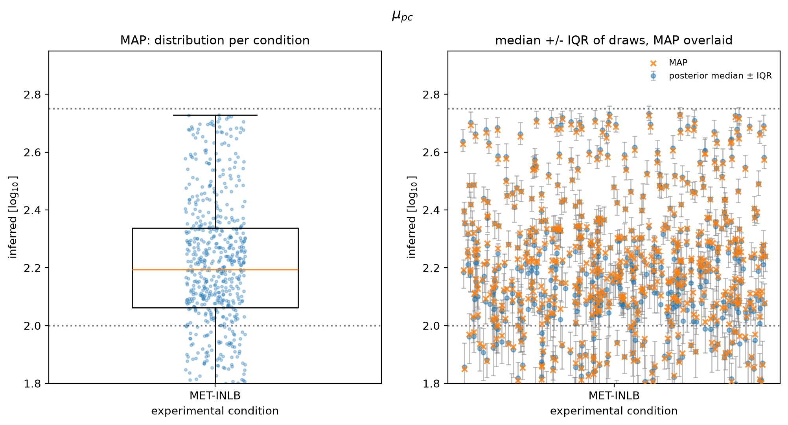

*mu_pc ($\mu_{pc}$). Left: per-condition distribution of the MAP (pooled over (cell x chunk)). Right: each window's median +/- IQR of its draws per condition (within-window spread), the MAP overlaid. The SGM is tabulated above and its gap to the median is in the agreement table. Source: the original Experiment summaries (MET-INLB: 60 cells, 600 windows), not the retained clouds of the aggregation.*

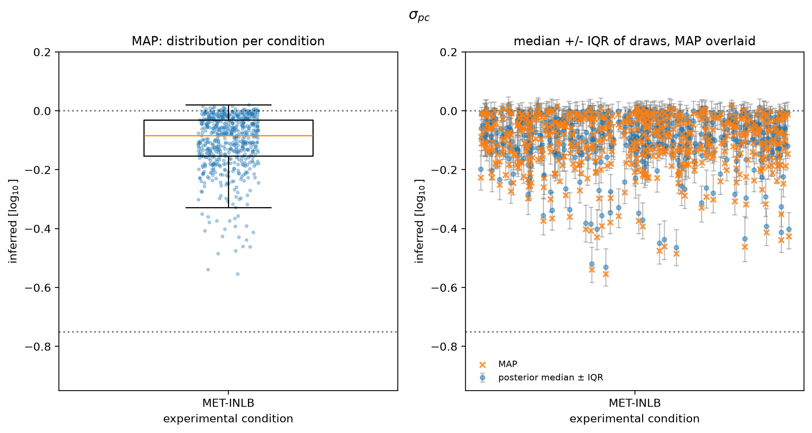

*sigma_pc ($\sigma_{pc}$). Left: per-condition distribution of the MAP (pooled over (cell x chunk)). Right: each window's median +/- IQR of its draws per condition (within-window spread), the MAP overlaid. The SGM is tabulated above and its gap to the median is in the agreement table. Source: the original Experiment summaries (MET-INLB: 60 cells, 600 windows), not the retained clouds of the aggregation.*

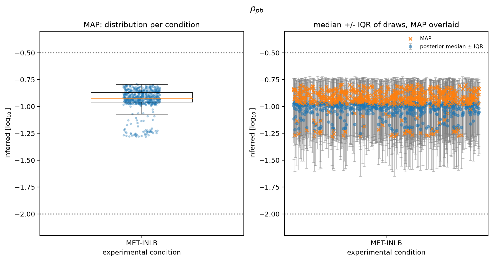

*prob_photo_bleach ($\rho_{pb}$). Left: per-condition distribution of the MAP (pooled over (cell x chunk)). Right: each window's median +/- IQR of its draws per condition (within-window spread), the MAP overlaid. The SGM is tabulated above and its gap to the median is in the agreement table. Source: the original Experiment summaries (MET-INLB: 60 cells, 600 windows), not the retained clouds of the aggregation.*

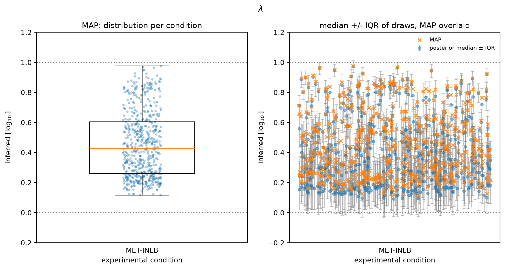

*lambda_rate ($\lambda$). Left: per-condition distribution of the MAP (pooled over (cell x chunk)). Right: each window's median +/- IQR of its draws per condition (within-window spread), the MAP overlaid. The SGM is tabulated above and its gap to the median is in the agreement table. Source: the original Experiment summaries (MET-INLB: 60 cells, 600 windows), not the retained clouds of the aggregation.*

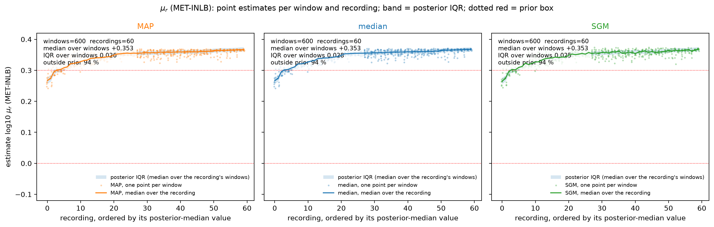

*mu_r ($\mu_{r}$), MET-INLB. The three point estimates per window, one panel each (MAP, median, SGM): recordings along the x axis ordered by their median value, one point per window, the recording's median of that estimate as the line, and the IQR of the draws (median over the recording's windows of the per-window Q25 and Q75) as the band, drawn once and identical on every panel. The estimate axis is clipped to the prior box widened by 40 %; values beyond it are counted in the tables, not drawn. Source: the original Experiment summaries (MET-INLB: 60 cells, 600 windows), not the retained clouds of the aggregation.*

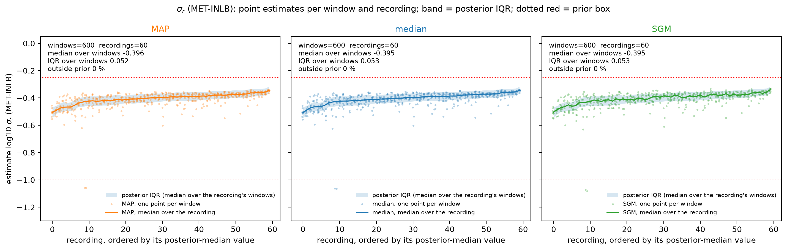

*sigma_r ($\sigma_{r}$), MET-INLB. The three point estimates per window, one panel each (MAP, median, SGM): recordings along the x axis ordered by their median value, one point per window, the recording's median of that estimate as the line, and the IQR of the draws (median over the recording's windows of the per-window Q25 and Q75) as the band, drawn once and identical on every panel. The estimate axis is clipped to the prior box widened by 40 %; values beyond it are counted in the tables, not drawn. Source: the original Experiment summaries (MET-INLB: 60 cells, 600 windows), not the retained clouds of the aggregation.*

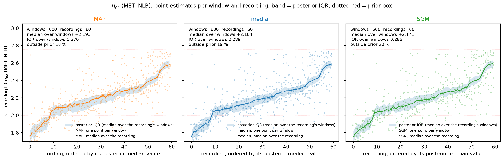

*mu_pc ($\mu_{pc}$), MET-INLB. The three point estimates per window, one panel each (MAP, median, SGM): recordings along the x axis ordered by their median value, one point per window, the recording's median of that estimate as the line, and the IQR of the draws (median over the recording's windows of the per-window Q25 and Q75) as the band, drawn once and identical on every panel. The estimate axis is clipped to the prior box widened by 40 %; values beyond it are counted in the tables, not drawn. Source: the original Experiment summaries (MET-INLB: 60 cells, 600 windows), not the retained clouds of the aggregation.*

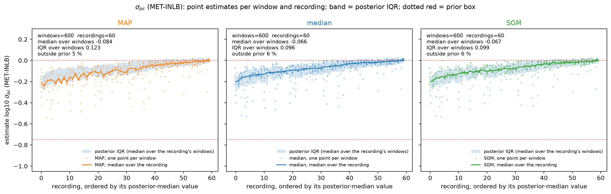

*sigma_pc ($\sigma_{pc}$), MET-INLB. The three point estimates per window, one panel each (MAP, median, SGM): recordings along the x axis ordered by their median value, one point per window, the recording's median of that estimate as the line, and the IQR of the draws (median over the recording's windows of the per-window Q25 and Q75) as the band, drawn once and identical on every panel. The estimate axis is clipped to the prior box widened by 40 %; values beyond it are counted in the tables, not drawn. Source: the original Experiment summaries (MET-INLB: 60 cells, 600 windows), not the retained clouds of the aggregation.*

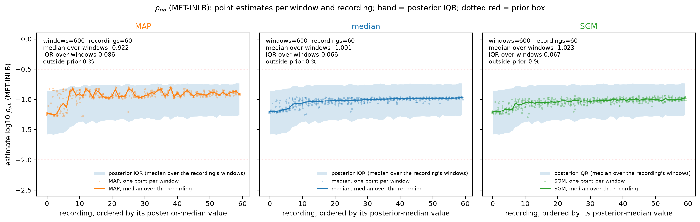

*prob_photo_bleach ($\rho_{pb}$), MET-INLB. The three point estimates per window, one panel each (MAP, median, SGM): recordings along the x axis ordered by their median value, one point per window, the recording's median of that estimate as the line, and the IQR of the draws (median over the recording's windows of the per-window Q25 and Q75) as the band, drawn once and identical on every panel. The estimate axis is clipped to the prior box widened by 40 %; values beyond it are counted in the tables, not drawn. Source: the original Experiment summaries (MET-INLB: 60 cells, 600 windows), not the retained clouds of the aggregation.*

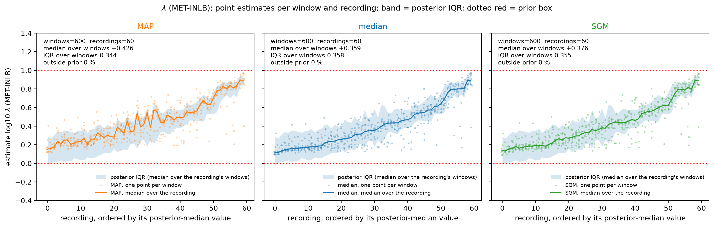

*lambda_rate ($\lambda$), MET-INLB. The three point estimates per window, one panel each (MAP, median, SGM): recordings along the x axis ordered by their median value, one point per window, the recording's median of that estimate as the line, and the IQR of the draws (median over the recording's windows of the per-window Q25 and Q75) as the band, drawn once and identical on every panel. The estimate axis is clipped to the prior box widened by 40 %; values beyond it are counted in the tables, not drawn. Source: the original Experiment summaries (MET-INLB: 60 cells, 600 windows), not the retained clouds of the aggregation.*

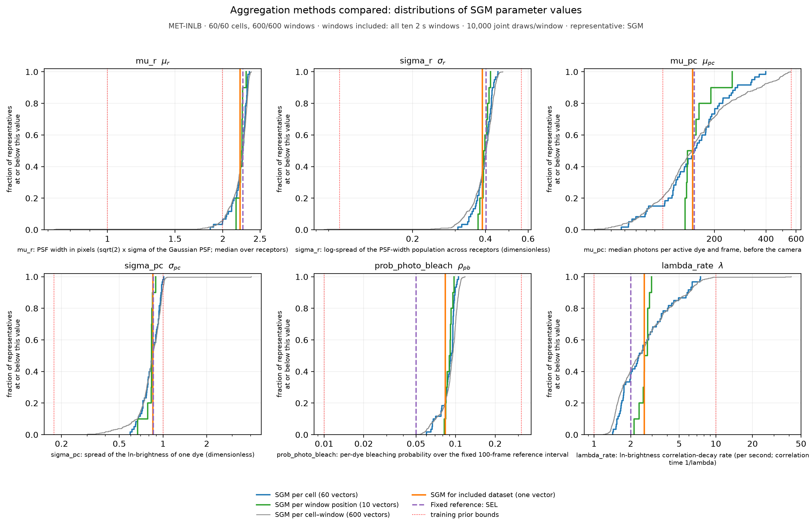

*MET-INLB · 60/60 cells, 600/600 windows · windows included: all ten 2 s windows · 10,000 joint draws/window · representative: SGM. Each panel is one parameter in physical units; each curve is the empirical cumulative distribution of one construction's SGM vectors (the fraction of its representatives at or below the x value), every construction normalized separately to total mass one, so the curves assign no weights of a selected nuisance mixture. The dataset vector and the fixed reference are vertical lines: a point representation, whose lack of width shows nothing about parameter recovery. Dotted red lines are the training-prior bounds of the estimator: training bounds, not uncertainty intervals and not clipping thresholds. Reading example: the 'SGM per cell' curve of mu_pc rises in 60 equal steps, one at the mu_pc coordinate of each complete cell-level SGM vector (the smallest 57.35 for cell 54, the largest 398.9 for cell 18). Dispersion across representatives, not posterior uncertainty.*

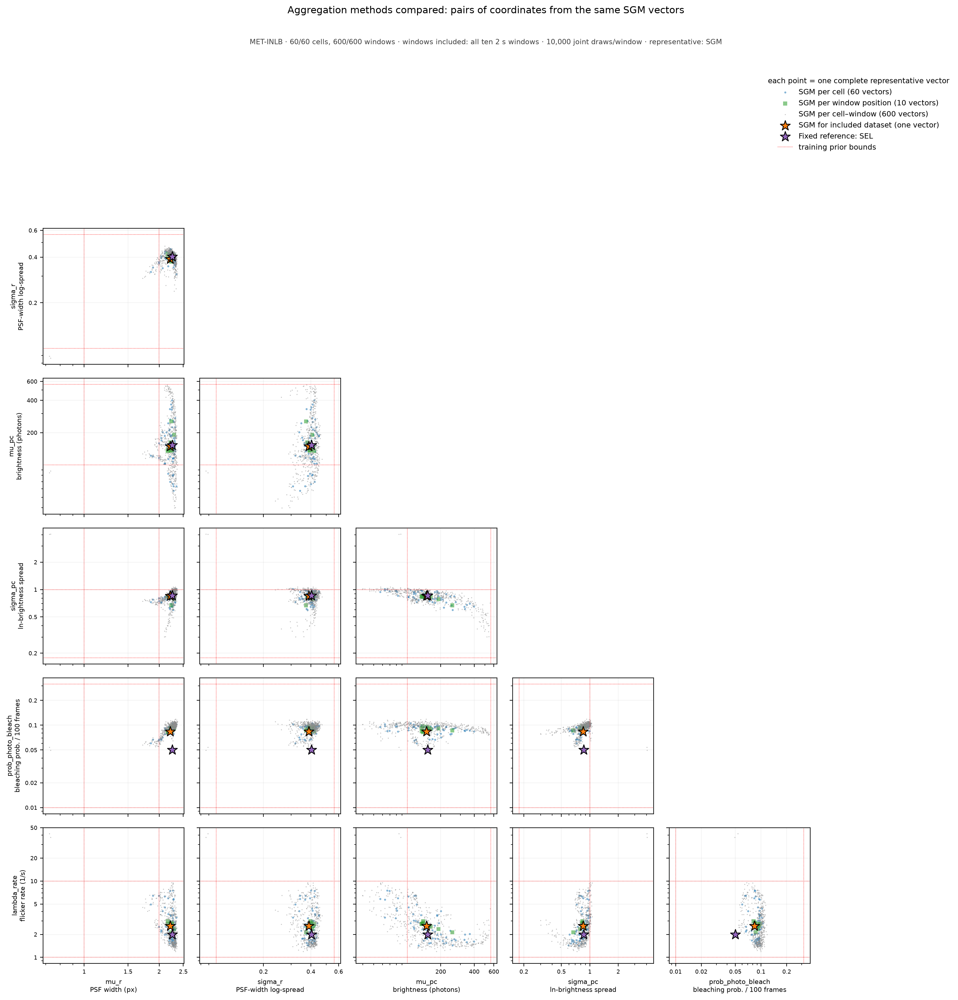

*MET-INLB · 60/60 cells, 600/600 windows · windows included: all ten 2 s windows · 10,000 joint draws/window · representative: SGM. Each point projects one complete representative vector onto a parameter pair (physical axes); the dataset vector and the fixed reference are single points; the empty half of the matrix avoids showing every pair twice. A trend across representatives is variation BETWEEN representatives, not the correlation inside an individual window posterior and not a within-window compensation law; nothing is fitted and no relation is imposed. Dotted red lines are the training-prior bounds of the estimator: training bounds, not uncertainty intervals and not clipping thresholds.*

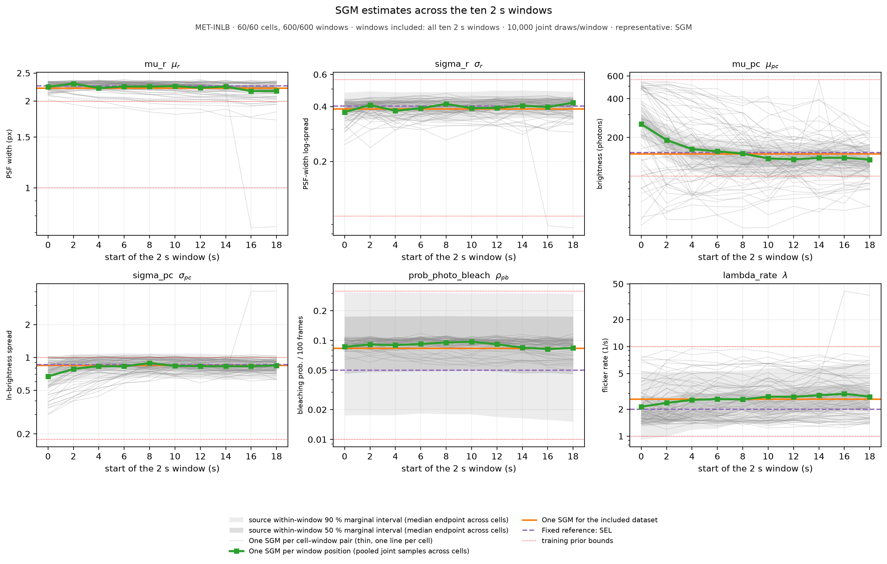

*MET-INLB · 60/60 cells, 600/600 windows · windows included: all ten 2 s windows · 10,000 joint draws/window · representative: SGM. x = start of each 2 s window within the recording. The last point at 18 s represents the frames from 18 to 20 s. Thin lines: 'SGM per cell–window', one line per cell (60 cells; identities in the report inventory). Thick line: 'SGM per window position', calculated from the joint samples pooled across cells at each position: it is not an average of the thin lines and need not lie between their values in every panel. Horizontal lines: 'SGM for included dataset' and 'Fixed reference: SEL'. Gray shading: the source within-window 50 % and 90 % marginal intervals, summarized by the median endpoint across cells: a summary of the input posteriors, not a confidence band for the thick line and not a range containing 90 % of the cells. Tightly grouped SGM centers can coexist with broad source intervals (bleaching shows this); representative dispersion is never posterior precision, and a change of a fitted imaging coordinate along the recording is assigned no physical cause here. Dotted red lines are the training-prior bounds of the estimator: training bounds, not uncertainty intervals and not clipping thresholds.*

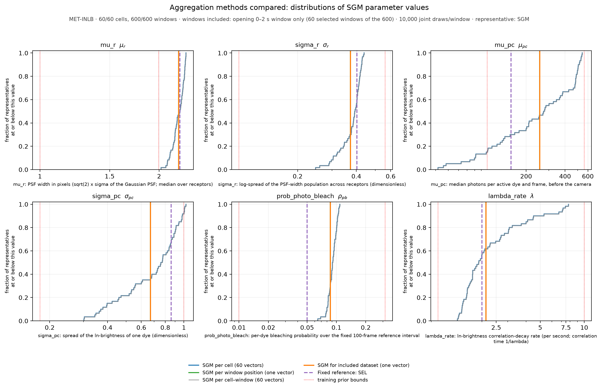

*MET-INLB · 60/60 cells, 600/600 windows · windows included: opening 0–2 s window only (60 selected windows of the 600) · 10,000 joint draws/window · representative: SGM. Each panel is one parameter in physical units; each curve is the empirical cumulative distribution of one construction's SGM vectors (the fraction of its representatives at or below the x value), every construction normalized separately to total mass one, so the curves assign no weights of a selected nuisance mixture. The dataset vector and the fixed reference are vertical lines: a point representation, whose lack of width shows nothing about parameter recovery. Dotted red lines are the training-prior bounds of the estimator: training bounds, not uncertainty intervals and not clipping thresholds. Reading example: the 'SGM per cell' curve of mu_pc rises in 60 equal steps, one at the mu_pc coordinate of each complete cell-level SGM vector (the smallest 41.68 for cell 58, the largest 542.7 for cell 13). Exact equivalences under this window selection: SGM for included dataset = SGM per window position; SGM per cell = SGM per cell–window (the same vectors drawn twice, so their curves coincide; expected, not missing output). Dispersion across representatives, not posterior uncertainty.*

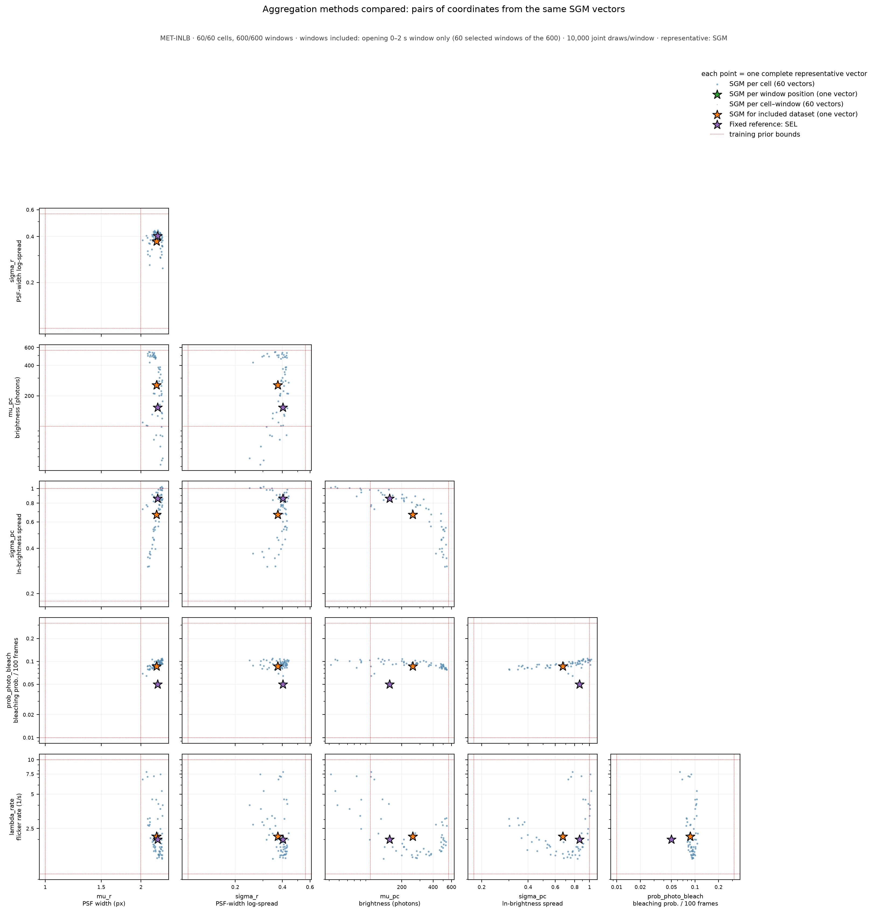

*MET-INLB · 60/60 cells, 600/600 windows · windows included: opening 0–2 s window only (60 selected windows of the 600) · 10,000 joint draws/window · representative: SGM. Each point projects one complete representative vector onto a parameter pair (physical axes); the dataset vector and the fixed reference are single points; the empty half of the matrix avoids showing every pair twice. A trend across representatives is variation BETWEEN representatives, not the correlation inside an individual window posterior and not a within-window compensation law; nothing is fitted and no relation is imposed. Dotted red lines are the training-prior bounds of the estimator: training bounds, not uncertainty intervals and not clipping thresholds. Exact equivalences under this window selection: SGM for included dataset = SGM per window position; SGM per cell = SGM per cell–window (the same vectors drawn twice, so their curves coincide; expected, not missing output).*

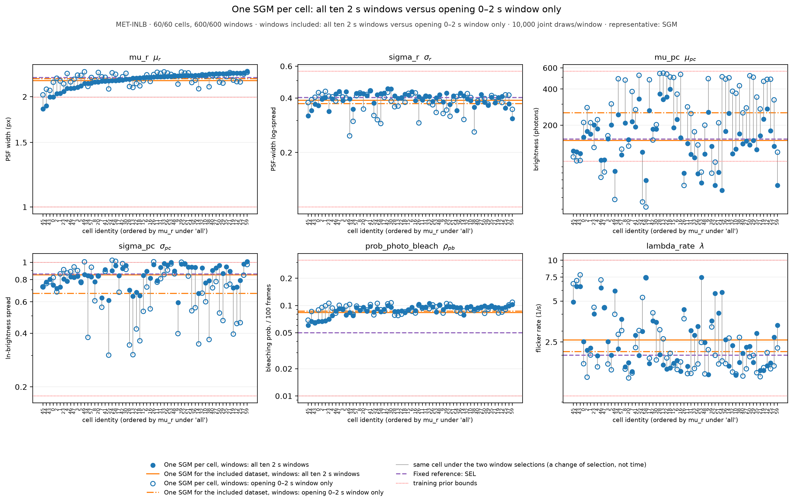

*MET-INLB · 60/60 cells, 600/600 windows · windows included: all ten 2 s windows versus opening 0–2 s window only · 10,000 joint draws/window · representative: SGM. x = cell identity. Each cell carries one marker per window selection (the per-cell construction's blue: filled for 'all ten 2 s windows', hollow for 'opening 0–2 s window only'), joined by a thin connector that represents a change of window selection, not elapsed time and not an uncertainty interval. Orange lines: 'SGM for included dataset' of each selection (one line style per selection); purple dashed: 'Fixed reference: SEL'. Blue never means the dataset vector and orange never means a per-cell vector. Examples (descriptive, not a rule): cell 54: mu_pc 506.5 (opening 0–2 s window only) against 57.35 (all ten 2 s windows); cell 3: mu_pc 163.5 (opening 0–2 s window only) against 154.3 (all ten 2 s windows). The effect of the window selection is recording-dependent. Dotted red lines are the training-prior bounds of the estimator: training bounds, not uncertainty intervals and not clipping thresholds.*

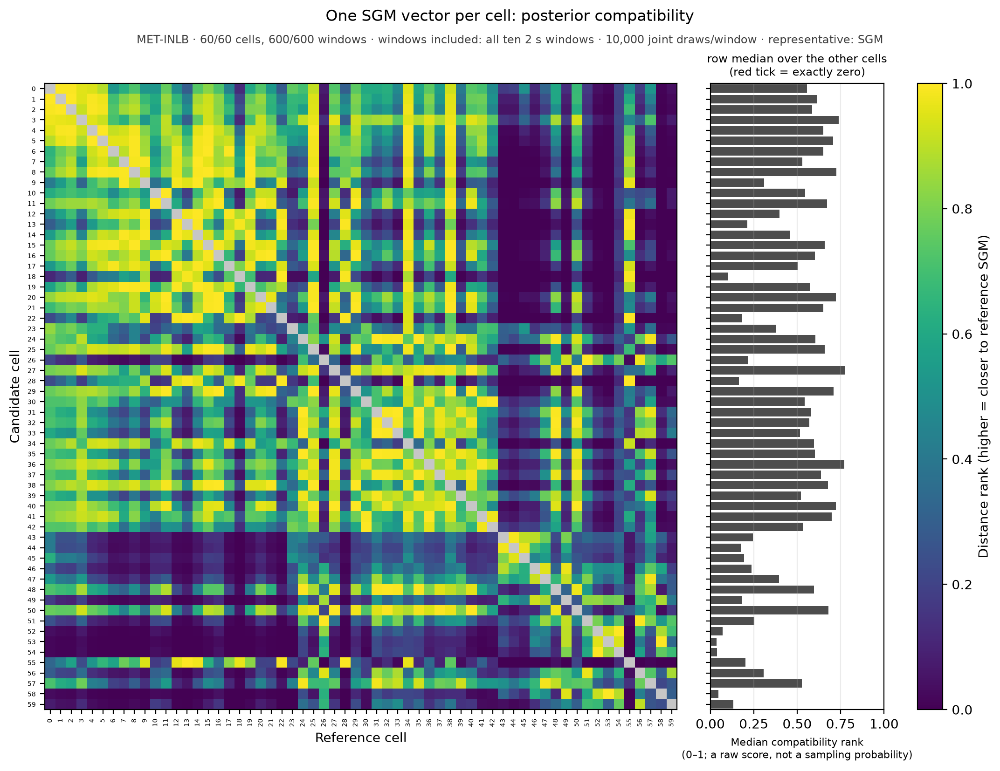

*MET-INLB · 60/60 cells, 600/600 windows · windows included: all ten 2 s windows · 10,000 joint draws/window · representative: SGM. Rows: candidate cell; columns: reference cell (stable numeric order, every cell retained). Each reference is the other cell's retained cloud, the equal-window mixture of its selected windows (10 windows x 10,000 draws), with that cell's own SGM; color = the share of the reference's draws strictly farther from its SGM than the candidate SGM, distances in estimator coordinates divided by the prior widths; the self comparison is gray (excluded). The matrix is asymmetric because each reference has its own spread. Right strip: the row median over the other cells, the raw score on the same 0–1 scale, not a sampling probability.*

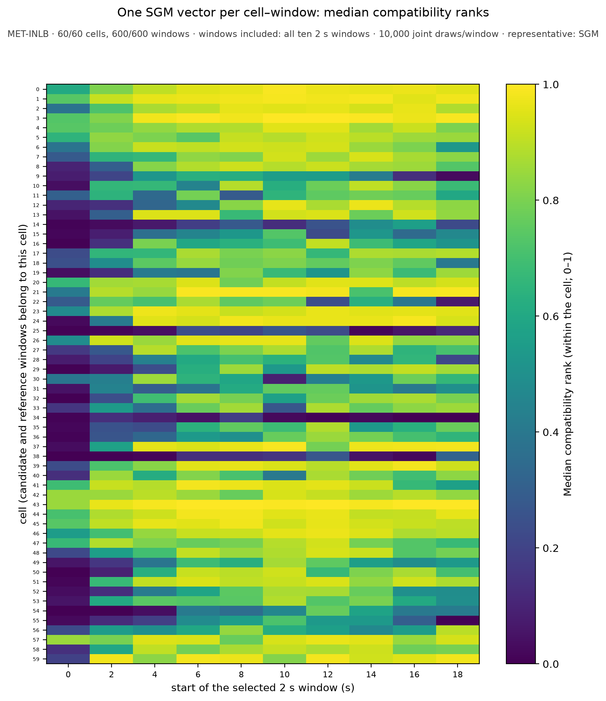

*MET-INLB · 60/60 cells, 600/600 windows · windows included: all ten 2 s windows · 10,000 joint draws/window · representative: SGM. Rows: cells in stable order; columns: the selected window start times. Color = the within-cell median compatibility rank of the cell–window SGM: its references are the other 9 selected windows of that same cell, each with its own cloud (10,000 draws) and SGM, and nothing outside the cell. Zeros stay visible as the darkest color and are centrality outcomes, not data failures (4 here). Each cell's full window-to-window matrix is in the linked atlas (compatibility/INLB/all/windows/index.md).*

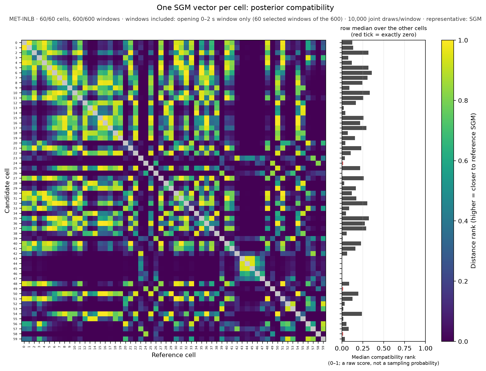

*MET-INLB · 60/60 cells, 600/600 windows · windows included: opening 0–2 s window only (60 selected windows of the 600) · 10,000 joint draws/window · representative: SGM. Rows: candidate cell; columns: reference cell (stable numeric order, every cell retained). Each reference is the other cell's retained cloud, the equal-window mixture of its selected windows (1 window x 10,000 draws), with that cell's own SGM; color = the share of the reference's draws strictly farther from its SGM than the candidate SGM, distances in estimator coordinates divided by the prior widths; the self comparison is gray (excluded). The matrix is asymmetric because each reference has its own spread. Right strip: the row median over the other cells, the raw score on the same 0–1 scale, not a sampling probability; 3 cell(s) score exactly zero (a centrality outcome, not a data quality verdict).*
