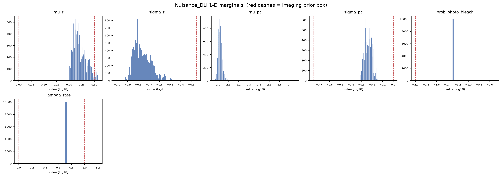
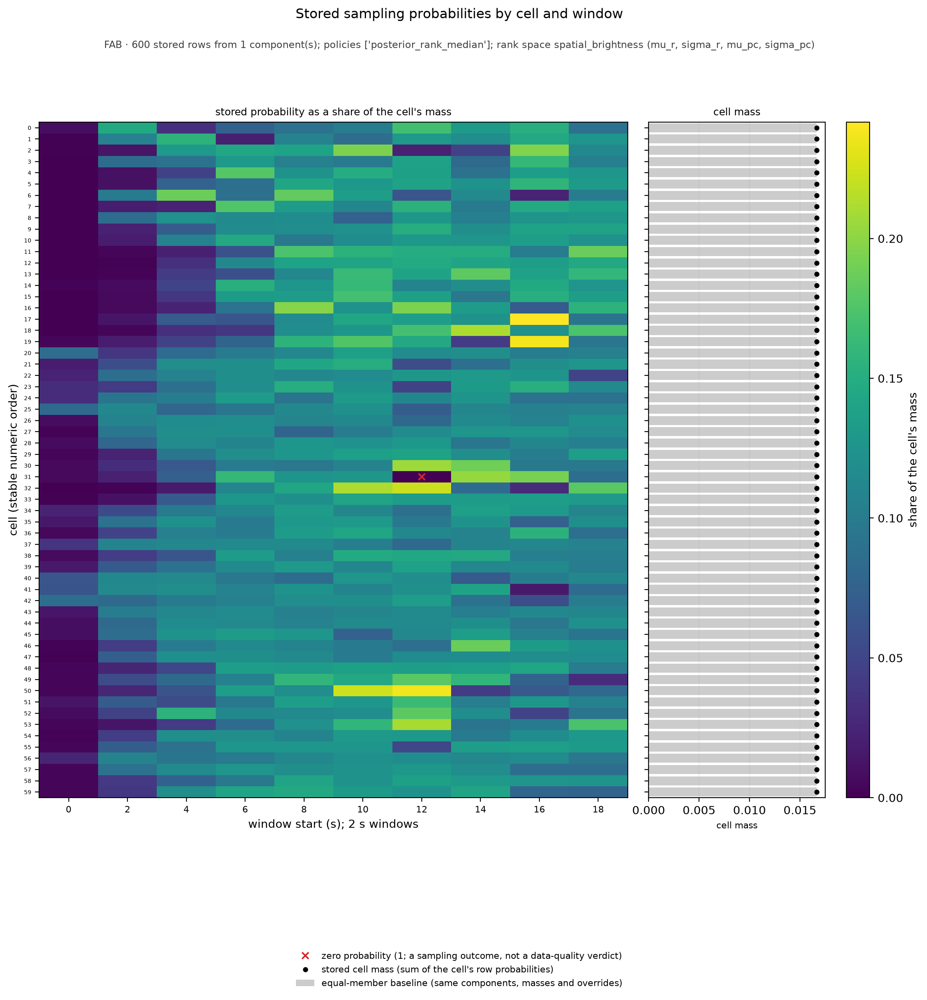
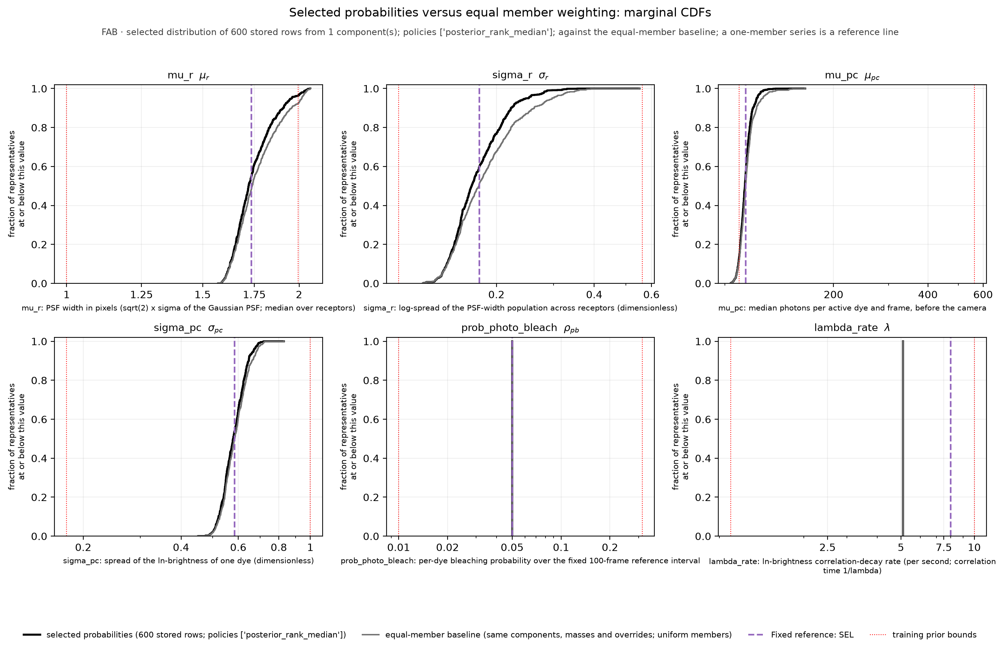
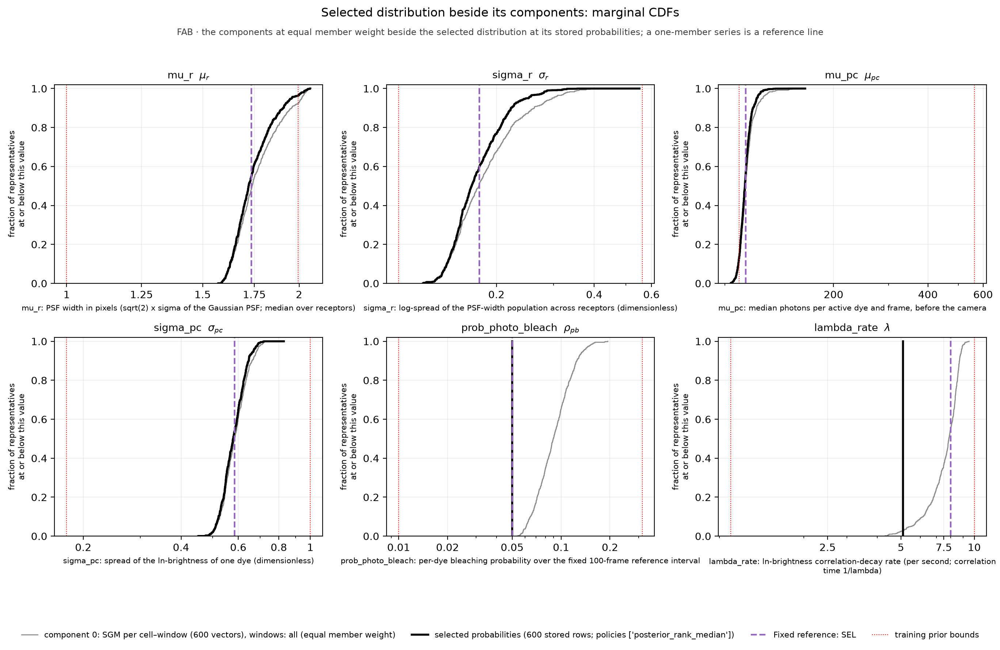
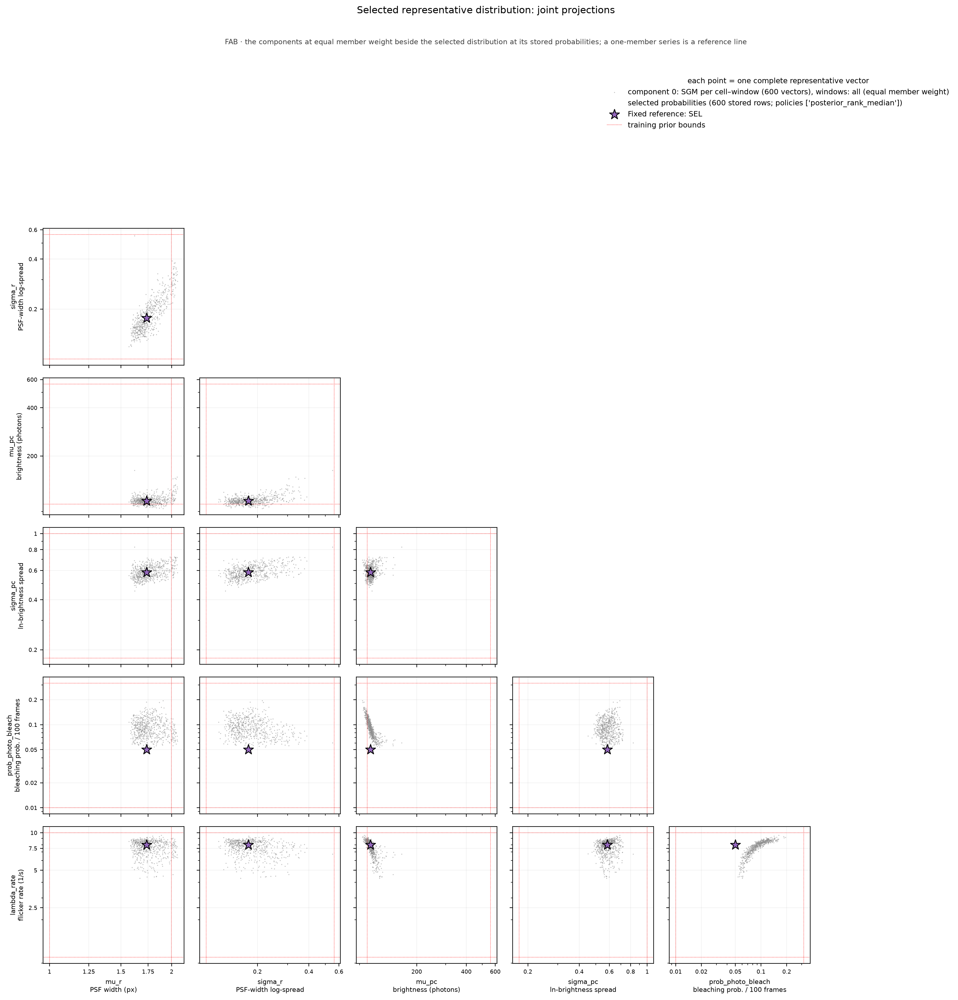

# Nuisance_DLI diagnostics - SRM_AND_SBI_MONOMER_DIMER_ALP_DETECTOR_FAB_2S_50FPS
Run: 2026-11-09 15:35:17 UTC

## Checks - 6 passed, 0 failed

| check | result | detail |
|---|---|---|
| file(artifact) | PASS | exists, 67774 bytes |
| parameter_keys_in_table_order | PASS | 6 keys: mu_r, sigma_r, mu_pc, sigma_pc, prob_photo_bleach, lambda_rate |
| shape(draws) | PASS | (10000, 6) (expected (10000, 6)) |
| no_nan_inf(draws) | PASS | clean |
| representative_probabilities_normalized | PASS | 600 vectors; total probability 1.000000000; 1 row(s) at zero |
| representative_row_provenance | PASS | 600 memberships over 600 stored rows |

## Quantitative

| metric | value | expected | meaning |
|---|---|---|---|
| frac_draws_outside_prior | 0.1765 | - | share of draws with at least one parameter outside the imaging prior box; permitted only under pool_mode='unrestricted', where it is a property of the calibration pool, not a defect. |

## Nuisance_DLI provenance

| field | value |
|---|---|
| artifact | /media/mars-fias/MARS_Data_Reserve_0/MARS_Data_Bank/Projects/RCL_Agent_Projects/srm-and-sbi-monomer-dimer-alp/Data_Bank/Posit/SRM_AND_SBI_MONOMER_DIMER_ALP_DETECTOR_FAB_2S_50FPS_RANK4_Nuisance_DLI.npz |
| posterior_sample_pool_choice | empirical_representatives |
| pool_mode | unrestricted |
| parameters | 6 |
| marginal draws | 10000 |

*How the calibrated imaging is represented for production marginalization.*

## Per-parameter marginal summary (log10)

| parameter | median | [p05, p95] | prior box | frac outside prior |
|---|---|---|---|---|
| mu_r | +0.235 | [+0.207, +0.291] | [+0.00, +0.30] | 0.036 |
| sigma_r | -0.775 | [-0.867, -0.608] | [-1.00, -0.25] | 0.000 |
| mu_pc | +2.018 | [+1.991, +2.056] | [+2.00, +2.75] | 0.142 |
| sigma_pc | -0.237 | [-0.291, -0.175] | [-0.75, +0.00] | 0.000 |
| prob_photo_bleach | -1.301 | [-1.301, -1.301] | [-2.00, -0.50] | 0.000 |
| lambda_rate | +0.708 | [+0.708, +0.708] | [+0.00, +1.00] | 0.000 |

*Drawn from the built nuisance, so this is exactly what production will sample. 'frac outside prior' is > 0 only for pool_mode='unrestricted'; bounded and the box forms stay within the prior box.*

## empirical_representatives: selection

| component | source Experiment | condition | window set | grouping | statistic | component mass | member policy | members / positive / zero | member probability (range) | effective members 1/sum(p^2) |
|---|---|---|---|---|---|---|---|---|---|---|
| 0 | SRM_AND_SBI_MONOMER_DIMER_ALP_DETECTOR_FAB_2S_50FPS_C128V42A | FAB | all | SGM per cell–window (`per_cell_window`) | sgm | 1.000000 | posterior_rank_median in rank space `spatial_brightness` (mu_r, sigma_r, mu_pc, sigma_pc) | 600 / 599 / 1 | 0.000000 – 0.004027 | 483.55 |

*rationale: Production selection RANK4 (adopted 2026-11-09 after review): one SGM representative per cell and 2 s window over all ten windows of the sixty FAB recordings (600 vectors), so that the between-cell and the within-recording variation of the effective imaging conditions across the full acquisition both enter the simulated population; member weighting posterior_rank_median keeps equal total probability per cell and, within a cell, weights each window by the median cross-posterior distance rank of its SGM among that cell's other windows (an unusual window receives less weight, a majority-zero window exactly zero, both documented; no cell is down-weighted as a whole). The four spatial and brightness coordinates of each SGM are retained together; the bleaching probability is overridden by the recorded value 0.05 (empirically anchored for Fab, declared for InlB) and the flicker rate by the direct single-dye-equivalent reference of the committed derivation, because the estimator does not recover the former and only partially recovers the latter. One complete vector is sampled per synthetic 2 s video and held fixed during it. Member weights from the ranks over the four retained coordinates only (rank space spatial_brightness), so the weights rest on exactly the coordinates the final vectors carry. | archive /media/mars-fias/MARS_Data_Reserve_0/MARS_Data_Bank/Projects/RCL_Agent_Projects/srm-and-sbi-monomer-dimer-alp/Data_Bank/Posit/SRM_AND_SBI_MONOMER_DIMER_ALP_DETECTOR_FAB_2S_50FPS_C128V42A_MAP_Experiment_COHORT60RANKSR3/aggregation_candidates.npz (sha256 5fe7091bef07…) | NOTE Complete cohort: MET-FAB 60 of 60 cells, 600 of 600 windows. The original MAP and summary references above come from the adopted product; the aggregation summaries come from the retained collections named below, fresh draws of the same estimator that do not reconstruct the original sampling attempt. | 600 member rows -> 600 unique vectors (1 at zero probability); effective rows 1/sum(p^2) over the stored rows = 483.55 (equal-member baseline 600.00); the effective number is a concentration measure of the sampling probabilities, within the stated normalization scope, not a count of independent experiments | the rows are NOT all original joint draws (a median statistic or an override is involved); the compatibility scores describe the original SGM candidates | the ranked coordinates exclude every overridden coordinate (prob_photo_bleach, lambda_rate), so the member weights rest only on coordinates the final vectors carry*

## empirical_representatives: explicit parameter overrides (applied to every vector; shown, never silent)

| parameter | value (physical) | stored (log10) | replaced range (log10) | reason |
|---|---|---|---|---|
| prob_photo_bleach | 0.05 | -1.3010 | [-1.2691, -0.7120] | empirically anchored declared per-dye bleaching probability over the fixed 100-frame reference interval: the measured whole-recording fluorescence decline of the sixty MET-FAB recordings over 20 s (0.054 to 0.057 per 100-frame interval, record ..._20S_50FPS_Direct_Fluorescence_Loss_Experiment_RAW), rounded as a working value and selected on 2026-10-01 (DETECTOR_WORKFLOW.md sec. 7.6). The estimator's own coordinate (median 0.093, MAP 0.148) is not retained: it does not recover the parameter on synthetic videos (r 0.06). Assumptions: ideal independent dyes of stationary mean brightness; the decline is not single-exponential, emitters leaving the field and label exchange are not separable from bleaching. |
| lambda_rate | 5.1 | +0.7076 | [+0.6337, +0.9787] | direct single-dye-equivalent reference: lambda_rate shape-matched to the normalized ln-brightness autocorrelation of the MET-FAB single-molecule localization tables (31,161 tracks, public accession S-BSST712; tau_corr(1/e) about 0.135 s), the matched-length model arm absorbing the finite-track detrending bias (DETECTOR_WORKFLOW.md sec. 6.5; the committed derivation Script_Bank/Analysis/SRM_AND_SBI_MONOMER_DIMER_ALP_DETECTOR_Flicker_Rate_Derivation.md). Assumptions that travel with the value: one dye per trace with the logarithm taken per trace (a multi-dye spot's ln-intensity is not a single-dye OU process and its autocorrelation also depends on sigma_pc), so this is a reference under the single-emitter assumption, not a calibration of dye multiplicity or of the image-analysis chain; mu_pc and sigma_pc cancel in the single-dye normalized autocorrelation. The adopted neural estimator's per-window coordinate (median 8.096, partially recovered, MAE 0.217 dex, r 0.49) is not retained; the neural value 8 of the SEL record (sec. 7.6) is a documented alternative. The condition-specific localization-table references, 5.1 per second for FAB and 4.7 for INLB, are similar within the reported cell-to-cell scatter; we use them as empirically anchored working overrides under the single-emitter model. Their agreement does not establish unbiased per-dye recovery; observation-chain effects and the single-dye approximation remain limitations. This is a selection from existing evidence, not a new measurement or a validation of the derivation. |

*a transformed vector is no longer the original joint draw; the compatibility scores describe the original SGMs and were not recomputed for the transformed rows.*

## empirical_representatives: weighted marginal summary (physical units; inverse weighted CDF)

| parameter | median | IQR | central 90 % range | outside-prior mass |
|---|---|---|---|---|
| mu_r | 1.7208 | 1.6679 – 1.8094 | 1.6124 – 1.9568 | 3.7 % |
| sigma_r | 0.16771 | 0.15147 – 0.19629 | 0.13601 – 0.25011 | 0.0 % |
| mu_pc | 104.28 | 101.44 – 107.16 | 98.048 – 113.76 | 13.7 % |
| sigma_pc | 0.57883 | 0.54626 – 0.61643 | 0.51142 – 0.66844 | 0.0 % |
| prob_photo_bleach | 0.05 | 0.05 – 0.05 | 0.05 – 0.05 | 0.0 % |
| lambda_rate | 5.1 | 5.1 – 5.1 | 5.1 – 5.1 | 0.0 % |

*empirical dispersion of the selected representatives under their probabilities, not a credible interval; total outside-prior mass 17.3 %.*

## empirical_representatives: exports

Per-member record (identities, the primary-space compatibility score, status and references, the rank space and the score used by the policy, contribution, stored row): `representatives_members.csv`; per stored row (probability, equal-member baseline probability, memberships by recorded identity, the stored estimator coordinates `<key>_stored_log10` and the physical values `<key>_physical`): `representatives_rows.csv`; both beside this report. Member policies in this artifact: ['posterior_rank_median']. The equal-member baseline uses the same components, component masses, duplicate consolidation and overrides with uniform members; it isolates the member weighting.

## What these mean

A check **PASS** means the invariant held; a **FAIL** aborts the run immediately with a located error message.

- **file** -- the output file exists on disk and is non-empty (the write succeeded).
- **shape** -- the array has the expected dimensions.
- **no_nan_inf** -- the array contains no NaN and no infinite values.
- **parameter_keys_in_table_order** -- the artifact's parameter order equals the detector table's, so the DLI stage maps every draw onto the right imaging row.
- **representative_probabilities_normalized** -- the stored per-vector probabilities sum to one; a component's members carry weight_k / n_k under uniform weighting, or the normalized median compatibility ranks under posterior_rank_median (a zero score is exactly zero probability, kept).
- **representative_row_provenance** -- every stored row names the members that contributed to it, by recorded identity, and their contributions add up to its probability.

## Figures

*1-D marginal of each imaging parameter under the built nuisance (sampled from the artifact); red dashes mark the imaging prior box.*

*FAB · 600 stored rows from 1 component(s); policies ['posterior_rank_median']; rank space spatial_brightness (mu_r, sigma_r, mu_pc, sigma_pc). Left: each stored row's probability as a share of its cell's total mass (rows: source cells in numeric order; columns: window start times in seconds); under the equal-member baseline every share would be 1/10. Red crosses mark rows at exactly zero: a sampling outcome of the selected policy, not a data-quality verdict. Right: the cell masses (black) against the equal-member baseline (gray bars); equal cell mass is the policy's rule. These are probabilities, not Experiment's raw ranks; the per-row values are in representatives_rows.csv.*

*Weighted empirical CDFs (physical units; the fraction of a series' mass at or below the x value) of the selected distribution at its stored probabilities, the equal-member baseline built from the same components, component masses, duplicate consolidation and overrides with uniform members (the comparison isolates the member weighting) and the fixed reference. Summary numbers use the inverse weighted empirical CDF. Dotted red lines are the training-prior bounds.*

*Each component's representatives at equal member weight (normalized to unit mass) beside the selected distribution and the reference. A component selected with the marginal-median statistic is labeled as a marginal-median vector, never as an SGM. Dotted red lines are the training-prior bounds.*

*Pairwise projections of the selected vectors (marker size follows the stored probability; a zero-probability row is drawn at the smallest size) beside the components and the reference; each point is one complete vector. Dotted red lines are the training-prior bounds.*
