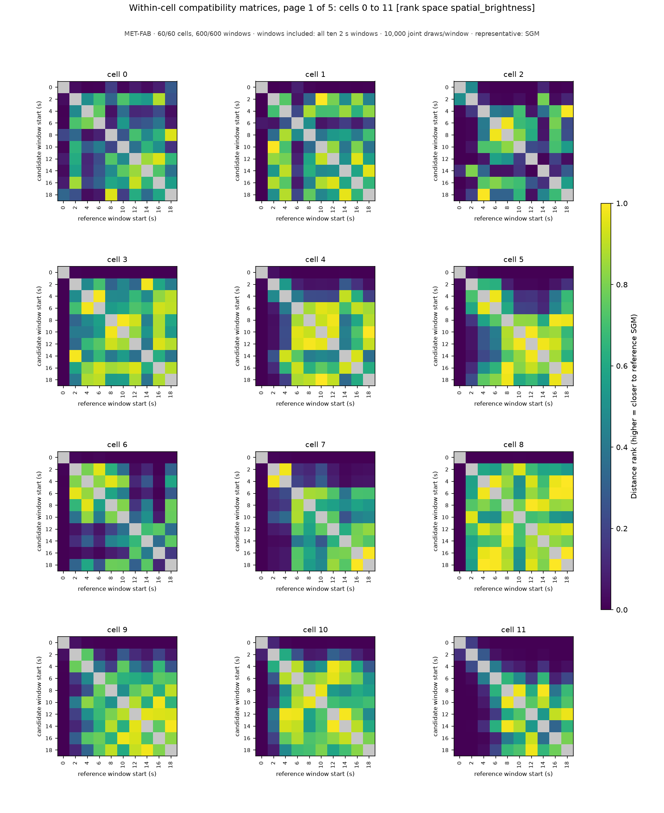
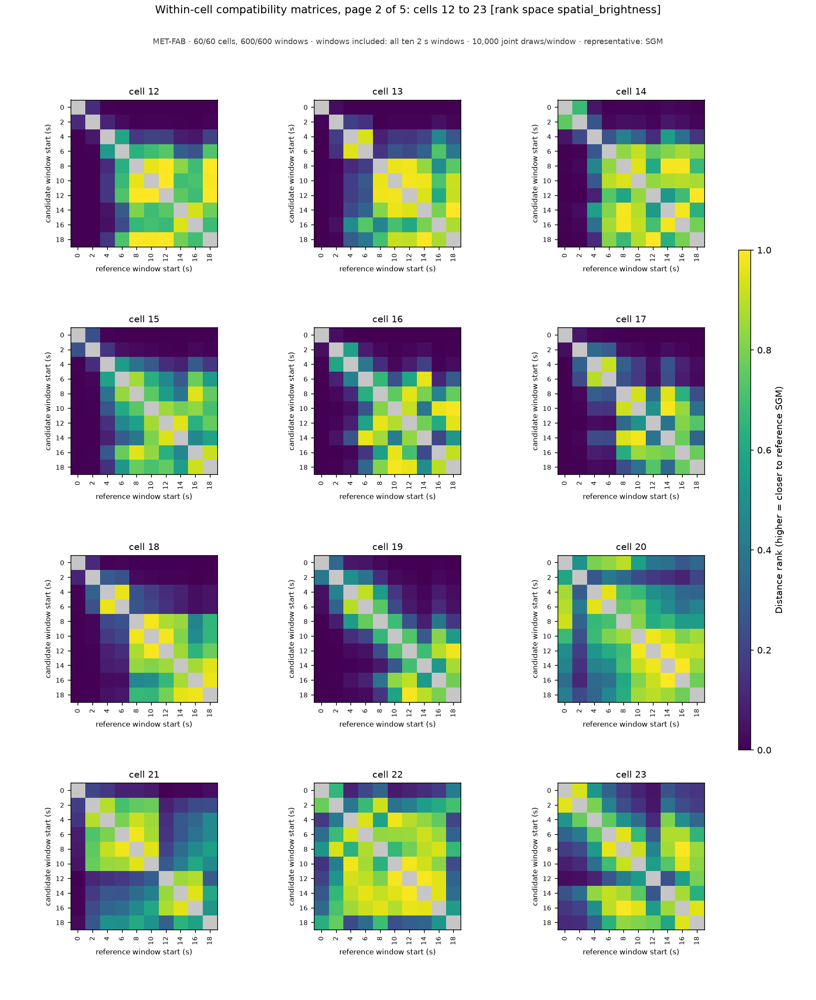
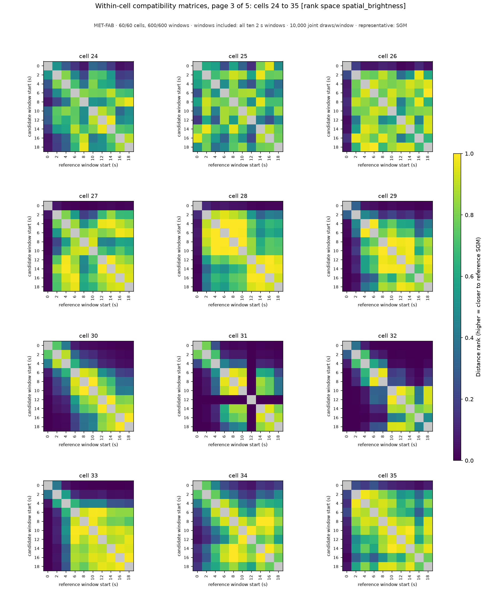
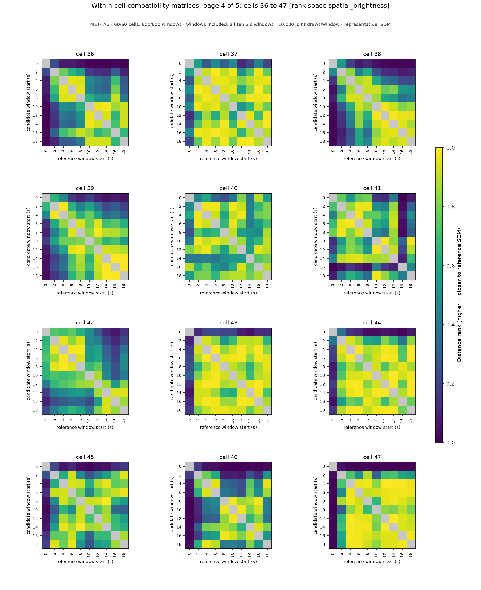
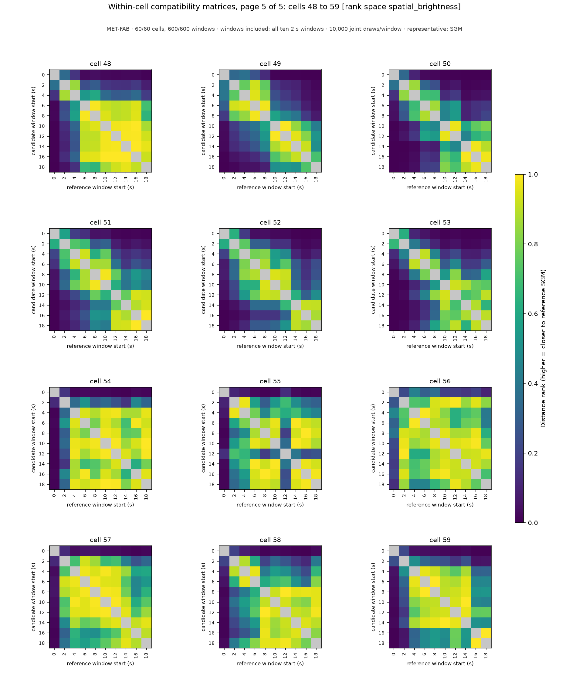

# Within-cell compatibility matrices: MET-FAB, windows included: all ten 2 s windows, rank space `spatial_brightness`

MET-FAB · 60/60 cells, 600/600 windows · windows included: all ten 2 s windows · 10,000 joint draws/window · representative: SGM

Each panel is one cell's window-to-window distance-rank matrix: rows are candidate windows, columns reference windows (both labeled by window start time in seconds); color is the share of the reference window's draws strictly farther from its own SGM than the candidate window's SGM (0–1, one scale for every panel); the self comparison is gray (excluded). Row medians (the within-cell scores) are the `compatibility_score_spatial_brightness` column of [aggregation_groups.csv](../../../../aggregation_groups.csv); every pairwise value is in [aggregation_compatibility_spatial_brightness.csv](../../../../aggregation_compatibility_spatial_brightness.csv); the matrices themselves are the `compatibility_spatial_brightness_block_*` arrays of [aggregation_candidates.npz](../../../../aggregation_candidates.npz). A zero is a centrality outcome, not a data-quality classification; raw-data notes and training-prior flags stay separate. Rank space `spatial_brightness`: distances over mu_r, sigma_r, mu_pc, sigma_pc only. Back to the [report](../../../../report.md).

| cell | page | within-cell scores by window start (s) |
|---|---|---|
| 0 | [page_01.png](page_01.png) | 0: 0.034, 2: 0.540, 4: 0.123, 6: 0.277, 8: 0.336, 10: 0.371, 12: 0.617, 14: 0.484, 16: 0.556, 18: 0.330 |
| 1 | [page_01.png](page_01.png) | 0: 0.007, 2: 0.484, 4: 0.703, 6: 0.097, 8: 0.483, 10: 0.391, 12: 0.588, 14: 0.532, 16: 0.657, 18: 0.567 |
| 2 | [page_01.png](page_01.png) | 0: 0.003, 2: 0.037, 4: 0.371, 6: 0.407, 8: 0.397, 10: 0.549, 12: 0.062, 14: 0.134, 16: 0.556, 18: 0.320 |
| 3 | [page_01.png](page_01.png) | 0: 0.003, 2: 0.459, 4: 0.487, 6: 0.697, 8: 0.566, 10: 0.542, 12: 0.740, 14: 0.450, 16: 0.862, 18: 0.562 |
| 4 | [page_01.png](page_01.png) | 0: 0.003, 2: 0.051, 4: 0.231, 6: 0.861, 8: 0.595, 10: 0.725, 12: 0.663, 14: 0.437, 16: 0.654, 18: 0.612 |
| 5 | [page_01.png](page_01.png) | 0: 0.001, 2: 0.058, 4: 0.395, 6: 0.458, 8: 0.741, 10: 0.668, 12: 0.719, 14: 0.635, 16: 0.816, 18: 0.679 |
| 6 | [page_01.png](page_01.png) | 0: 0.002, 2: 0.313, 4: 0.587, 6: 0.280, 8: 0.573, 10: 0.421, 12: 0.201, 14: 0.356, 16: 0.076, 18: 0.320 |
| 7 | [page_01.png](page_01.png) | 0: 0.001, 2: 0.073, 4: 0.094, 6: 0.705, 8: 0.534, 10: 0.440, 12: 0.621, 14: 0.399, 16: 0.592, 18: 0.551 |
| 8 | [page_01.png](page_01.png) | 0: 0.001, 2: 0.592, 4: 0.851, 6: 0.795, 8: 0.814, 10: 0.525, 12: 0.886, 14: 0.725, 16: 0.870, 18: 0.888 |
| 9 | [page_01.png](page_01.png) | 0: 0.002, 2: 0.118, 4: 0.379, 6: 0.619, 8: 0.628, 10: 0.649, 12: 0.800, 14: 0.632, 16: 0.740, 18: 0.741 |
| 10 | [page_01.png](page_01.png) | 0: 0.004, 2: 0.105, 4: 0.601, 6: 0.818, 8: 0.545, 10: 0.658, 12: 0.723, 14: 0.705, 16: 0.759, 18: 0.687 |
| 11 | [page_01.png](page_01.png) | 0: 0.001, 2: 0.013, 4: 0.077, 6: 0.216, 8: 0.617, 10: 0.552, 12: 0.532, 14: 0.531, 16: 0.361, 18: 0.662 |
| 12 | [page_02.png](page_02.png) | 0: 0.001, 2: 0.009, 4: 0.166, 6: 0.554, 8: 0.688, 10: 0.693, 12: 0.724, 14: 0.691, 16: 0.666, 18: 0.715 |
| 13 | [page_02.png](page_02.png) | 0: 0.000, 2: 0.012, 4: 0.183, 6: 0.260, 8: 0.491, 10: 0.718, 12: 0.613, 14: 0.799, 16: 0.608, 18: 0.702 |
| 14 | [page_02.png](page_02.png) | 0: 0.012, 2: 0.040, 4: 0.262, 6: 0.814, 8: 0.683, 10: 0.870, 12: 0.589, 14: 0.642, 16: 0.792, 18: 0.679 |
| 15 | [page_02.png](page_02.png) | 0: 0.002, 2: 0.024, 4: 0.160, 6: 0.549, 8: 0.554, 10: 0.706, 12: 0.571, 14: 0.396, 16: 0.635, 18: 0.561 |
| 16 | [page_02.png](page_02.png) | 0: 0.000, 2: 0.021, 4: 0.075, 6: 0.292, 8: 0.626, 10: 0.394, 12: 0.615, 14: 0.424, 16: 0.223, 18: 0.495 |
| 17 | [page_02.png](page_02.png) | 0: 0.001, 2: 0.035, 4: 0.178, 6: 0.166, 8: 0.301, 10: 0.368, 12: 0.347, 14: 0.321, 16: 0.624, 18: 0.240 |
| 18 | [page_02.png](page_02.png) | 0: 0.001, 2: 0.018, 4: 0.126, 6: 0.148, 8: 0.451, 10: 0.488, 12: 0.651, 14: 0.810, 16: 0.467, 18: 0.660 |
| 19 | [page_02.png](page_02.png) | 0: 0.005, 2: 0.029, 4: 0.076, 6: 0.124, 8: 0.250, 10: 0.283, 12: 0.234, 14: 0.069, 16: 0.380, 18: 0.153 |
| 20 | [page_02.png](page_02.png) | 0: 0.510, 2: 0.225, 4: 0.502, 6: 0.594, 8: 0.665, 10: 0.808, 12: 0.689, 14: 0.706, 16: 0.606, 18: 0.624 |
| 21 | [page_02.png](page_02.png) | 0: 0.073, 2: 0.230, 4: 0.476, 6: 0.478, 8: 0.567, 10: 0.597, 12: 0.226, 14: 0.352, 16: 0.473, 18: 0.500 |
| 22 | [page_02.png](page_02.png) | 0: 0.172, 2: 0.615, 4: 0.756, 6: 0.848, 8: 0.788, 10: 0.822, 12: 0.904, 14: 0.914, 16: 0.884, 18: 0.352 |
| 23 | [page_02.png](page_02.png) | 0: 0.181, 2: 0.237, 4: 0.505, 6: 0.669, 8: 0.851, 10: 0.694, 12: 0.268, 14: 0.742, 16: 0.856, 18: 0.644 |
| 24 | [page_03.png](page_03.png) | 0: 0.172, 2: 0.528, 4: 0.576, 6: 0.744, 8: 0.524, 10: 0.742, 12: 0.621, 14: 0.702, 16: 0.510, 18: 0.505 |
| 25 | [page_03.png](page_03.png) | 0: 0.566, 2: 0.771, 4: 0.544, 6: 0.648, 8: 0.772, 10: 0.833, 12: 0.490, 14: 0.758, 16: 0.720, 18: 0.742 |
| 26 | [page_03.png](page_03.png) | 0: 0.058, 2: 0.765, 4: 0.831, 6: 0.838, 8: 0.774, 10: 0.795, 12: 0.571, 14: 0.813, 16: 0.755, 18: 0.855 |
| 27 | [page_03.png](page_03.png) | 0: 0.015, 2: 0.671, 4: 0.840, 6: 0.849, 8: 0.552, 10: 0.713, 12: 0.821, 14: 0.890, 16: 0.888, 18: 0.823 |
| 28 | [page_03.png](page_03.png) | 0: 0.046, 2: 0.533, 4: 0.778, 6: 0.730, 8: 0.850, 10: 0.820, 12: 0.866, 14: 0.633, 16: 0.744, 18: 0.698 |
| 29 | [page_03.png](page_03.png) | 0: 0.019, 2: 0.149, 4: 0.580, 6: 0.729, 8: 0.773, 10: 0.830, 12: 0.849, 14: 0.730, 16: 0.617, 18: 0.826 |
| 30 | [page_03.png](page_03.png) | 0: 0.025, 2: 0.124, 4: 0.262, 6: 0.386, 8: 0.370, 10: 0.421, 12: 0.801, 14: 0.734, 16: 0.379, 18: 0.374 |
| 31 | [page_03.png](page_03.png) | 0: 0.018, 2: 0.067, 4: 0.223, 6: 0.489, 8: 0.380, 10: 0.389, 12: 0.000, 14: 0.617, 16: 0.584, 18: 0.265 |
| 32 | [page_03.png](page_03.png) | 0: 0.000, 2: 0.004, 4: 0.025, 6: 0.163, 8: 0.211, 10: 0.315, 12: 0.330, 14: 0.126, 16: 0.044, 18: 0.267 |
| 33 | [page_03.png](page_03.png) | 0: 0.006, 2: 0.070, 4: 0.440, 6: 0.832, 8: 0.783, 10: 0.921, 12: 0.873, 14: 0.867, 16: 0.880, 18: 0.844 |
| 34 | [page_03.png](page_03.png) | 0: 0.155, 2: 0.348, 4: 0.632, 6: 0.722, 8: 0.854, 10: 0.711, 12: 0.572, 14: 0.873, 16: 0.840, 18: 0.708 |
| 35 | [page_03.png](page_03.png) | 0: 0.105, 2: 0.616, 4: 0.826, 6: 0.678, 8: 0.878, 10: 0.884, 12: 0.668, 14: 0.846, 16: 0.506, 18: 0.820 |
| 36 | [page_04.png](page_04.png) | 0: 0.023, 2: 0.224, 4: 0.473, 6: 0.451, 8: 0.601, 10: 0.641, 12: 0.509, 14: 0.487, 16: 0.698, 18: 0.399 |
| 37 | [page_04.png](page_04.png) | 0: 0.299, 2: 0.906, 4: 0.925, 6: 0.947, 8: 0.956, 10: 0.859, 12: 0.681, 14: 0.899, 16: 0.926, 18: 0.888 |
| 38 | [page_04.png](page_04.png) | 0: 0.042, 2: 0.252, 4: 0.365, 6: 0.766, 8: 0.602, 10: 0.846, 12: 0.834, 14: 0.839, 16: 0.599, 18: 0.596 |
| 39 | [page_04.png](page_04.png) | 0: 0.108, 2: 0.438, 4: 0.583, 6: 0.734, 8: 0.832, 10: 0.710, 12: 0.882, 14: 0.713, 16: 0.741, 18: 0.645 |
| 40 | [page_04.png](page_04.png) | 0: 0.460, 2: 0.808, 4: 0.814, 6: 0.692, 8: 0.615, 10: 0.905, 12: 0.849, 14: 0.494, 16: 0.732, 18: 0.801 |
| 41 | [page_04.png](page_04.png) | 0: 0.394, 2: 0.714, 4: 0.750, 6: 0.673, 8: 0.776, 10: 0.683, 12: 0.759, 14: 0.876, 16: 0.101, 18: 0.531 |
| 42 | [page_04.png](page_04.png) | 0: 0.496, 2: 0.474, 4: 0.575, 6: 0.599, 8: 0.676, 10: 0.685, 12: 0.766, 14: 0.521, 16: 0.327, 18: 0.583 |
| 43 | [page_04.png](page_04.png) | 0: 0.124, 2: 0.836, 4: 0.923, 6: 0.963, 8: 0.866, 10: 0.906, 12: 0.948, 14: 0.851, 16: 0.931, 18: 0.915 |
| 44 | [page_04.png](page_04.png) | 0: 0.069, 2: 0.674, 4: 0.954, 6: 0.935, 8: 0.869, 10: 0.938, 12: 0.930, 14: 0.972, 16: 0.773, 18: 0.978 |
| 45 | [page_04.png](page_04.png) | 0: 0.058, 2: 0.550, 4: 0.794, 6: 0.853, 8: 0.811, 10: 0.486, 12: 0.713, 14: 0.859, 16: 0.674, 18: 0.600 |
| 46 | [page_04.png](page_04.png) | 0: 0.012, 2: 0.189, 4: 0.433, 6: 0.502, 8: 0.472, 10: 0.436, 12: 0.382, 14: 0.807, 16: 0.569, 18: 0.527 |
| 47 | [page_04.png](page_04.png) | 0: 0.009, 2: 0.587, 4: 0.972, 6: 0.968, 8: 0.919, 10: 0.804, 12: 0.945, 14: 0.948, 16: 0.952, 18: 0.944 |
| 48 | [page_05.png](page_05.png) | 0: 0.023, 2: 0.167, 4: 0.344, 6: 0.898, 8: 0.895, 10: 0.918, 12: 0.905, 14: 0.910, 16: 0.950, 18: 0.678 |
| 49 | [page_05.png](page_05.png) | 0: 0.011, 2: 0.158, 4: 0.241, 6: 0.304, 8: 0.459, 10: 0.419, 12: 0.516, 14: 0.457, 16: 0.222, 18: 0.088 |
| 50 | [page_05.png](page_05.png) | 0: 0.007, 2: 0.060, 4: 0.142, 6: 0.310, 8: 0.271, 10: 0.512, 12: 0.543, 14: 0.097, 16: 0.153, 18: 0.190 |
| 51 | [page_05.png](page_05.png) | 0: 0.050, 2: 0.273, 4: 0.217, 6: 0.376, 8: 0.529, 10: 0.494, 12: 0.641, 14: 0.402, 16: 0.499, 18: 0.415 |
| 52 | [page_05.png](page_05.png) | 0: 0.021, 2: 0.142, 4: 0.469, 6: 0.337, 8: 0.344, 10: 0.356, 12: 0.543, 14: 0.353, 16: 0.150, 18: 0.279 |
| 53 | [page_05.png](page_05.png) | 0: 0.012, 2: 0.047, 4: 0.142, 6: 0.285, 8: 0.412, 10: 0.537, 12: 0.710, 14: 0.312, 16: 0.336, 18: 0.581 |
| 54 | [page_05.png](page_05.png) | 0: 0.019, 2: 0.322, 4: 0.884, 6: 0.876, 8: 0.798, 10: 0.954, 12: 0.946, 14: 0.731, 16: 0.865, 18: 0.949 |
| 55 | [page_05.png](page_05.png) | 0: 0.024, 2: 0.490, 4: 0.624, 6: 0.872, 8: 0.876, 10: 0.876, 12: 0.353, 14: 0.924, 16: 0.939, 18: 0.904 |
| 56 | [page_05.png](page_05.png) | 0: 0.195, 2: 0.847, 4: 0.733, 6: 0.773, 8: 0.876, 10: 0.949, 12: 0.919, 14: 0.873, 16: 0.914, 18: 0.753 |
| 57 | [page_05.png](page_05.png) | 0: 0.032, 2: 0.675, 4: 0.851, 6: 0.936, 8: 0.885, 10: 0.914, 12: 0.954, 14: 0.878, 16: 0.645, 18: 0.644 |
| 58 | [page_05.png](page_05.png) | 0: 0.020, 2: 0.260, 4: 0.492, 6: 0.635, 8: 0.920, 10: 0.813, 12: 0.896, 14: 0.854, 16: 0.826, 18: 0.819 |
| 59 | [page_05.png](page_05.png) | 0: 0.023, 2: 0.245, 4: 0.742, 6: 0.878, 8: 0.906, 10: 0.818, 12: 0.765, 14: 0.875, 16: 0.489, 18: 0.479 |

## Pages

### Page 1: cells 0, 1, 2, 3, 4, 5, 6, 7, 8, 9, 10, 11

### Page 2: cells 12, 13, 14, 15, 16, 17, 18, 19, 20, 21, 22, 23

### Page 3: cells 24, 25, 26, 27, 28, 29, 30, 31, 32, 33, 34, 35

### Page 4: cells 36, 37, 38, 39, 40, 41, 42, 43, 44, 45, 46, 47

### Page 5: cells 48, 49, 50, 51, 52, 53, 54, 55, 56, 57, 58, 59

