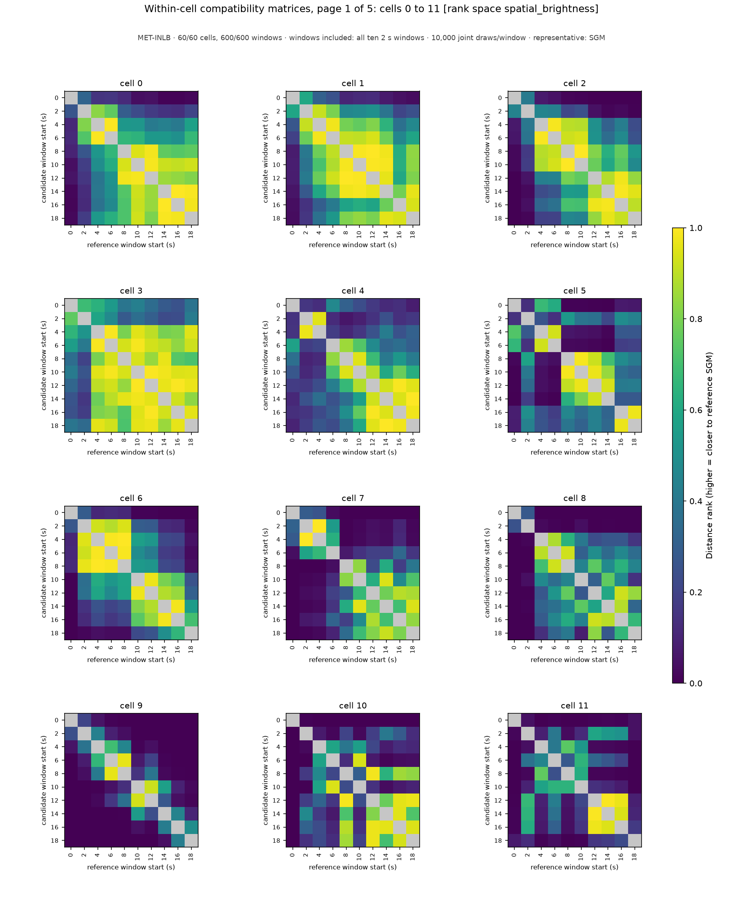
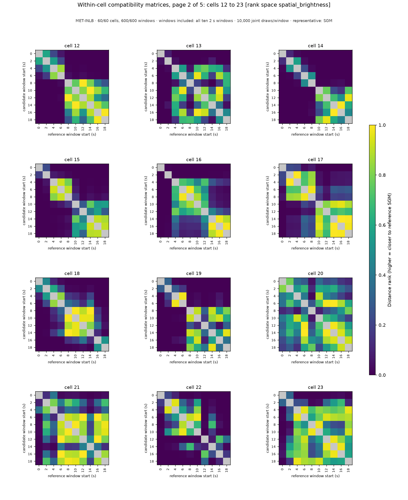
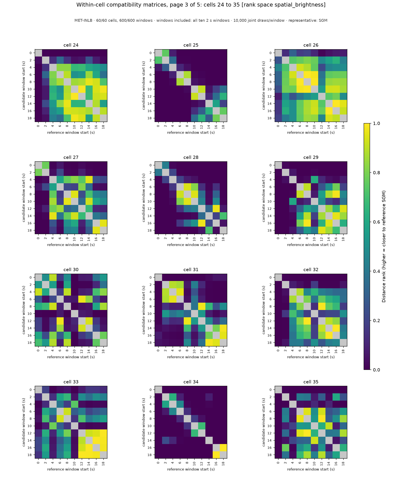
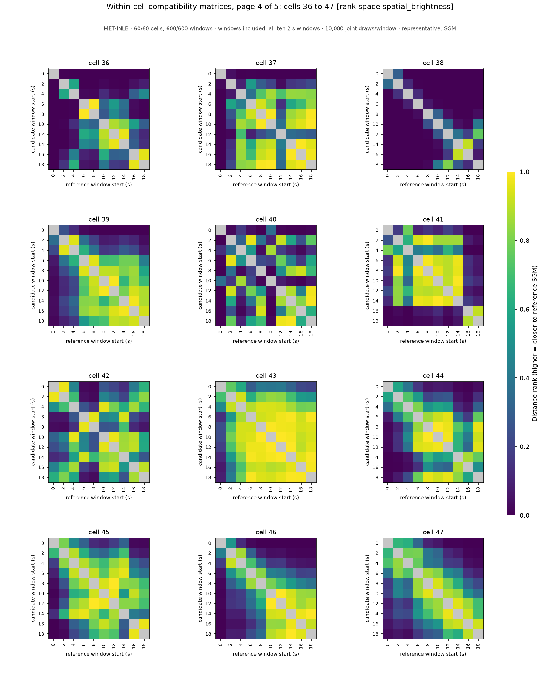
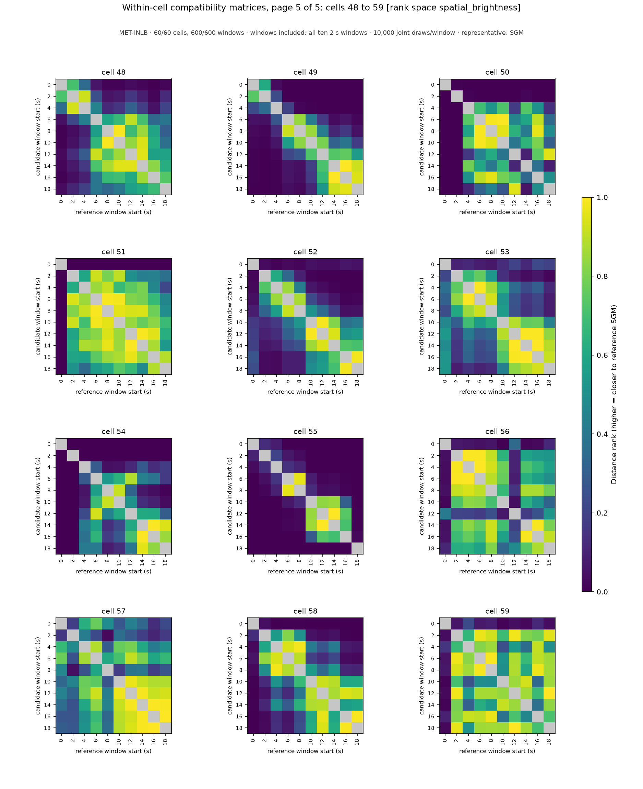

# Within-cell compatibility matrices: MET-INLB, windows included: all ten 2 s windows, rank space `spatial_brightness`

MET-INLB · 60/60 cells, 600/600 windows · windows included: all ten 2 s windows · 10,000 joint draws/window · representative: SGM

Each panel is one cell's window-to-window distance-rank matrix: rows are candidate windows, columns reference windows (both labeled by window start time in seconds); color is the share of the reference window's draws strictly farther from its own SGM than the candidate window's SGM (0–1, one scale for every panel); the self comparison is gray (excluded). Row medians (the within-cell scores) are the `compatibility_score_spatial_brightness` column of [aggregation_groups.csv](../../../../aggregation_groups.csv); every pairwise value is in [aggregation_compatibility_spatial_brightness.csv](../../../../aggregation_compatibility_spatial_brightness.csv); the matrices themselves are the `compatibility_spatial_brightness_block_*` arrays of [aggregation_candidates.npz](../../../../aggregation_candidates.npz). A zero is a centrality outcome, not a data-quality classification; raw-data notes and training-prior flags stay separate. Rank space `spatial_brightness`: distances over mu_r, sigma_r, mu_pc, sigma_pc only. Back to the [report](../../../../report.md).

| cell | page | within-cell scores by window start (s) |
|---|---|---|
| 0 | [page_01.png](page_01.png) | 0: 0.043, 2: 0.230, 4: 0.526, 6: 0.645, 8: 0.737, 10: 0.909, 12: 0.810, 14: 0.731, 16: 0.721, 18: 0.722 |
| 1 | [page_01.png](page_01.png) | 0: 0.118, 2: 0.480, 4: 0.760, 6: 0.778, 8: 0.833, 10: 0.831, 12: 0.805, 14: 0.787, 16: 0.580, 18: 0.800 |
| 2 | [page_01.png](page_01.png) | 0: 0.009, 2: 0.215, 4: 0.425, 6: 0.474, 8: 0.760, 10: 0.740, 12: 0.753, 14: 0.542, 16: 0.700, 18: 0.445 |
| 3 | [page_01.png](page_01.png) | 0: 0.388, 2: 0.362, 4: 0.808, 6: 0.923, 8: 0.799, 10: 0.952, 12: 0.931, 14: 0.895, 16: 0.828, 18: 0.928 |
| 4 | [page_01.png](page_01.png) | 0: 0.158, 2: 0.146, 4: 0.253, 6: 0.362, 8: 0.418, 10: 0.625, 12: 0.668, 14: 0.361, 16: 0.493, 18: 0.378 |
| 5 | [page_01.png](page_01.png) | 0: 0.066, 2: 0.368, 4: 0.271, 6: 0.142, 8: 0.482, 10: 0.357, 12: 0.413, 14: 0.279, 16: 0.350, 18: 0.338 |
| 6 | [page_01.png](page_01.png) | 0: 0.011, 2: 0.285, 4: 0.524, 6: 0.417, 8: 0.521, 10: 0.578, 12: 0.575, 14: 0.257, 16: 0.219, 18: 0.039 |
| 7 | [page_01.png](page_01.png) | 0: 0.000, 2: 0.040, 4: 0.044, 6: 0.188, 8: 0.186, 10: 0.475, 12: 0.277, 14: 0.616, 16: 0.320, 18: 0.351 |
| 8 | [page_01.png](page_01.png) | 0: 0.000, 2: 0.004, 4: 0.267, 6: 0.353, 8: 0.480, 10: 0.357, 12: 0.522, 14: 0.370, 16: 0.461, 18: 0.277 |
| 9 | [page_01.png](page_01.png) | 0: 0.001, 2: 0.003, 4: 0.042, 6: 0.067, 8: 0.035, 10: 0.050, 12: 0.042, 14: 0.007, 16: 0.000, 18: 0.000 |
| 10 | [page_01.png](page_01.png) | 0: 0.000, 2: 0.128, 4: 0.130, 6: 0.036, 8: 0.468, 10: 0.098, 12: 0.323, 14: 0.473, 16: 0.314, 18: 0.224 |
| 11 | [page_01.png](page_01.png) | 0: 0.009, 2: 0.118, 4: 0.024, 6: 0.280, 8: 0.015, 10: 0.115, 12: 0.211, 14: 0.183, 16: 0.170, 18: 0.072 |
| 12 | [page_02.png](page_02.png) | 0: 0.001, 2: 0.001, 4: 0.009, 6: 0.029, 8: 0.262, 10: 0.671, 12: 0.360, 14: 0.730, 16: 0.428, 18: 0.259 |
| 13 | [page_02.png](page_02.png) | 0: 0.000, 2: 0.003, 4: 0.556, 6: 0.559, 8: 0.065, 10: 0.525, 12: 0.640, 14: 0.180, 16: 0.468, 18: 0.211 |
| 14 | [page_02.png](page_02.png) | 0: 0.000, 2: 0.000, 4: 0.000, 6: 0.002, 8: 0.007, 10: 0.000, 12: 0.001, 14: 0.015, 16: 0.026, 18: 0.001 |
| 15 | [page_02.png](page_02.png) | 0: 0.000, 2: 0.001, 4: 0.007, 6: 0.016, 8: 0.046, 10: 0.151, 12: 0.006, 14: 0.043, 16: 0.022, 18: 0.041 |
| 16 | [page_02.png](page_02.png) | 0: 0.000, 2: 0.003, 4: 0.269, 6: 0.074, 8: 0.089, 10: 0.117, 12: 0.444, 14: 0.185, 16: 0.120, 18: 0.090 |
| 17 | [page_02.png](page_02.png) | 0: 0.001, 2: 0.059, 4: 0.063, 6: 0.280, 8: 0.196, 10: 0.212, 12: 0.064, 14: 0.318, 16: 0.285, 18: 0.305 |
| 18 | [page_02.png](page_02.png) | 0: 0.001, 2: 0.018, 4: 0.124, 6: 0.220, 8: 0.153, 10: 0.206, 12: 0.092, 14: 0.158, 16: 0.118, 18: 0.006 |
| 19 | [page_02.png](page_02.png) | 0: 0.000, 2: 0.002, 4: 0.011, 6: 0.016, 8: 0.307, 10: 0.169, 12: 0.037, 14: 0.337, 16: 0.085, 18: 0.360 |
| 20 | [page_02.png](page_02.png) | 0: 0.266, 2: 0.554, 4: 0.396, 6: 0.696, 8: 0.246, 10: 0.590, 12: 0.611, 14: 0.682, 16: 0.496, 18: 0.547 |
| 21 | [page_02.png](page_02.png) | 0: 0.034, 2: 0.427, 4: 0.326, 6: 0.850, 8: 0.856, 10: 0.852, 12: 0.797, 14: 0.154, 16: 0.856, 18: 0.820 |
| 22 | [page_02.png](page_02.png) | 0: 0.002, 2: 0.125, 4: 0.072, 6: 0.289, 8: 0.096, 10: 0.165, 12: 0.000, 14: 0.097, 16: 0.005, 18: 0.000 |
| 23 | [page_02.png](page_02.png) | 0: 0.005, 2: 0.240, 4: 0.782, 6: 0.866, 8: 0.386, 10: 0.615, 12: 0.602, 14: 0.574, 16: 0.704, 18: 0.647 |
| 24 | [page_03.png](page_03.png) | 0: 0.000, 2: 0.080, 4: 0.601, 6: 0.535, 8: 0.859, 10: 0.669, 12: 0.678, 14: 0.647, 16: 0.873, 18: 0.569 |
| 25 | [page_03.png](page_03.png) | 0: 0.000, 2: 0.000, 4: 0.001, 6: 0.002, 8: 0.005, 10: 0.023, 12: 0.008, 14: 0.000, 16: 0.001, 18: 0.002 |
| 26 | [page_03.png](page_03.png) | 0: 0.111, 2: 0.639, 4: 0.489, 6: 0.766, 8: 0.850, 10: 0.869, 12: 0.486, 14: 0.759, 16: 0.777, 18: 0.754 |
| 27 | [page_03.png](page_03.png) | 0: 0.005, 2: 0.016, 4: 0.577, 6: 0.219, 8: 0.411, 10: 0.490, 12: 0.311, 14: 0.391, 16: 0.260, 18: 0.175 |
| 28 | [page_03.png](page_03.png) | 0: 0.000, 2: 0.000, 4: 0.008, 6: 0.135, 8: 0.054, 10: 0.028, 12: 0.142, 14: 0.011, 16: 0.160, 18: 0.000 |
| 29 | [page_03.png](page_03.png) | 0: 0.000, 2: 0.001, 4: 0.038, 6: 0.198, 8: 0.459, 10: 0.121, 12: 0.477, 14: 0.570, 16: 0.625, 18: 0.413 |
| 30 | [page_03.png](page_03.png) | 0: 0.383, 2: 0.115, 4: 0.601, 6: 0.220, 8: 0.592, 10: 0.004, 12: 0.144, 14: 0.158, 16: 0.279, 18: 0.534 |
| 31 | [page_03.png](page_03.png) | 0: 0.005, 2: 0.056, 4: 0.023, 6: 0.035, 8: 0.245, 10: 0.332, 12: 0.205, 14: 0.123, 16: 0.076, 18: 0.078 |
| 32 | [page_03.png](page_03.png) | 0: 0.000, 2: 0.010, 4: 0.384, 6: 0.589, 8: 0.453, 10: 0.213, 12: 0.462, 14: 0.432, 16: 0.453, 18: 0.404 |
| 33 | [page_03.png](page_03.png) | 0: 0.076, 2: 0.434, 4: 0.035, 6: 0.325, 8: 0.491, 10: 0.033, 12: 0.628, 14: 0.470, 16: 0.563, 18: 0.548 |
| 34 | [page_03.png](page_03.png) | 0: 0.000, 2: 0.001, 4: 0.001, 6: 0.001, 8: 0.000, 10: 0.000, 12: 0.000, 14: 0.000, 16: 0.000, 18: 0.000 |
| 35 | [page_03.png](page_03.png) | 0: 0.000, 2: 0.251, 4: 0.019, 6: 0.416, 8: 0.502, 10: 0.337, 12: 0.418, 14: 0.248, 16: 0.488, 18: 0.432 |
| 36 | [page_04.png](page_04.png) | 0: 0.000, 2: 0.007, 4: 0.044, 6: 0.031, 8: 0.024, 10: 0.317, 12: 0.259, 14: 0.294, 16: 0.306, 18: 0.164 |
| 37 | [page_04.png](page_04.png) | 0: 0.001, 2: 0.179, 4: 0.729, 6: 0.598, 8: 0.855, 10: 0.867, 12: 0.288, 14: 0.861, 16: 0.854, 18: 0.844 |
| 38 | [page_04.png](page_04.png) | 0: 0.000, 2: 0.000, 4: 0.001, 6: 0.001, 8: 0.004, 10: 0.014, 12: 0.011, 14: 0.001, 16: 0.000, 18: 0.019 |
| 39 | [page_04.png](page_04.png) | 0: 0.004, 2: 0.139, 4: 0.227, 6: 0.692, 8: 0.808, 10: 0.681, 12: 0.793, 14: 0.813, 16: 0.845, 18: 0.677 |
| 40 | [page_04.png](page_04.png) | 0: 0.012, 2: 0.372, 4: 0.137, 6: 0.429, 8: 0.362, 10: 0.078, 12: 0.540, 14: 0.599, 16: 0.251, 18: 0.612 |
| 41 | [page_04.png](page_04.png) | 0: 0.109, 2: 0.856, 4: 0.421, 6: 0.897, 8: 0.898, 10: 0.826, 12: 0.839, 14: 0.835, 16: 0.061, 18: 0.021 |
| 42 | [page_04.png](page_04.png) | 0: 0.265, 2: 0.447, 4: 0.656, 6: 0.268, 8: 0.137, 10: 0.594, 12: 0.604, 14: 0.568, 16: 0.660, 18: 0.574 |
| 43 | [page_04.png](page_04.png) | 0: 0.390, 2: 0.704, 4: 0.888, 6: 0.927, 8: 0.937, 10: 0.938, 12: 0.955, 14: 0.969, 16: 0.904, 18: 0.946 |
| 44 | [page_04.png](page_04.png) | 0: 0.065, 2: 0.255, 4: 0.516, 6: 0.728, 8: 0.740, 10: 0.646, 12: 0.646, 14: 0.544, 16: 0.323, 18: 0.774 |
| 45 | [page_04.png](page_04.png) | 0: 0.179, 2: 0.484, 4: 0.766, 6: 0.741, 8: 0.814, 10: 0.679, 12: 0.822, 14: 0.657, 16: 0.414, 18: 0.329 |
| 46 | [page_04.png](page_04.png) | 0: 0.003, 2: 0.039, 4: 0.167, 6: 0.398, 8: 0.467, 10: 0.719, 12: 0.608, 14: 0.412, 16: 0.288, 18: 0.350 |
| 47 | [page_04.png](page_04.png) | 0: 0.062, 2: 0.329, 4: 0.364, 6: 0.477, 8: 0.444, 10: 0.507, 12: 0.694, 14: 0.697, 16: 0.437, 18: 0.267 |
| 48 | [page_05.png](page_05.png) | 0: 0.019, 2: 0.122, 4: 0.199, 6: 0.433, 8: 0.562, 10: 0.621, 12: 0.578, 14: 0.717, 16: 0.611, 18: 0.392 |
| 49 | [page_05.png](page_05.png) | 0: 0.000, 2: 0.000, 4: 0.005, 6: 0.054, 8: 0.124, 10: 0.311, 12: 0.267, 14: 0.058, 16: 0.052, 18: 0.038 |
| 50 | [page_05.png](page_05.png) | 0: 0.000, 2: 0.001, 4: 0.500, 6: 0.593, 8: 0.584, 10: 0.650, 12: 0.383, 14: 0.366, 16: 0.512, 18: 0.267 |
| 51 | [page_05.png](page_05.png) | 0: 0.000, 2: 0.501, 4: 0.679, 6: 0.812, 8: 0.912, 10: 0.827, 12: 0.822, 14: 0.866, 16: 0.849, 18: 0.552 |
| 52 | [page_05.png](page_05.png) | 0: 0.032, 2: 0.009, 4: 0.028, 6: 0.121, 8: 0.323, 10: 0.377, 12: 0.421, 14: 0.257, 16: 0.265, 18: 0.235 |
| 53 | [page_05.png](page_05.png) | 0: 0.116, 2: 0.137, 4: 0.364, 6: 0.309, 8: 0.249, 10: 0.628, 12: 0.531, 14: 0.481, 16: 0.523, 18: 0.430 |
| 54 | [page_05.png](page_05.png) | 0: 0.000, 2: 0.000, 4: 0.113, 6: 0.382, 8: 0.052, 10: 0.086, 12: 0.446, 14: 0.411, 16: 0.378, 18: 0.392 |
| 55 | [page_05.png](page_05.png) | 0: 0.000, 2: 0.000, 4: 0.002, 6: 0.022, 8: 0.033, 10: 0.063, 12: 0.011, 14: 0.012, 16: 0.001, 18: 0.000 |
| 56 | [page_05.png](page_05.png) | 0: 0.055, 2: 0.580, 4: 0.720, 6: 0.632, 8: 0.872, 10: 0.625, 12: 0.207, 14: 0.762, 16: 0.691, 18: 0.623 |
| 57 | [page_05.png](page_05.png) | 0: 0.331, 2: 0.184, 4: 0.605, 6: 0.710, 8: 0.268, 10: 0.771, 12: 0.917, 14: 0.826, 16: 0.672, 18: 0.709 |
| 58 | [page_05.png](page_05.png) | 0: 0.000, 2: 0.047, 4: 0.413, 6: 0.190, 8: 0.494, 10: 0.596, 12: 0.394, 14: 0.556, 16: 0.224, 18: 0.243 |
| 59 | [page_05.png](page_05.png) | 0: 0.055, 2: 0.811, 4: 0.545, 6: 0.857, 8: 0.861, 10: 0.500, 12: 0.863, 14: 0.625, 16: 0.713, 18: 0.856 |

## Pages

### Page 1: cells 0, 1, 2, 3, 4, 5, 6, 7, 8, 9, 10, 11

### Page 2: cells 12, 13, 14, 15, 16, 17, 18, 19, 20, 21, 22, 23

### Page 3: cells 24, 25, 26, 27, 28, 29, 30, 31, 32, 33, 34, 35

### Page 4: cells 36, 37, 38, 39, 40, 41, 42, 43, 44, 45, 46, 47

### Page 5: cells 48, 49, 50, 51, 52, 53, 54, 55, 56, 57, 58, 59

