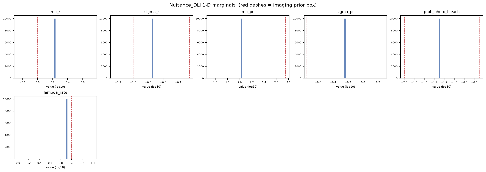

# Nuisance_DLI diagnostics - SRM_AND_SBI_MONOMER_DIMER_ALP_DETECTOR_FAB_2S_50FPS
Run: 2026-11-02 15:49:45 UTC

## Checks - 5 passed, 0 failed

| check | result | detail |
|---|---|---|
| file(artifact) | PASS | exists, 3840 bytes |
| parameter_keys_in_table_order | PASS | 6 keys: mu_r, sigma_r, mu_pc, sigma_pc, prob_photo_bleach, lambda_rate |
| shape(draws) | PASS | (10000, 6) (expected (10000, 6)) |
| no_nan_inf(draws) | PASS | clean |
| draws_inside_prior_box | PASS | 0.0000 of 10000 draws have a parameter outside the box |

## Nuisance_DLI provenance

| field | value |
|---|---|
| artifact | /media/mars-fias/MARS_Data_Reserve_0/MARS_Data_Bank/Projects/RCL_Agent_Projects/srm-and-sbi-monomer-dimer-alp/Data_Bank/Posit/SRM_AND_SBI_MONOMER_DIMER_ALP_DETECTOR_FAB_2S_50FPS_SEL_Nuisance_DLI.npz |
| posterior_sample_pool_choice | selection_user |
| pool_mode | bounded |
| parameters | 6 |
| marginal draws | 10000 |

*How the calibrated imaging is represented for production marginalization.*

## selection_user: the fixed vector, its sources and limitations

| parameter | value (physical) | log10 | in prior box | source | limitation |
|---|---|---|---|---|---|
| mu_r | 1.734 | +0.2390 | yes | adopted Fab detector estimator C128V42A, record ..._FAB_2S_50FPS_C128V42A_MAP_Experiment, median over the 600 per-window posterior medians (ten 2 s windows of the sixty recordings), transformed to physical units; MAP and SGM aggregates read beside it (MAP 1.737, SGM 1.738). Neural estimate supported by synthetic recovery (MAE 0.011 dex, r 0.98 on the 25,000 EVAL videos of the current model, DETECTOR_WORKFLOW.md sec. 9.10); replaces the direct PSF-width estimate 1.585 selected before, which becomes the sensitivity scenario SEL_MU_R | a demonstrated synthetic accuracy, no demonstrated experimental one; 7 % of windows above the 2.0 px prior edge; the direct estimator disagrees by 0.04 dex with no ground truth to decide; the fitted width falls 0.03 dex along a recording, which no fixed value represents; point estimate retained as produced, precision not established |
| sigma_r | 0.177 | -0.7520 | yes | adopted Fab detector estimator C128V42A, same record and aggregation (MAP 0.178, SGM 0.176); supported by the direct PSF-width cross-check 0.21 and the fit-corrected localization reference about 0.15 (sec. 6.7). Neural estimate supported by synthetic recovery (MAE 0.034 dex, r 0.98) | falls 0.15 dex along a recording in 92 % of recordings, a within-recording decline no fixed value represents; experimental accuracy model-dependent |
| mu_pc | 105 | +2.0212 | yes | adopted Fab detector estimator C128V42A, same record and aggregation (MAP 105.3, SGM 104.8). Neural estimate supported by synthetic recovery (MAE 0.028 dex, r 0.98) | no independent experimental cross-check (the localization per-detection brightness 386 is a spot-level sum, sec. 6.7 caveat 3); 8 to 14 % of windows below the 100-photon prior edge; falls 0.03 dex along a recording; a per-dye window median under the labeling and camera assumptions |
| sigma_pc | 0.5848 | -0.2330 | yes | adopted Fab detector estimator C128V42A, same record and aggregation (MAP 0.5779, SGM 0.5861); fit-corrected localization reference about 0.5. Neural estimate supported by synthetic recovery (MAE 0.079 dex, r 0.90, the weakest of the four spatial and brightness parameters) | experimental accuracy model-dependent |
| prob_photo_bleach | 0.05 | -1.3010 | yes | empirically anchored: a declared per-dye bleaching probability, anchored to the measured whole-recording fluorescence decline of the sixty MET-FAB recordings over 20 s (0.054 to 0.057 per 100-frame interval on the 16-bit frames; record ..._20S_50FPS_Direct_Fluorescence_Loss_Experiment_RAW), rounded as a working value, selected on 2026-10-01 from the overlay of single-rate declines on the measured curves (figures/field_flux_curves_FAB.png). The adopted estimator's own value (median 0.093, MAP 0.148) plays no part: it does not recover the parameter (r 0.06, MAE comparable to a constant guess). Probability over the fixed 100-frame reference interval | the analysis measures the field-fluorescence decline, not per-dye bleaching; the mapping to the simulator's per-dye probability rests on the assumptions recorded in DETECTOR_WORKFLOW.md sec. 7.6 (ideal independent dyes of stationary mean brightness); the recorded decline is not single-exponential and is stronger in brighter recordings; the background itself falls 9 %; emitters leaving the field and label exchange are not separable from bleaching; the late-phase rate 0.03 and the faster-loss value 0.10 are the declared sensitivity scenarios SEL_PB03 and SEL_PB10 |
| lambda_rate | 8 | +0.9031 | yes | declared, rounded from the adopted Fab detector estimator C128V42A (median 8.096 per second, MAP 8.204, SGM 7.884; window spread 0.07 dex), the neural value being the default source under the hierarchy; partially recovered (MAE 0.217 dex, r 0.49), so its digits are not retained; replaces the nominal 5 chosen before. The localization-autocorrelation anchor about 5 (sec. 6.5) sits 0.21 dex below, comparable in magnitude to the synthetic mean absolute error | not a uniquely measured rate; nothing on the recordings decides between 8 and the anchor 5; rises 0.06 dex along a recording; correlation time 0.12 s |

*A user-selected, fixed vector: every biology simulation receives it unchanged. It carries no calibrated joint uncertainty; the biology inference is conditional on these values. *

## Per-parameter marginal summary (log10)

| parameter | median | [p05, p95] | prior box | frac outside prior |
|---|---|---|---|---|
| mu_r | +0.239 | [+0.239, +0.239] | [+0.00, +0.30] | 0.000 |
| sigma_r | -0.752 | [-0.752, -0.752] | [-1.00, -0.25] | 0.000 |
| mu_pc | +2.021 | [+2.021, +2.021] | [+2.00, +2.75] | 0.000 |
| sigma_pc | -0.233 | [-0.233, -0.233] | [-0.75, +0.00] | 0.000 |
| prob_photo_bleach | -1.301 | [-1.301, -1.301] | [-2.00, -0.50] | 0.000 |
| lambda_rate | +0.903 | [+0.903, +0.903] | [+0.00, +1.00] | 0.000 |

*Drawn from the built nuisance, so this is exactly what production will sample. 'frac outside prior' is > 0 only for pool_mode='unrestricted'; bounded and the box forms stay within the prior box.*

## What these mean

A check **PASS** means the invariant held; a **FAIL** aborts the run immediately with a located error message.

- **file** -- the output file exists on disk and is non-empty (the write succeeded).
- **shape** -- the array has the expected dimensions.
- **no_nan_inf** -- the array contains no NaN and no infinite values.
- **parameter_keys_in_table_order** -- the artifact's parameter order equals the detector table's, so the DLI stage maps every draw onto the right imaging row.
- **draws_inside_prior_box** -- the bounded pool and the box constructions must stay inside the imaging prior box; only pool_mode='unrestricted' may place mass outside it.

## Figures

*1-D marginal of each imaging parameter under the built nuisance (sampled from the artifact); red dashes mark the imaging prior box.*
