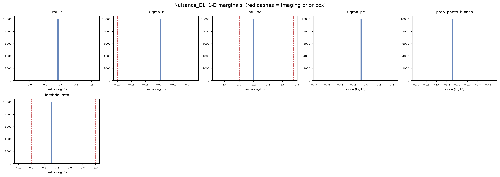

# Nuisance_DLI diagnostics - SRM_AND_SBI_MONOMER_DIMER_ALP_DETECTOR_INLB_2S_50FPS
Run: 2026-11-02 15:49:49 UTC

## Checks - 4 passed, 0 failed

| check | result | detail |
|---|---|---|
| file(artifact) | PASS | exists, 4349 bytes |
| parameter_keys_in_table_order | PASS | 6 keys: mu_r, sigma_r, mu_pc, sigma_pc, prob_photo_bleach, lambda_rate |
| shape(draws) | PASS | (10000, 6) (expected (10000, 6)) |
| no_nan_inf(draws) | PASS | clean |

## Quantitative

| metric | value | expected | meaning |
|---|---|---|---|
| frac_draws_outside_prior | 1 | - | share of draws with at least one parameter outside the imaging prior box; permitted only under pool_mode='unrestricted', where it is a property of the calibration pool, not a defect. |

## Nuisance_DLI provenance

| field | value |
|---|---|
| artifact | /media/mars-fias/MARS_Data_Reserve_0/MARS_Data_Bank/Projects/RCL_Agent_Projects/srm-and-sbi-monomer-dimer-alp/Data_Bank/Posit/SRM_AND_SBI_MONOMER_DIMER_ALP_DETECTOR_INLB_2S_50FPS_SEL_Nuisance_DLI.npz |
| posterior_sample_pool_choice | selection_user |
| pool_mode | unrestricted |
| parameters | 6 |
| marginal draws | 10000 |

*How the calibrated imaging is represented for production marginalization.*

## selection_user: the fixed vector, its sources and limitations

| parameter | value (physical) | log10 | in prior box | source | limitation |
|---|---|---|---|---|---|
| mu_r | 2.256 | +0.3533 | no (acknowledged) | adopted InlB detector estimator C128V42AP3LR32, record ..._INLB_2S_50FPS_C128V42AP3LR32_MAP_Experiment, median over the 600 per-window posterior medians (ten 2 s windows of the sixty recordings), transformed to physical units; MAP and SGM aggregates read beside it (MAP 2.256, SGM 2.253). Declared reference scenario: the estimator recovers mu_r on synthetic videos inside the prior box (MAE 0.009 dex, r 0.99) and returns, on the recordings, values beyond its training range (above the 2.0 px edge in 94 % of windows and in 57 of 60 recordings); retained under the source hierarchy because the recordings are read as wider than any in-box value and no in-box value is better supported (the lead, 2026-10-27). The localization per-detection width 1.47 against 1.36 for Fab (sec. 6.7 caveat 3) is the same direction and a different quantity | an extrapolation of the learned flow beyond its tested imaging domain, which does not independently establish the physical PSF width of the InlB recordings; the in-domain value at the exact prior ceiling, 10^0.3 = 1.9952623 px, is the sensitivity scenario SEL_MU_R, and neither choice establishes the physical width; falls 0.02 dex along a recording; point estimate retained as produced, precision not established |
| sigma_r | 0.4029 | -0.3948 | yes | adopted InlB detector estimator C128V42AP3LR32, same record and aggregation (MAP 0.4015, SGM 0.403); localization reference 0.42 as fitted (sec. 6.2). Neural estimate retained as a working value: synthetic recovery is demonstrated within the training domain (MAE 0.029 dex, r 0.98); experimental use here accompanies the extrapolated PSF-width estimate | the assembled vector lies outside the tested joint domain through mu_r; wider than Fab's 0.177; no within-recording trend (+0.01 dex, not significant); experimental accuracy model-dependent |
| mu_pc | 152.9 | +2.1844 | yes | adopted InlB detector estimator C128V42AP3LR32, same record and aggregation (MAP 156, SGM 148.1). Neural estimate retained as a working value: synthetic recovery is demonstrated within the training domain (MAE 0.024 dex, r 0.99); experimental use here accompanies the extrapolated PSF-width estimate. The localization per-detection brightness 690 against 386 for Fab is a spot-level sum (sec. 6.7 caveat 3); the per-dye ratio to Fab here is 1.46 | window spread 0.29 dex and a fall of 0.20 dex along a recording (over 0.3 dex in 35 to 38 % of recordings), markedly less stable than Fab's; 18 to 20 % of windows below the 100-photon prior edge; a window median across a strong within-recording decline; a per-dye value under the labeling and camera assumptions |
| sigma_pc | 0.8588 | -0.0661 | yes | adopted InlB detector estimator C128V42AP3LR32, same record and aggregation (MAP 0.8238, SGM 0.857); localization reference 0.55 as fitted (sec. 6.2). Neural estimate retained as a working value: synthetic recovery is demonstrated within the training domain (MAE 0.074 dex, r 0.92); experimental use here accompanies the extrapolated PSF-width estimate | the same conditioning as mu_pc; 5 to 6 % of windows above the 1.0 prior edge; experimental accuracy model-dependent |
| prob_photo_bleach | 0.05 | -1.3010 | yes | declared: an explicit shared-rate assumption, the same dye, illumination, camera settings and 100-frame reference interval as MET-FAB, so the Fab empirically anchored value 0.05 is adopted as the practical baseline in the absence of an InlB decline analysis (the lead, 2026-10-27). The adopted estimator's own value (median 0.100, MAP 0.120) plays no part: it does not recover the parameter (r 0.02) | no measurement on the InlB recordings supports it; the swift track-termination rate for InlB (0.014 per frame against 0.010 for Fab, Rahm et al. 2021) does not establish a change in per-dye bleaching; the faster-loss value 0.10 is the declared sensitivity scenario SEL_PB10; an InlB decline analysis would supply an independent empirical constraint, not a direct measurement of this parameter, and is deferred |
| lambda_rate | 2 | +0.3010 | yes | declared, the rounded neural-based working choice from the adopted InlB detector estimator C128V42AP3LR32 (median 2.283 per second, MAP 2.664, SGM 2.376; window spread 0.36 dex); partially recovered (MAE 0.206 dex, r 0.53), so its digits are not retained; no InlB localization anchor exists | unstable across windows and conditioned on the extrapolated PSF-width estimate; the unrounded neural medians differ by a factor of about 3.5 between the conditions (2.28 against 8.10) and the selected values by a factor of four (2 against 8), a difference the model attributes to the recordings and the record does not explain; Fab's value 8 is the shared-rate sensitivity scenario SEL_LAMBDA, a useful comparison that does not establish that both conditions must share one inferred effective flicker rate; rises 0.09 dex along a recording |

*A user-selected, fixed vector: every biology simulation receives it unchanged. It carries no calibrated joint uncertainty; the biology inference is conditional on these values. Outside-prior justification: mu_r 2.256 px lies above the detector prior box [1, 1.99526]: the adopted InlB estimator returns PSF-width estimates beyond its training range on 94 % of the experimental windows; this acknowledges an extrapolation beyond the tested imaging domain and certifies nothing about the physical PSF width (DETECTOR_WORKFLOW.md sec. 7.6 and 9.10; the lead, 2026-10-27)*

## Per-parameter marginal summary (log10)

| parameter | median | [p05, p95] | prior box | frac outside prior |
|---|---|---|---|---|
| mu_r | +0.353 | [+0.353, +0.353] | [+0.00, +0.30] | 1.000 |
| sigma_r | -0.395 | [-0.395, -0.395] | [-1.00, -0.25] | 0.000 |
| mu_pc | +2.184 | [+2.184, +2.184] | [+2.00, +2.75] | 0.000 |
| sigma_pc | -0.066 | [-0.066, -0.066] | [-0.75, +0.00] | 0.000 |
| prob_photo_bleach | -1.301 | [-1.301, -1.301] | [-2.00, -0.50] | 0.000 |
| lambda_rate | +0.301 | [+0.301, +0.301] | [+0.00, +1.00] | 0.000 |

*Drawn from the built nuisance, so this is exactly what production will sample. 'frac outside prior' is > 0 only for pool_mode='unrestricted'; bounded and the box forms stay within the prior box.*

## What these mean

A check **PASS** means the invariant held; a **FAIL** aborts the run immediately with a located error message.

- **file** -- the output file exists on disk and is non-empty (the write succeeded).
- **shape** -- the array has the expected dimensions.
- **no_nan_inf** -- the array contains no NaN and no infinite values.
- **parameter_keys_in_table_order** -- the artifact's parameter order equals the detector table's, so the DLI stage maps every draw onto the right imaging row.

## Figures

*1-D marginal of each imaging parameter under the built nuisance (sampled from the artifact); red dashes mark the imaging prior box.*
